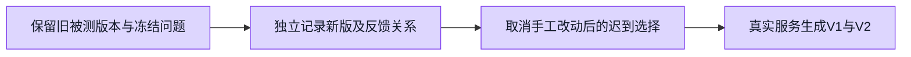

# V2 原生迭代版本与选择生命周期

此记录只描述实际代码与下列定向结果，不代替课堂验收、人工设计签核或模型质量评估。

- 第6步新引用使用现有 `StageDraft.fields`，与 `prototypeReference`、`questionSnapshot` 和历史 `newVersion` 学生文字分别保存。确认关系记录旧问题原始字符串、新版实际ID、学生填写的反馈引用与修改原因。没有新版时，返回第1–4步的学习记录仍可确认。
- 学生修改新版文字会清除新版结构引用与关系；修改反馈或原因会清除关系。旧被测对象和问题快照不因此改写。格式化分别标明旧被测版本与新版待测试状态。
- 新版关系的每一字段满足schema后，序列化总长仍必须不超过6000。新增反例以合法旧快照加合法1900字反馈与原因超过总长，确认返回失败且原draft完全不变。
- 选择器新增可选 `selectionScope`。宿主手工文字、旧问题快照或迭代依据变化时重建读取生命周期；即使原引用始终为null、文字先改B再改回A，旧请求也不能恢复结构标记。当前owner/关联资源范围、原生服务及权限契约没有扩大。

实际定向验证：

- 修复前，三条null→null迟到选择反例全部失败：[picker-scope-red.log](picker-scope-red.log)。
- 修复后，picker17、关系8、迭代宿主2，共27项通过：[picker-scope-green.log](picker-scope-green.log)。
- 四个本轮修改源/测试文件定向eslint退出0：[picker-scope-eslint.log](picker-scope-eslint.log)。
- 运行中的stack06为本次选择生命周期修复前的构建快照，不能声称包含本修复；需后续统一构建和验收。

真实V1/V2验收脚本位于 `/tmp/aidt-design-native-acceptance/real-v1-v2.mjs`，使用普通登录、真实Design创建/关联、现有chat生成API和不可变版本API；最多两个客户端生成POST，每次`maxScreens:1`，无自动重试。目标检查`reply.source=model`、实际不同版本ID、真实树与可见静态标记、学生确认保存的旧问题/新版关系。它不把合成的验收场景或修改请求当用户研究资料。

执行前等待：原生Agent首场曾遇到`CREDIT_DISPATCH_ACCOUNTING_UNSUPPORTED`。A6随后报告配置修复后的新运行以`MODEL_CALL_FAILED`结束，A1正在核实供应商调用边界；这不是Design已经发生的结果，Design尚未请求。root要求Design生成等待健康状态与独立路径支持确认。未将供应商连通检查、脚本准备、单测或原生UI读取当作真实模型生成闭环通过。

## 真实Design专项执行结果

A1随后确认Design走独立Node提供商路径并给出窗口，root授权最多两个POST；已实际执行一次后停止。

- 首两次前置停在项目创建响应的完整schema校验，均未请求模型：[P3失败路径](project-create-p3-schema-failure.json)。仓库`project.controller.ts:31`及`application/project/create-project.ts:58`明确记录`KNOWN_CONTRACT_GAPS.P3`：真实创建只返回`id/kind/status`，尚无合法项目创建审计事件类型；不得编造`provenanceEventId`。
- root核对上述源码后，允许Design专项仅验证真实已实现的三字段投影，并独立保留完整schema失败记录。本专项没有改契约、补造审计回执，也没有声称创建响应全合同通过。
- 第三次正常UI登录、真实创建项目及GET overview、Stage3/4保存、Stage5学生问题确认及UI保存、真实Design创建与资源关联、S5原生制作说明offer带入原生composer均成功。
- 首个真实`POST /pm-designs/:id/chat`返回 **HTTP402**。脚本立即停止；`modelPostAttempts=1`，没有发起第二次V2请求或重试，也没有读回可确认为本次生成的V1/V2版本。HTTP402的具体计费原因及是否触及供应商由A1继续查证，不能从此状态码推断。
- 实际结果：[result.json](real-design-stack06-03-result.json)。原生界面截图：[402后的原生Design](real-design-stack06-03-402.png)。截图显示原生空画板和仍留在输入框的学生制作说明；专项脚本直接调用了上述一次既有生成API，不能把截图作为生成质量证据。

该次attempt的结论：新增关联与历史保留逻辑已通过上述定向测试；真实服务已证实授权读写与原生composer交接。截止这次402，真实V1/V2生成、选择保存和反馈版本关系的端到端场景尚未完成，后续新授权结果另列如下。

## 既有余额账号的新授权专项

以上402失败保留。A1定位旧lead无钱包，确认同一隔离组织已有管理员的原seed钱包余额20000、held0，无需变更财务或角色；root另行明确授权新attempt再最多两个生成POST。私密字段只由外部脚本读取，未存入本证据。

2026-11-16 04:34:03–04:34:50 UTC实际完成：[完整结果](real-design-funded-result.json)。

1. 该账号正常登录UI，新建它实际拥有的合成小组及Design，通过真实Project GET、Stage保存、资源关联。现行`create-project-rules.ts:41`允许lead/admin创建，无提权、无访问旧lead小组；这一场景不替代普通学生的权限验收。
2. 第一次生成POST返回`source=model`，原生不可变版本seq1；读取实际原型树与`AIDT-STATIC-V1`标记，并在原生iframe/树界面断言该标记可见。API往返及版本读回23.6秒。
3. 学生通过真实picker选择V1并保存S5共享V2；带入S6问题卡、注明无真实用户测试、选择返回原型并确认保存。
4. 再把S5保存为另一个不同问题（共享V3）。打开S6原生Design时，制作说明必须保留旧S5 V2问题，且不含当前新问题，断言通过。
5. 第二次生成POST返回`source=model`，实际seq2、不同不可变版本ID和树哈希；`AIDT-STATIC-V2`在真实界面可见。API往返及版本读回13.0秒。没有重试或第三次生成请求。
6. 学生通过真实迭代picker选择V2，填写明确标为“软件验收更改单、无真实用户反馈”的依据与修改原因，确认关系，保存S6共享V2并重载。旧问题快照原始字符串保持不变，仍绑定原生V1；新增引用绑定V2，关系含旧快照及学生依据，读回通过。

原生界面：[V1总览](real-design-v1.png)、[V2总览](real-design-v2.png)、[旧版与新版关系](real-design-v2-relation.png)。总览受当前画板位置及缩放影响，仅显示页面的一部分；完整可见标记断言由实际iframe/树读取完成，截图不代替质量评估。

随后与A6协调20秒只读窗口，正常登录同一已有余额账号，读取该账号自己的Design：原生iframe内新版按钮确切文字“先看取餐区”及V2标记均可见；这一轮没有任何生成POST。[完整画板局部截图](real-design-v2-frame.png)、[只读结果](real-design-v2-frame-result.json)。已视觉检查截图，未包含凭据或会话头。

本场景只验证单屏静态生成、真实版本选择、冻结历史、学生依据与持久化链路。输入和修改请求均为合成验收材料，没有证明用户需求、理解改善、研究结论或广泛生成质量。两个客户端POST可能有多个内部模型请求，物理调用及计费审计由A1单独核对，不能宣称仅两次completion。P3完整创建响应合同缺口继续保留。运行产物仍是scope竞态修复前的stack06；新修复须在最终统一构建中复验。
