# 教学上下文桥接：无供应商费用集成验收

2026-11-16，协调者通知用户已批准桥接设计。本计划记录测试工作，不修改人类签核状态。当前基线`7d1abe52b`；不启动独立应用栈，不调用供应商，不重置收费总账。

```mermaid
flowchart LR
  A[核对批准边界与13条反例] --> B[约定各owner真实seam]
  B --> C[真实PG来源与原子受理夹具]
  C --> D[claim/execute冻结历史块]
  D --> E[实际adapter messages hash与receipt]
  E --> F[零调用拒绝/旧快照恢复/普通Chat]
  F --> G[真实隔离PG执行与证据]
  G --> H[后续收费lane准备，等待总次数授权]
  classDef pending fill:#e5e7eb,stroke:#6b7280,color:#111827
  classDef doing fill:#fef3c7,stroke:#d97706,color:#111827
  classDef tested fill:#ddd6fe,stroke:#7c3aed,color:#111827
  classDef blocked fill:#fee2e2,stroke:#dc2626,color:#111827
  class A tested
  class B,C,D,E,F,G tested
  class H blocked
```

分工：A1提供同session原子受理与重放口；A2提供`prepareScopeIn/prepareIn/revalidateIn`和真实PG来源装载；A3提供selector/envelope/receipt单一契约；A5提供claim/execute与实际provider适配边界；协调者独占kernel。A6只写跨层真实PG验收及证据，不复制这些owner的单元测试或生产规则。

供应商前记录transport的测试只能证明适配消息组装与receipt对应，不能称供应商/真实Agent E2E。正向要到实际适配器入参；负向必须先达到来源与授权检查，再观察ModelCall计数0，不能被余额不足提前挡住。伪造body.context正文仅保留在不可信客户端槽，不修改原human文字来配合断言。

来源与范围详见[13条验收设计](./server-context-acceptance-draft.md)。真实PG须使用标准`with-test-isolation`或协调者提供的合法测试DB预约，不使用已清理的旧业务栈身份或生产库。
