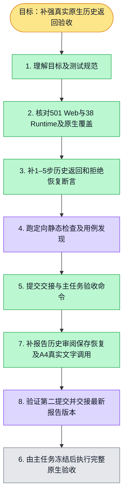

# 执行计划 — 原生历史轮次返回验收补强

> 规范：`.harness/instructions/execution-plan-visualization.md`。
> 改状态用 `node .harness/scripts/execution-plan.mjs set <本文件> <节点> <状态>`，
> 改完 `check` 一遍；不要手改 classDef 颜色。

## 我理解的目标
- **目标**：补足第6步后续保存后旧轮次的1–5步返回、错误恢复与原生持久化断言。
- **完成判据**：定向类型、ESLint、testid及1例原生用例发现通过；完整原生构建/浏览器由主任务冻结后执行。
- **不做什么**：不改业务组件、全局Playwright配置、模型lane、签核或共享Backlog；不部署、合并、GitHub外发。
- **假设与待确认**：独立QA分支；共享依赖只读；旧轮次必须以真实历史API读取，不拦截、不造模型成功。

## 执行计划

图例：⬜ 灰=未开始 · 🟨 黄=已开始 · 🟩 绿=已完成 · 🟪 紫=已测试（有证据） · 🟥 红=被堵塞

## 进度日志（append-only，每次改颜色追加一行）
| 时间 | 节点 | 状态变化 | 依据（命令 / 证据 / 堵塞原因） |
|---|---|---|---|
| 2026-11-16 | G, S1 | todo → doing | 接到目标，开始理解 |
| 2026-11-16 | S7 | todo → doing | root追加真实报告历史验收任务；已与A3核对pageSize5、最多2页，服务读取limit+1决定游标 |
