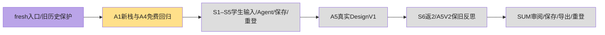

# 新组织同组六步与总结验收：入口准备

用户已重新授权真实模型测试与验收。本轮使用A1新隔离栈、新组织/身份和学生自建新组，新canonical默认Agent；旧三账、失败、pending结算与旧组原样保留。新journal记录本轮七个有界阶段任务，不改变生产计费/权限，不把旧失败删掉重跑。

**当前只准备入口，尚未实际运行本轮模型。** A1先零执行健康/来源核查，A4先独立免费界面回归；模型窗口由root与A1实际ready后逐阶段启动，Playwright 1worker/0自动retry。基础SDK连通、TLS受控回归及旧课堂结果不能替代本轮原生Chat。



## 命令与新文件

A1新namespace为`/workspace/scratch/aidt-real-acceptance-20261117/`。仅使用其正式ready后给出的新runtime，身份/密码/isolation只在子进程内存载入，不能打印或放进本库。

新文件是`native-run-journal.json`、`journey-state.json`；S1运行前两者必须不存在。旧S1/S2 supplement/resume环境全部清除，**本轮S1不使用原additional-S1补账入口**。日期marker显式为`fresh-native-seven-20261117`。

逐阶段底层命令如下；每次只选一个，后续按实际结果推进，不让整套自动收费循环：

```sh
pnpm --filter web exec playwright test --config playwright.aidt-v2.config.ts \
  --grep 'completion S1:'
```

之后匹配`completion S2:`至`completion S6:`，总结匹配`completion SUM:`。不用`^`锚点（Playwright完整title包含文件前缀）。每次先`--list`确认恰1条。

必需环境：

| 组别 | 环境与约束 |
| --- | --- |
| 显式本轮 | `AIDT_V2_FRESH_JOURNEY=fresh-native-seven-20261117`、`AIDT_V2_AUTHORIZED_PHASE=s1`（后续对应阶段） |
| 新记录 | `AIDT_V2_RUN_LEDGER`与`AIDT_V2_COMPLETION_STATE`为上述不同绝对JSON路径；`AIDT_V2_OUTPUT_DIR`每attempt独立 |
| 新真实环境 | `AIDT_V2_REAL_AGENT=1`、A1实际`WORKSPACEX_*`预约、`REAL_MODEL_E2E_BASE_URL`、`AIDT_V2_API_ORIGIN`、`NEXT_PUBLIC_API_PATH_PREFIX=/__fullstack_api` |
| 正常身份 | `REAL_MODEL_E2E_EMAIL/PASSWORD`仅从新runtime读取既有funded admin正常登录，不注入session、不加余额或角色；不证明普通学生付费条件 |
| 素材与运行 | 源码自带合成fixture；run等待有界、trace/screenshots关闭、Playwright1worker/0retry |

本机私密wrapper已准备`/tmp/run-aidt-fresh-journey.mjs <new-runtime> <phase> <new-out>`。它要求操作者显式`AIDT_ROOT_AUTHORIZED_PHASE`与phase一致、A1实际executor/paid window开启且其他后台执行关闭，清旧supp环境，正常funded登录，先精确发现1条，执行前后只读比较三旧账SHA。wrapper当前只做syntax检查，未读取未ready runtime或发送。

## 同组交接

S1学生主题V1→明确回答/重写/确认V2。S2真实材料和提纲、发现卡分栏。S3显式暂无与待验证画像/HMW。S4三个不同点子/真实图/选择理由/PDF。S5先学生确认验证问题并共享保存，再交A5同一owner正常生成、选择真实V1并冻结S6。S6先学生无认识变化/return2保存，A5再另存return5/V2关系，保留旧return2历史；SUM才读取同组六步与真实旧反思，独立总结Skill、审阅实际AI结果、保留人工原段、主动save、精确Markdown导出与重登。

## 已验证的入口条件

[9单元测试](./entry-unit.txt)、[scoped TS退出0](./entry-types.txt)、[ESLint退出0](./entry-eslint.txt)、[S1只发现1条](./entry-s1-list.txt)、[机器记录](./entry-machine.json)。反例覆盖未知fresh marker、旧supp/resume字段即使空值也拒绝、相对/相同路径、已有历史文件不覆盖、同新七任务journal记录S1/S2并保留失败，禁止自动第二次S1。

这仅是QA入口准备；所有模型回复、来源应用、学生决定与教学质量待实际取证。机械流程通过与教学适切性分别记录，人工验收签字继续空白。
