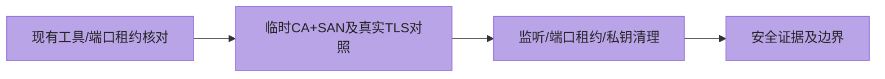

# 本机TLS受控回归计划

本轮仅零模型费用。真实Python/httpx向已获标准端口租约的127.0.0.1 TLS listener发HEAD，旧启动profile遗漏临时CA应验证失败，新restoreOwnerEnvironment继承同临时CA应HTTP200。TLS校验始终开启、retry0、timeout3秒；无用户CN/凭据/模型配置/DB/外部proxy或外部网络。



仅证明受控launch机制可以造成该类证书错误；不能事后证明S2实际底层cause。原失败、费用pending和预算占用保持。

## 实际结果

[机器记录](./loopback-tls-machine.json)、[真实对照与既有环境测试6/6](./loopback-tls-green.txt)、[scoped TS退出0](./loopback-tls-types.txt)、[loopback监听门退出0](./loopback-tls-listen-gate.txt)。不使用MockTransport或TLS校验关闭。

- 已存在的Python3.12.14/httpx0.28.1，OpenSSL3.5.7/Node22.23.5。
- 临时独立CA签127.0.0.1 SAN证书，服务端真实bind回环与标准全局端口租约47970；第二owner尝试同lease被拒绝。
- 旧base-only环境没有SSL_CERT_FILE，实际ssl.SSLCertVerificationError，服务端HEAD计数0。
- 实际restoreOwnerEnvironment继承同临时CA，httpx.HTTPTransport verify=True/trust_env=True/retries=0、timeout3秒；HEAD200/空body，服务端恰1条HEAD且无authorization/cookie/body。
- finally实际关闭listener、同port成功rebind再关闭、原lease释放、临时目录及CA/server私钥删除。若无法确认listener关闭则保留标准lease quarantine，不假释放。
- 第一轮[QA红日志](./loopback-tls-first-red.txt)保留：异常采集器只看__cause__，漏掉__context__中的SSL原型，误判反例；遍历两者后捕获真实SSLCertVerificationError。首红也已实际清理端口与私钥，没有模型/外部请求。

## 重现（仅本机TLS，无业务栈）

前提为已有Node/tsx、OpenSSL3和装有httpx的Python，不安装依赖、不读取用户CN/env/凭据，不恢复DB。替换解释器绝对路径即可：

```sh
AIDT_TLS_TEST_PYTHON=/absolute/path/to/existing/python \
  pnpm exec tsx --test scripts/tests/aidt-checkpoint-network-env-tls.test.ts \
  scripts/tests/aidt-checkpoint-network-env.test.mjs
```

本测试仅证明省略/保留调用者CA的启动环境可以造成/解决该受控证书错误。它没有重放S2、没有调用模型/SDK/DB或外网；不能将其追认为S2 actual根因，也不改变S2失败、补账占用和待结算财务状态。

## 后续窄扩：真实AsyncOpenAI，仅本机固定模拟响应

本次root另批准零模型费用的SDK对照，在同一临时CA/127.0.0.1 TLS listener/标准租约fixture内新增独立命名SDK子用例。没有新依赖，不修改之前HEAD的无auth/body0断言；在SDK执行后再次逐字断言HEAD仍恰1、无authorization/cookie/body。

- [7/7实际日志](./loopback-openai-tls-green.txt)、[机器记录](./loopback-openai-tls-machine.json)、[scoped TS0](./loopback-openai-tls-types.txt)、[loopback门0](./loopback-openai-tls-listen-gate.txt)；重现命令仍为上面两文件，当前包含5环境单元+1真实HEAD+1真实SDK子用例。
- 已有AsyncOpenAI3.1.0，base_url固定`https://127.0.0.1:<标准租约端口>/mock-only/v1`，api_key仅静态`offline-fixture`。一条合成user消息、model名称明确offline-fixture-model，SDK max_retries0/timeout3秒，httpx AsyncHTTPTransport verify=True/trust_env=True/retries0，证书hostname校验开启。
- 旧base-only profile实际由SDK包装成APIConnectionError。直接调用A5真实private_error_diagnostic，观测APIConnectionError→ConnectError→ConnectError→SSLCertVerificationError，errno1、ssl_verify_code20，无截断/循环；服务端POST0。该code只属于本机临时CA，不是原S2错误码。
- 新helper CA profile下，SDK向`/mock-only/v1/chat/completions`恰POST1。实际请求108字节、唯一合成user消息、dummy Authorization严格匹配，未带cookie；本机服务返回固定canned OpenAI JSON，SDK实际解析到明确“Offline loopback fixture response; not a model.”。不是模型生成，canned usage0只在内存fixture中，没有写入任何真实usage/credit记录。
- 本轮实际标准租约36507；同finally真实关闭listener、同port可再bind、lease释放、临时CA/server私钥移除。所有HTTP仍仅本机，无用户CN/env/真实凭据/外部proxy/供应商请求或DB。

以上只将受控机制对齐真实SDK包装与安全异常cause投影，**不能事后证明原S2 actual底层cause**，也不把原pending财务状态改为结清或释放预算。原HEAD首红/绿历史均保留，不改成当时已运行SDK。
