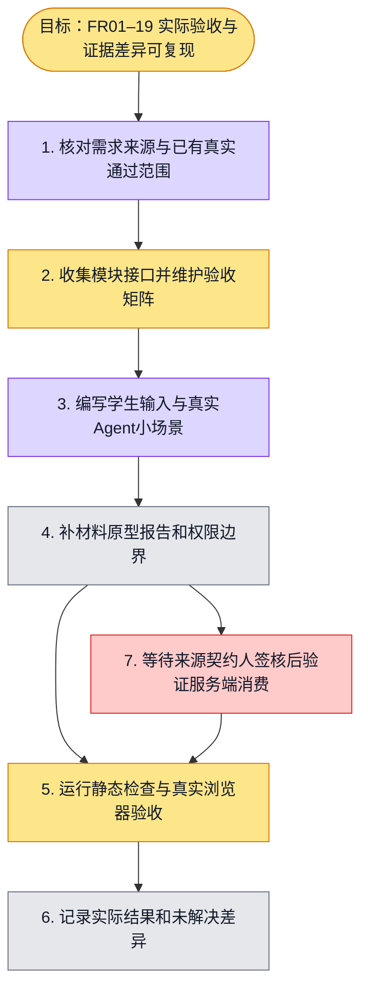

# AIDT V2 FR01–19 真实验收计划

## 我理解的目标

将用户 V2 需求逐条映射到真实可见流程、持久化记录和验收证据。沿用原生 Chat；真实 Agent 必须经过浏览器发送、运行记录和持久消息，不以模型直连或模拟响应代替。不部署、不提交、不变更签核或生产权限。A1 独占真实服务栈；A6 只使用其已预约的本机栈。

## 进度

| 时间 | 节点 | 状态 | 依据 |
| --- | --- | --- | --- |
| 2026-11-16 | S1 | done | root同步FR01–14原文行为映射，FR15–19取自aidt-v2-delta；N08原生证据completed=true、2cycles、13free，不能扩大为V2全覆盖。 |
| 2026-11-16 | S2/S3 | doing | 新增外部唯一栈配置、真实原生Agent运行支持、FR15/FR16/CAS归档小场景；均尚未浏览器运行。 |
| 2026-11-16 | S5 | doing | attempt01/02真实执行均在Agent前失败：冷编译与Web OOM；未发送模型。等待A1预构建/start，禁止fixture补绿。 |
| 2026-11-16 | S2 | doing | 完整人工手册已落库并交root渲染PDF，人工实际结果与签字始终空白；新spec默认CI不运行。 |
| 2026-11-16 | S5 | doing | attempt05两项真实UI绿；attempt08原付费S1同run机械恢复绿；attempt11全界面成员文字22处真绿。S1上下文drop不伪写通过，模型收费暂停。 |
| 2026-11-16 | S7 | todo | 实际模型发现TeachingContext丢失，新增服务端来源验收节点；root已打包三件束并向人类请求签核，未代签/未先写核心生产契约。 |
