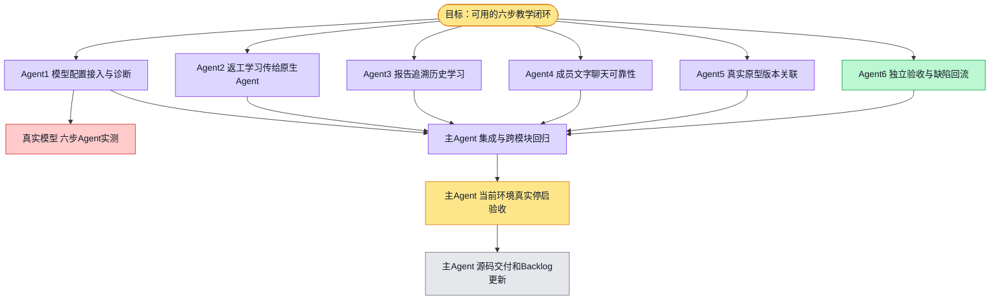

# 执行计划 — 完成教学功能缺口

## 我理解的目标
- **目标**：六个子智能体并行完成独立功能片段，保留原生Chat和全局成员文字插件，在当前环境真实验收。
- **完成判据**：逐项先复现/实现/验证，主分支整合后统一测试、类型/设计及真实本机验收，交付代码和明确的能力状态。
- **不做什么**：不部署生产、合并、改权限、代签新服务契约；不以mock代替模型；录音/语音房继续后置。
- **假设与待确认**：用户电脑的cn.local.env尚未同步，此处可独立推进其加载和诊断，不编造真实凭据。

## 进度日志
| 时间 | 节点 | 状态变化 | 依据 |
|---|---|---|---|
| 2026-11-16 | G,S1-S6 | todo → doing | 用户要求保持6个子智能体并行，分别使用隔离worktree |
