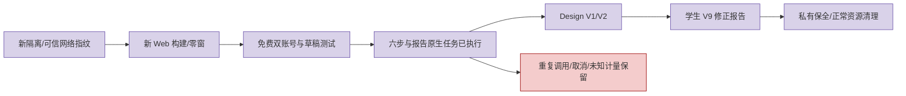

# 新独立验收轮：真实结果与资源收尾

本轮新组织、正常种子身份和 canonical-default Agent 独立重走。Web 实际新构建 `ff9b73ebefa9b05047e918c2018b6d360f90feb3`（含草稿修复 c9cf6ebb7），API 实际启动源 `5c2922b83bc3de14ea7ae6fca03391f7a79be10e`。旧三份账本、旧 checkpoint 与旧 pending 诊断均保持原哈希。模型任务由正常开发测试管理员执行；普通成员的真实双账号协作与非成员隔离另行验证。

七个原生逻辑任务与两个 Design 业务任务，共实际 94 次物理请求。93 条成功 reported usage 和 93 条 settled credit；S3 留有 1 条 failed/unknown usage、1 条 pending credit，持有 6346 hundredths（63.46 测试 credits）。已知 reported 部分总计 780085 tokens，完整总量未知。最后验证余额 19219.49，held 与 remaining-held 是两个原字段，均为 6346，不相加。未修改余额、持有、结算状态、角色或权限来获得通过。此统计不含主 Agent 独立的 22-token 配置验证，也不含旧轮。

| 任务 | 实际物理请求 | 结果 |
|---|---:|---|
| S1 | 4 | succeeded，学生保存/重登回读通过 |
| S2 | 6 | 同 run 单次计划确认后 succeeded，原 QA 中断保留 |
| S3 | 44 | 约 201 秒晚完成，21 次不同 call_skill；原 QA 卡点与 1 条未知计量保留 |
| S4 | 6 | succeeded，学生保存、三份 PDF/图像通过 |
| S5 | 15 | 按有界 QA 规则正常取消；后续来自明确人工合成学生稿 |
| S6 | 6 | 同 run 计划确认后 succeeded；return2 历史与真实静态反馈保存 |
| SUM | 9 | 同 run 计划确认后 succeeded；原 AI 稿内容仍有遗漏，学生 V9 修正另存 |
| Design V1 / V2 | 2 / 2 | 两次唯一业务 POST 均 source=model；V2 绑定 QA 红与零模型续绿分记，旧 V1 SHA 未变 |

免费浏览器检查已通过草稿/附件重试，以及独立 collaboration 组织的双账号成员文字和非成员隔离。SQL 核实该组织 4 条共享消息/2 作者、1 条私有消息/1 作者且 0 模型任务；首次普通成员建组前置与跨 origin 旧 QA helper 的失败保留。

原 AI 总结稿没有完整披露截断、原件未读与版本历史。学生使用真实已保存资料在界面追加纠正，V9 保存、重新登录、11664 字节 Markdown 导出 SHA `8c5c4144aef519e32ee98bb2ea294b58082146fd22847b5beeb7bf7e7e96210d` 已核。V8、原 AI 稿与原导出保留。原型反馈是静态检查和明确合成材料，无真人研究或课堂学习效果验收。

`final-private-diagnostic-backup.json` 与 `final-private-diagnostic-verification.json` 记录唯一 custom dump、14 表 COPY 计数、8 张关键表全列全单元格比对、7 条原件回执 bytes/SHA、14 个存储/sidecar 文件、原稿/V8/V9 与账本保全。最初把 canonical MIME 与 FS 默认 MIME 错当相等的断言失败保留；`final-backup-mime-explanation.json` 说明两层值分别记录，所有源副本 bytes/SHA/sidecar 逐字相等。同一 dump 续核，没有重 dump。该私有诊断含未决计量，未实际恢复，不是 zero-outstanding 可恢复点，不进入 Library/交付包。

`final-cleanup.json` 是清理完成依据：正常 owner exec 18308 exit 0；33 个实际记录进程均停止，自有容器/卷/网络为 0，13 端口可绑定、13 端口租约与 1 个 stack slot 释放。共享 object-store 根与原件源未删除，上传配置继续保留 0600。容器 loopback URL 仅用于本环境测试，当前服务均已停止。
