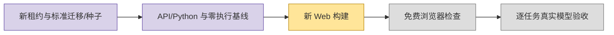

# 独立真实浏览器验收栈

本轮使用全新标准隔离种子、canonical-default Agent 和新构建；不续写旧 checkpoint，不重置旧三份账本或 pending 状态。

`fresh-baseline.json` 为 app_rw 的真实只读查询；`child-network-launch.json` 为真实 Node/Python 子进程启动时观测的网络字段 presence/SHA，未记录配置值。配置连通成功由主 Agent 的独立 22-token 调用验证，不能代替原生 Chat、Design 或课堂验收。
