# 新独立主组 Design V1 / V2 验收

V1 与 V2 的真实生成、版本、原生界面绑定及冻结历史检查已完成。全部材料、检查与修改情境均为合成材料，没有真人访谈或测试；S5 原生 Agent 取消仍是未通过项，人工续写后的 Design 成功不改变该结论。

```mermaid
flowchart LR
  A["S3 V2 / S4 V4 已保存"] --> B["S5 Agent 已取消；学生人工确认 V2"]
  B --> C["真实 Design V1 / source=model"]
  C --> D["picker 保存 S5 V3 / S6 V1 冻结"]
  D --> E["学生真实静态检查 / S6 V4 return2"]
  E --> F["新 S6 V5 return5 / 新 S5 V4 反证"]
  F --> G["真实 Design V2 / source=model"]
  G --> H["首 QA 竞态超时"]
  H --> I["零模型续完 / S6 V6 新版关系"]
  classDef tested fill:#ede9fe,stroke:#7c3aed,color:#111;
  classDef blocked fill:#fee2e2,stroke:#dc2626,color:#111;
  class A,C,D,E,F,G,I tested;
  class B,H blocked;
```

| 检查 | 实际结果与证据 |
| --- | --- |
| V1 | [一次业务 POST 结果](v1-result.json)、[真实版本](v1-actual-version.json)、[实际 HTML](v1-actual-page.html)、[原生界面](v1-native.png)。seq1，source=model；原生选择器保存 S5 V3，S6 V1 冻结确切问题与版本。 |
| V1 内容审阅 | 标题、号码指引、静态按钮存在，但没有号码分区映射，按钮无 handler/data-goto；notes 却声称可跳转，是模型说明缺陷。没有重新生成或伪改 V1。 |
| 学生纠正 | S6 V4 原文明示确切 V1 ID、实际静态检查、非真人测试，通用 SYN-TEST-FEEDBACK 不是本版实测。学生先选择 return2，再独立选择 return5 制作新合成示意；原 return2 保存为历史。 |
| 冻结反证 | 当前 S5 V4 改成新问题，但历史 return5 与 S6 Design 制作说明仍引用旧冻结问题；原脚本检查已通过。 |
| V2 | [原执行结果](v2-result.json)保留后续 UI 超时红；该文件同时记录唯一 POST、source=model、新版本、合成号码映射可见等已通过检查。[实际版本](v2-actual-version.json) seq2，[实际 HTML](v2-actual-page.html)新增“示例2→B分区”及“合成设计内容，非实测”；[原生界面](v2-native.png)不是模拟回复。 |
| V2 内容审阅 | “先看取餐分区”仍为静态按钮，无脚本/外部图片。notes 正确写明无交互、不跳转。只证明明确合成设计改动存在，不能证明原问题被验证或可用性提升。 |
| QA 竞态及续完 | 版本点击后未等待异步快照读取，就编辑 feedback，selectionScope 正确取消挂起选择，确认按钮 disabled；[诊断记录](binding-race-diagnostic.json)。等待完整“已记录”版本 ID 后，[零模型续完结果](bind-continuation-result.json)通过，[关系界面](v2-relation.png)真实保存为 S6 V6，reload 读取完全一致。 |
| 历史保护 | 新迭代引用只记录 V2 产出；旧问题 snapshot 字节不变，旧 S6 V4 return2 整对象历史精确不变；关系引用同一旧 V1 与确切 S6 V4 静态检查原文。 |

V2 后 A1 另以同租户、只读原生 PgDesignProjectRepository.getVersion 核 [旧 V1 不可变性](../../a1/design-old-v1-immutability.json)：规范化 prototype SHA 仍为 `8547127735a405a9ff3715ceb1ea3bb4a24300659242a473c74796355e414c09`。这是服务仓储读证据，没有冒称额外 HTTP GET 或再次登录。

计量按独立审计：[V1](../../a1/design-v1-accounting.json) 2 physical / 7075 reported tokens / 2 settled；[V2](../../a1/design-v2-accounting.json) 2 physical / 9196 reported tokens / 2 settled。合计 2 次业务 POST、4 次物理调用、16271 reported tokens、4 笔 settled。既有 S3 pending 保留，未改余额、权限或旧账。脚本原结果的 pending-stack-owner-audit 是当时原始字段，以后续 A1 文件为准，未覆写原始记录。

可移植 QA 源码及操作见 [runner 说明](../../../../../../apps/web/scripts/aidt-design-acceptance.md)。新增 bind-existing 入口没有生成 POST 能力；本次实际续完先运行等价临时脚本，再抽取可移植源码，仅离线检查，不在 SUM 浏览器窗口重复登录。原红结果、诊断红和续完绿分别保留。[离线命令结果](qa-offline-checks.txt)不代表完整产品回归。

仍未覆盖真人测试、课堂效果、模型视觉输入及普通学生模型权限。S4 合成 PNG/PDF 由 A6 另行验收，不证明 Design 使用了视觉输入。不存在完整七步全绿结论。
