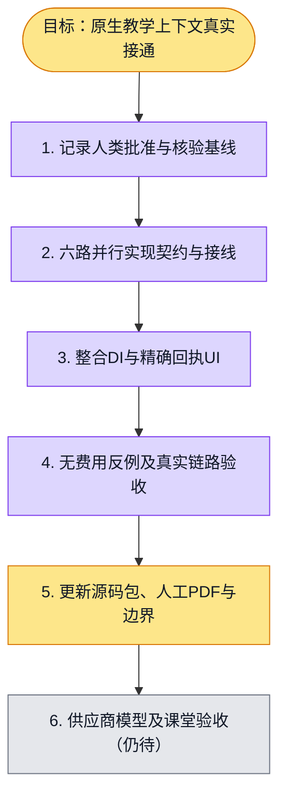

# 执行计划 — 已批准的原生教学上下文桥接

> 规范：`.harness/instructions/execution-plan-visualization.md`。
> 改状态用 `node .harness/scripts/execution-plan.mjs set <本文件> <节点> <状态>`，
> 改完 `check` 一遍；不要手改 classDef 颜色。

## 我理解的目标
- **目标**：让六步/SUM原生Chat实际收到本组精确已保存版本，保留原话、权限与普通Chat。
- **完成判据**：契约/授权/原子受理/模型实际消息/回执的反例与原生E2E通过，类型与普通Chat回归通过；更新人工PDF。
- **不做什么**：不部署、不合并、不扩大权限、不改旧Skill不可变包、不将缺材料或prepared冒称已派发。
- **假设与待确认**：用户本轮明确批准设计束；继续沿现隔离分支及已有模型/存储服务，真实教学质量另由人审。

## 执行计划

图例：⬜ 灰=未开始 · 🟨 黄=已开始 · 🟩 绿=已完成 · 🟪 紫=已测试（有证据） · 🟥 红=被堵塞

## 进度日志（append-only，每次改颜色追加一行）
| 时间 | 节点 | 状态变化 | 依据（命令 / 证据 / 堵塞原因） |
|---|---|---|---|
| 2026-11-16（北京时间） | G, S1 | todo → doing | 接到目标，开始理解 |
