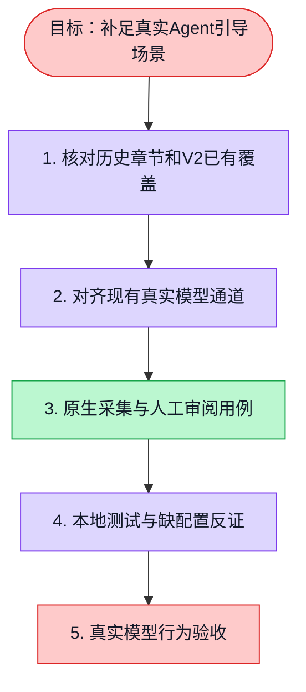

# 执行计划 — 历史引导场景与原生Agent验收

> 规范：`.harness/instructions/execution-plan-visualization.md`。
> 改状态用 `node .harness/scripts/execution-plan.mjs set <本文件> <节点> <状态>`，
> 改完 `check` 一遍；不要手改 classDef 颜色。

## 我理解的目标
- **目标**：核对既有V2，补足群体引导场景的原生Chat真实模型采集与人工审阅入口。
- **完成判据**：用例目录与人工判据可检查，采集器复用现有真实模型配置、原生Chat和持久消息契约；单元、类型和显式未配置路径通过。真实模型缺失必须标阻塞。
- **不做什么**：不改变现有Chat UI、不升级已发布Skill、不自动开启匿名投票/私信/录音、不触生产或增加服务契约。
- **假设与待确认**：历史指南已读取；现环境无模型凭据、真实Agent端点和专用验收账号，质量验收需配置后运行并由人审阅。

## 执行计划

图例：⬜ 灰=未开始 · 🟨 黄=已开始 · 🟩 绿=已完成 · 🟪 紫=已测试（有证据） · 🟥 红=被堵塞

## 进度日志（append-only，每次改颜色追加一行）
| 时间 | 节点 | 状态变化 | 依据（命令 / 证据 / 堵塞原因） |
|---|---|---|---|
| 2026-11-15 | G, S1 | todo → doing | 接到目标，开始理解 |
