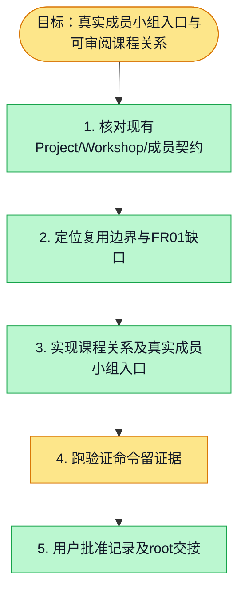

# 执行计划 — FR01 真实课程与小组入口

> 规范：`.harness/instructions/execution-plan-visualization.md`。
> 改状态用 `node .harness/scripts/execution-plan.mjs set <本文件> <节点> <状态>`，
> 改完 `check` 一遍；不要手改 classDef 颜色。

## 我理解的目标
- **目标**：按用户已批准方案A，实现受约束课程→已有真实成员小组入口
- **完成判据**：成员组入口与课程四操作回归通过；同org/一组一课/成员隔离在真实栈验证
- **不做什么**：不以tag/localStorage冒充课程关系；不改ProjectAidt或Chat；不代签/部署/发真人邀请
- **假设与待确认**：用户已批准方案A；复用Project成员，不自动授予课程管理员子组权限

## 执行计划

图例：⬜ 灰=未开始 · 🟨 黄=已开始 · 🟩 绿=已完成 · 🟪 紫=已测试（有证据） · 🟥 红=被堵塞

## 进度日志（append-only，每次改颜色追加一行）
| 时间 | 节点 | 状态变化 | 依据（命令 / 证据 / 堵塞原因） |
|---|---|---|---|
| 2026-11-16 | G, S1 | todo → doing | 接到目标，开始理解 |
