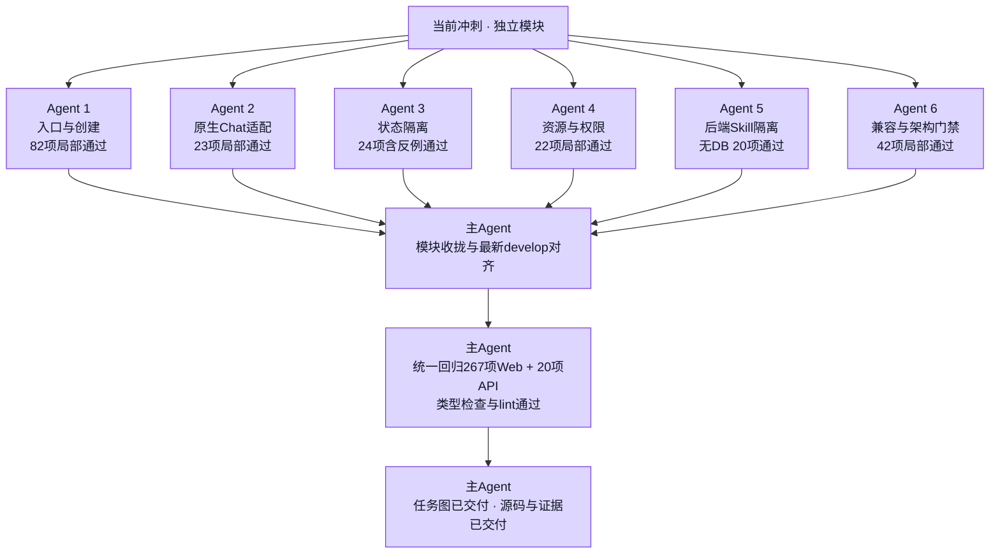

当前更新：2026-11-15 07:20 北京时间。当前冲刺：独立模块隔离与兼容性验证已通过本地检查；完整课堂P0与真实服务验收另列。 各Agent测试有重叠，不相加；统一回归单独统计。本地通过不代表真实模型、录音或课堂验收。

🟨 进行中　🟩 实现完成待验证　🟪 本地测试通过　⬜ 待开始　🟥 阻塞或待确认。颜色与文字同时表示状态。

# 六个 Agent 的并行规划图

# 当前冲刺 Backlog

| 任务 | 负责人 | 交付与验收 | 当前进度 |
|---|---|---|---|
| B01 入口、开关与创建适配器 | Agent 1 | 默认关闭时无AIDT入口和请求，普通项目列表/创建不受干扰 | 🟪 本地测试通过；82项局部回归通过；已纳入最新develop整合回归 |
| B02 原生Chat与教学适配隔离 | Agent 2 | 普通Chat空态保持，教学上下文和取消请求按身份隔离 | 🟪 本地测试通过；23项局部测试与lint通过；原生Chat空态保持 |
| B03 小组、身份与本页状态隔离 | Agent 3 | 换组、换用户、续期、只读降级不串草稿或旧资源 | 🟪 本地测试通过；24项局部测试通过；A→B→A旧图片回调反例先失败、修复后通过 |
| B04 资源权限与原生工具适配 | Agent 4 | 旧资料迟到不显示，权限未决不露旧工作区，普通白板不被劫持 | 🟪 本地测试通过；22项局部测试与lint通过；已纳入统一回归 |
| B05 后端Skill注册与启动隔离 | Agent 5 | 默认不导入AIDT技能；启用时普通包不变，不覆盖用户内容 | 🟪 本地测试通过；20项无DB测试通过；最新develop的API类型检查与完整lint通过 |
| B06 普通功能兼容与模块边界门禁 | Agent 6 | 开关两态保持普通Chat/Project行为，禁止共享模块反向依赖 | 🟪 本地测试通过；42项局部兼容/架构测试通过；模块依赖门禁通过 |
| B07 收拢独立模块与公共入口 | 主Agent | features/aidt自包含，通过明确公共入口消费，整体文字沟通保持独立 | 🟪 本地测试通过；27个实现文件迁入features/aidt；公共入口与架构门禁通过 |
| B08 统一整合与回归验证 | 主Agent + Agent 6 | 单次最终typecheck、相关前后端回归、边界门禁及反证通过 | 🟪 本地测试通过；最新develop上267项Web、20项无DB API通过；双端typecheck/lint及模块ESLint通过 |
| B09 交付可审阅结果与剩余项 | 主Agent | 源码、测试证据、启用/关闭说明与待接能力清楚；不部署 | 🟪 已交付；源码与测试证据下载包已提供，未部署 |

# 后续真实功能 Backlog

| 任务 | 优先级 | 拟定负责人 | 状态与验收 |
|---|---|---|---|
| N01 评审新增共享成果、阶段状态与成员消息契约 | P0 | 主Agent + 课程/研发负责人 | 🟥 待确认；仅新增契约需设计确认；现有接口继续复用，明确权限与冲突语义 |
| N02 课程/小组与阶段成果真实保存恢复 | P0 | Agent 3 | ⬜ 待开发；依赖N01；刷新、重新登录后同组成果可恢复 |
| N03 六阶段AI与已授权历史上下文 | P0 | Agent 2 + Agent 5 | ⬜ 待集成验收；真实模型与Skill验收；学生先输入，不伪造研究证据 |
| N04 真实材料上传、转写及来源关联 | P0 | Agent 4 | ⬜ 待集成验收；采集授权、原音频与转写校对、失败恢复 |
| N05 小组成员文字消息真实传输 | P0 | Agent 5 + Agent 6 | ⬜ 待开发；依赖N01；隔离、重连、重试与实际成员收发验证 |
| N06 创意PDF、原型版本、测试迭代与报告 | P0 | Agent 1 + Agent 3 + Agent 4 | ⬜ 待集成验收；真实文件和版本回执，不把预览当保存或测试通过 |
| N07 约30人课堂试点验收 | P0 | 主Agent + Agent 6 + 课程负责人 | ⬜ 待试点；依赖N02–N06；教师试用、组间隔离、完整真实流程 |
| N08 语音房、教师评分与可选展示增强 | 后置 | 后续派单 | ⬜ 暂缓；本轮先做成员文字沟通；不挤占隔离与P0闭环 |

后续表中的 Agent 为拟定负责人，尚未启动这些服务开发。新契约由课程与研发负责人确认；语音房明确后置。关闭后端开关仅停止后续自动安装，不删除已经存在的技能或修改用户权限。

当前没有生产部署、合并或权限变动；GitHub外发此前被拒绝，本轮没有重试发布。协调网关未配置，未声称已取得仓库租约或CI通过。
