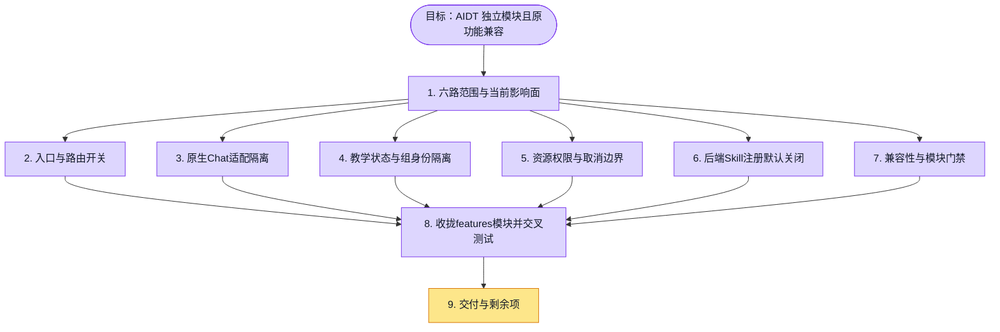

# 执行计划 — AIDT 独立模块 六路并行隔离

> 规范：`.harness/instructions/execution-plan-visualization.md`。
> 改状态用 `node .harness/scripts/execution-plan.mjs set <本文件> <节点> <状态>`，
> 改完 `check` 一遍；不要手改 classDef 颜色。

## 我理解的目标
- **目标**：AIDT 通过显式开关接入，关闭后保留已有Project/Chat/导航与Skill目录行为。
- **完成判据**：开关开/关兼容测试、组/身份切换反证、模块依赖门禁、相关web/API测试和typecheck；UI仍可审阅。
- **不做什么**：不部署、不改权限/数据库/新API、不冒签设计、不重试被拒绝的GitHub外发；不声称完整P0已交付。
- **假设与待确认**：6小时是本轮冲刺目标；先完成模块隔离，新增共享状态/消息契约仍待评审。继续保留上一轮Demo和所有用户修改。

## 执行计划

图例：⬜ 灰=未开始 · 🟨 黄=已开始 · 🟩 绿=已完成 · 🟪 紫=已测试（有证据） · 🟥 红=被堵塞

## 进度日志（append-only，每次改颜色追加一行）
| 时间 | 节点 | 状态变化 | 依据（命令 / 证据 / 堵塞原因） |
|---|---|---|---|
| 2026-11-15 06:40 北京时间 | G, S1 | todo → doing | 接到目标，开始理解 |
