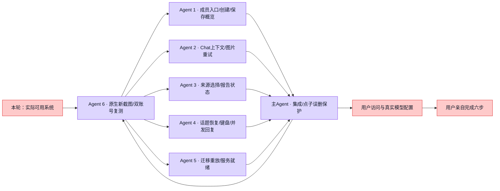

# AIDT 可操作系统反馈闭环计划

目标：学生能实际打开并完成小组操作；技术测试、用户访问和真实AI分别给证据。A+B边界不扩，访谈录音C另排，语音房后置。当前以c616680c5为新基线独立捕捉，修复后冻结业务版本再复验。上一轮结果保留历史，不移作本轮证据。

进度：2026-11-15 09:48 北京时间，六个Agent已启动本轮，问题队列见issues.json；无受控预览入口和真实模型配置，不能标整套系统已可供用户操作。GitHub外发和协调网关限制保留。
