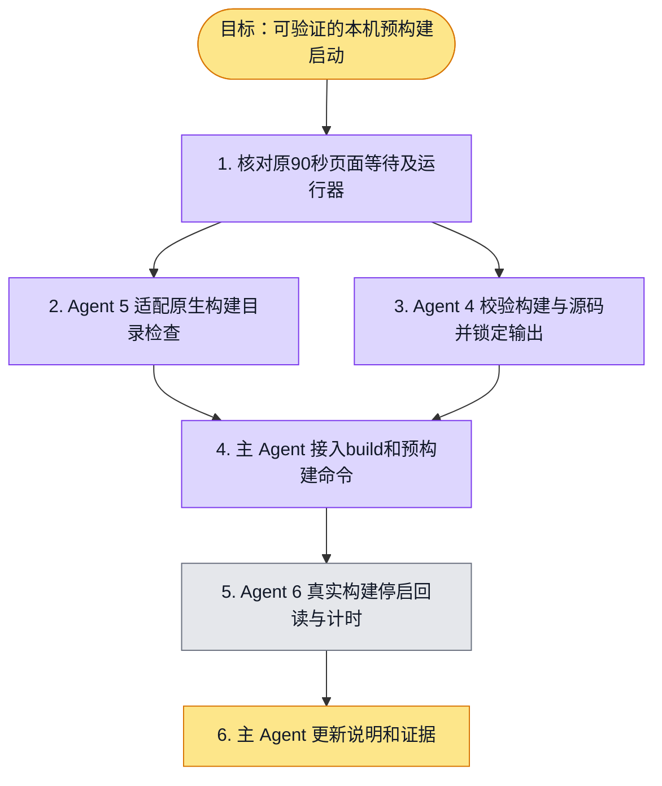

# AIDT 本机预构建执行计划

目标：消除本机每次进入步骤工作区时的开发编译等待，保留原生 Chat、共享成果及全局成员文字，不部署或扩权限。完成判据：安全拒绝过期/错误构建；真实预构建后两次停启，精确回读原成果与消息，并记录实际页面耗时。AI/ASR 未配置不冒称可用。

进展：目录适配、CLI/产物边界单测已通过第一轮。真实 build 尚未运行；不会将单测当成速度提升或模型接通证据。根命令改为直接调用 tsx，保持用户相对数据路径基于当前仓库目录；原默认 dev 保留。
