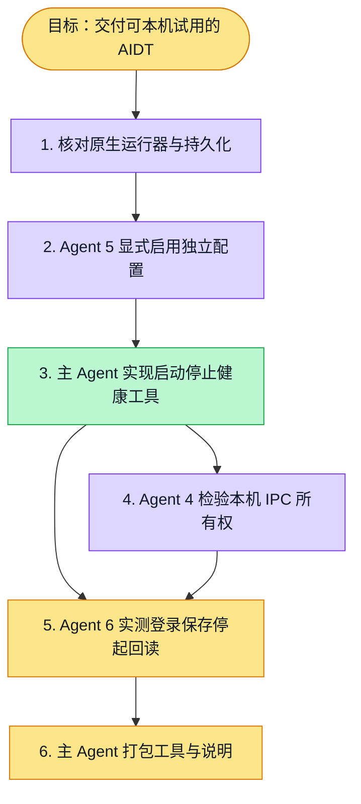

# AIDT 本机试用工具执行计划

目标：用户在自己的电脑用持久账号启动原生 AIDT，保存成果与成员文字，停止后可重新进入。复用 Local Runtime；不使用临时 fixture，不部署或更改权限。完成判据为真实原生登录、共享保存、停止与同目录重启回读。macOS/Windows 未实机验证。

| 时间 UTC | 节点 | 状态 | 实际依据 |
|---|---|---|---|
| 2026-11-15 03:54 | S1/S2/S4 | 已测试 | 真实 PGlite 重开、配置与13项IPC；日志保留 |
| 2026-11-15 03:54 | S3/S5/S6 | 实现后整体验收中 | 新CLI/脚本已存在；真实浏览器重启验收开始；未宣称本机交付完成 |

原运行器 processes.test 中一项“孙进程停止”检查将容器僵尸进程视为仍在运行，15项中14项通过；本轮不把它改写为全绿。Windows 命名管道分支及 macOS 只能交付源码，尚无实机运行证据。
