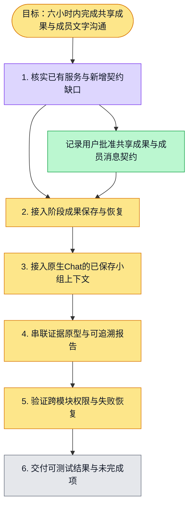

# AIDT 六小时开发冲刺

## 我理解的目标

- 目标：在六小时内完成用户已批准的共享成果与成员文字沟通，按一小时一轮验收；独立模块复用现有 WorkspaceX 能力。
- 完成判据：真实保存与重入、原生 Chat 的授权上下文、跨模块往返、可追溯导出及相关回归有可复现证据。成员文字消息必须真实收发才算完成。
- 范围：用户确认先完成A+B：六阶段共享稿、小组报告、成员文字频道和话题；访谈录音另排，语音房、教师评分后置。不部署生产、不扩大权限、不重试此前被拒绝的 GitHub 发布。
- 时间：2026-11-15 07:28 至 13:28 北京时间为本轮六小时窗口。小时为计划检查点，不把提前完成的技术批次称为一小时已经过去。新增服务契约仍需人类设计签核；超时或阻塞如实保留未完成状态。

## 六路分工

| Agent | 负责范围 | 本轮产出 |
|---|---|---|
| Agent 1 / aidt_entry_isolation | 共享阶段服务、权限与持久化 | 真实CAS、历史和幂等契约 |
| Agent 2 / aidt_chat_isolation | 原生 Chat、Skill 与已保存上下文 | 授权上下文接入及取消隔离 |
| Agent 3 / aidt_state_isolation | 阶段保存/恢复交互 | 真实回执、冲突恢复与身份隔离 |
| Agent 4 / aidt_resource_isolation | 成员文字UI及跨模块衔接 | 全局入口、单层话题与上下文连续性 |
| Agent 5 / aidt_backend_isolation | 成员文字消息能力与契约 | 用户批准B后的真实消息服务与鉴权 |
| Agent 6 / aidt_compatibility_tests | 可访问体验与整合验收 | 原生 E2E、可运行条件与回归 |
| 主 Agent | 集成、报告导出、问题修复与交付 | 源码、验证记录、可体验性事实 |

## 执行计划

图例：⬜ 待开始 · 🟨 进行中 · 🟩 已实现 · 🟪 已验证 · 🟥 阻塞

## 小时检查点

| 计划截止 北京时间 | 检查点 | 通过条件 |
|---|---|---|
| 08:28 | 第一轮 | 已有 API 路径、权限语义和真实缺口有代码依据 |
| 09:28 | 第二轮 | 同组成果真实保存、重新进入可读；失败不丢草稿 |
| 10:28 | 第三轮 | Chat 仅消费本组授权、已确认内容，原生交互保持 |
| 11:28 | 第四轮 | 资料、原型、测试和报告来源连续，缺失明确 |
| 12:28 | 第五轮 | 跨组/身份/只读/冲突/重试和原模块回归 |
| 13:28 | 第六轮 | 提供实际可测试交付；剩余阻塞不能标为完成 |

## 进度日志

| 时间 | 节点 | 状态 | 依据 |
|---|---|---|---|
| 2026-11-15 07:28 北京时间 | G, H1 | doing | 用户要求六小时、每小时迭代，六路已重启；当前检视原生能力 |

## 本轮实际完成记录

2026-11-15 08:45 北京时间，最终业务提交 `8f31b6fa4d94d74f0228df2367546b2782a06e27` 完成干净构建和真实双账号全栈 3/3 验收；约 08:46 完成隔离服务清理。A+B 提前在第二小时内完成代码与验收；前端 492、API 无DB 83 项通过。35 张截图和两份PG回读已实际保存。交付证据另行提交，不将六个检查点描述为六个小时已执行。

当前限制：没有可调用的受控应用预览入口，因此交付截图页与可复现源码，不提供容器localhost冒充外部链接。访谈录音另排，语音房、外部模型教学质量及30人试点未验收。
