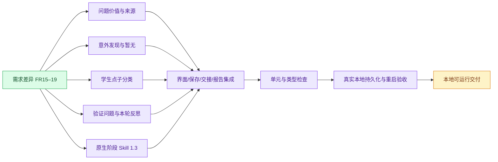

# AIDT V2 Markdown 开发执行计划

来源：`docs/requirements/aidt-v2-delta.md`，用户直接粘贴的完整 Markdown 为依据。既有 A+B 批准继续有效；不增加服务契约或代理签核，不部署生产。当前位于隔离分支 `worker/aidt-v2-learning-loop`。

分工：问题反思 Agent 负责 FR15 与教学输入输出说明；资源 Agent 负责 FR16；创意 Agent 负责 FR17 及描述单；验证 Agent 负责 FR18/19 与历史浏览；后端/Skill Agent 负责不可变 1.3 包与显式新版会话；QA Agent 负责真实本地验收；主 Agent 负责整体集成、保存引用、报告、回溯导航及交付。

状态含义：组件测试通过不等于真实保存、模型行为、30人课堂或生产验收。构建与端到端结果完成后另记；当前不标整个功能完成。
