# 新一轮真实浏览器与模型验收

目标：用户配置模型已实际成功后，用新独立测试小组从原生WorkspaceX UI完整重走六步、Design与报告；逐项区分机械结果与教学内容。
完成判据：真实浏览器页面操作、服务端保存/重登回读、原始文件/版本、实际模型回复/计量与精确来源审计相互匹配。
边界：不清旧失败/预算/pending，不改权限余额；不部署生产或合并，不假造真人研究；新seed独立不冒旧状态恢复。

```mermaid
flowchart TD
 G([目标：真实浏览器六步与报告验收])
 E[1. 确认用户新授权、初始化与真实模型连通]
 I[2. 启动唯一新栈并构建当前UI]
 B[3. 免费浏览器验证草稿重试与成员文字]
 S1[4. 提出问题与理由来源]
 S2[5. 共情材料与采纳清单PDF]
 S3[6. 意外发现、画像与HMW]
 S4[7. 学生分类选择与描述单]
 S5[8. 验证问题、原型V1与冻结]
 S6[9. 测试反思、回溯与原型V2]
 R[10. 小组报告审阅保存与导出]
 V[11. 独立审计、交付与资源清理]
 G --> E --> I --> B --> S1 --> S2 --> S3 --> S4 --> S5 --> S6 --> R --> V
 classDef todo fill:#e5e7eb,stroke:#6b7280,color:#111827
 classDef doing fill:#fde68a,stroke:#d97706,color:#111827
 classDef done fill:#bbf7d0,stroke:#16a34a,color:#111827
 classDef tested fill:#ddd6fe,stroke:#7c3aed,color:#111827
 classDef blocked fill:#fecaca,stroke:#dc2626,color:#111827
 class G blocked
 %% blocked G: 实际测试和交付收尾完成不等于整体验收：S5native因重复调用cancelled、S3性能/1unknownpending、S2教学边界及SUM可见V2/截断披露仍未全过。其余独立技术路径已测；不宣布全原生闭环或课堂通过。
 class E tested
 %% evidence E: 用户明确无需credit额度停测并授权浏览器；标准init quick0；真实SDK OK/3.7s/22tokens/0retry（provider-connectivity.json），产品链尚待验
 class I tested
 %% evidence I: A1新seed app_rw基线0run/physical/usage，canonical SHA802cf，子进程CA/proxy指纹；真实新Web build ff9含c9cf BUILD HpTdw6E9Fzu6NgYyCuctM，API/Python/正常登录200，zero-window-ready.json
 class B tested
 %% evidence B: A4真实新Web浏览器1pass5.4s：A重试保B正文/附件/mention、正常B清稿，member频道/话题/切步草稿真实API；3SDK全浏览器abort，A1SQL0run/physical/usage/credit；首consultant setup红保留
 class S1 tested
 %% evidence S1: 真实browser1pass35.1s/run33945939… succeeded，学生选择save V2/freshlogin精确；A2冻结V1原话/pin/dispatch/canonical源审过；4physical reported24544tokens/4settled；A3保留4问号例子/引号改写/why分支未验小偏离，不真人课堂评分
 class S2 tested
 %% evidence S2: A6 same-run continuation browser1pass17.4s，source frozenV3/currentV4+freshlogin，实际printDOM PDF146318B；A1 6physical/6reported40165tokens/6settled/holds0；A2 checkpoint继承原dispatch audit0。初次计划确认护栏中断红记录保留。
 class S3 tested
 %% evidence S3: A6实际浏览器1pass208.8s、真实run e607b916…succeeded/学生V2重登；A2源/派发/hash/readback audit0。A1确认44physical，其中43reported281610tokens/settled、1failedunknown/pending63.46；性能财务缺陷保留。正常cancel前GET已succeeded故未POST，不存在取消或QA超时。
 class S4 tested
 %% evidence S4: A6 browser1pass40.5s，学生多标签/选择V3+freshlogin；三不同点子actualPDF305209/272723/262399B、图decode/各自文字/不同SHA；A1 runf53bc122…6physical/6reported49174tokens/6settled，S3既有pending保留。
 class S5 blocked
 %% blocked S5: S5native55fa0cc5…86.4s browser fail；实际8call_skill/15physical，正常cancel202后cancelled，无新unknown。按用户卡住跳过，留原失败并以明确学生人工稿继续独立Design，不记S5Agent通过；Design仍待。
 class S6 tested
 %% evidence S6: S6原护栏红保留，once同run续完1pass32.6s，无新human/reserve；学生V3到V4/unchanged/return2/真实静态检查纠正/重登，旧题V1冻结。A1 6physical/6reported67749tokens/6settled，S3pending不变；非完整链绿。
 class R tested
 %% evidence R: SUM原护栏红保留，once同run续完1pass54.1s/实际3070字草稿/学生V8+8613B精确MD；再0费学生纠正V9/11664B+freshlogin/旧refs原AI旧导出不变。A1 9physical/197065reportedtokens/9settled。A2可见投影29源17截断，V2/currentreturn5可见仍被遗漏、旧return2不完整；AI整编内容未全过，学生补正不追认模型全读。
 class V doing
```

