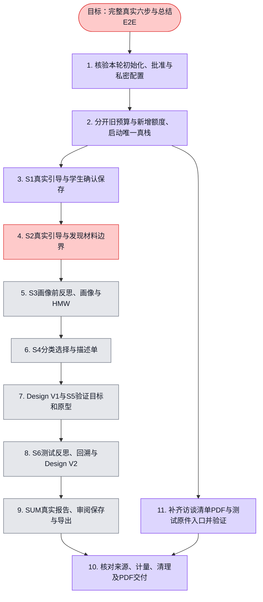

# 执行计划 — 已批准的补充真实模型E2E

> 规范：`.harness/instructions/execution-plan-visualization.md`。
> 改状态用 `node .harness/scripts/execution-plan.mjs set <本文件> <节点> <状态>`，
> 改完 `check` 一遍；不要手改 classDef 颜色。

## 我理解的目标
- **目标**：按V2完整走通原生六步与SUM，核对真实模型、保存成果、历史来源和学生决定。
- **完成判据**：现有真实Playwright用例与实际run/消息/receipt/计量及文件字节对应；失败保留，不把配置或prepared当模型通过。
- **不做什么**：不部署生产、不合并、不扩大权限或余额、不造真人证据、不自动新建重试。
- **假设与待确认**：用户本轮明确“批准”新增S1一次+Design最多两任务；原S2–S6/SUM六名额保留，旧账不重置；未另给金额上限，不虚构货币硬限额。

## 执行计划

图例：⬜ 灰=未开始 · 🟨 黄=已开始 · 🟩 绿=已完成 · 🟪 紫=已测试（有证据） · 🟥 红=被堵塞

## 进度日志（append-only，每次改颜色追加一行）
| 时间 | 节点 | 状态变化 | 依据（命令 / 证据 / 堵塞原因） |
|---|---|---|---|
| 2026-11-16（北京时间） | G, E | todo → doing | 接到目标，开始理解 |
| 2026-11-16（本轮） | E, C, U1 | 初始化与唯一栈已测试，S1链路已测试 | A1 fresh健康/实际执行器与计量，A6 S1真实1passed，A2只读精确来源审计；S1复合三问体验偏离见A3报告，不当教学通过。 |
| 2026-11-16（本轮） | U2 | 前置QA失败后继续首模型调用 | 上传HTTP状态与MIME参数断言错误已定位，A1证实S2 run0/旧账不变；保留尝试记录，未把前置失败当新模型重试。 |
| 2026-11-16（本轮） | F | 新增 → doing | 逐项核对发现S2缺访谈清单PDF入口、S6缺测试原件入口；A4复用现有Web导出/上传补齐，A1规划独立新Web构建，PG/API/同组保留。 |
