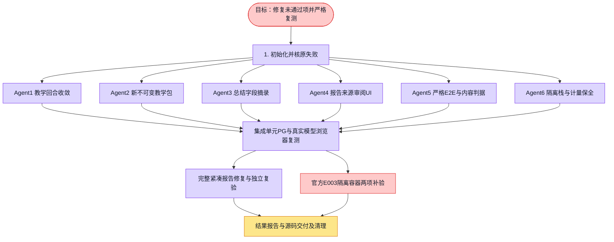

# 修复验收未通过项

目标：解决已有S3/S5重复调用、S2模拟采访边界、SUM来源挤占/版本遗漏及截断不可见；通过严格实际复验，不降低断言。
范围：沿现有已签selector/snapshot/receipt和原生Chat，版本兼容、旧数据/账本保全；无生产/合并/权限余额修改、无被拒GitHub外发。新wire契约仍需人类签核，本轮优先不新增。
已知环境：init quick退出0；coord-gateway未配置导致tick失败，正式协调心跳不虚报；readiness队列为全仓任务，本轮按用户明确AIDT缺陷直接交办推进。

