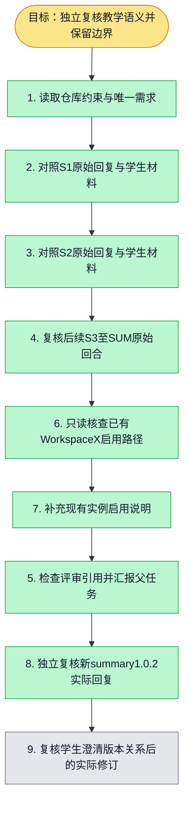

# 执行计划 — 独立教学语义复核

## 我理解的目标
- 目标：逐回合审阅真实模型回复，区分关键教学失败、语言建议与未覆盖范围。
- 完成判据：每个可用回合对照保存前学生材料与需求，留下精确来源及结论，并向父任务即时报告关键失败；最终检查文件引用有效。
- 不做什么：不运行模型、不起栈、不改代码/原始回执/权限/余额，不部署，不代替人类课程验收。
- 假设与待确认：父任务负责真实模型执行及原始材料落盘，本子任务等待后续回执；父任务确认全局 init 已通过。

## 进度日志
| 节点 | 状态 | 依据 |
| --- | --- | --- |
| S1 | done | 已读取 AGENTS、bootstrap、execution-plan 规范/技能、runtime 知识库及 aidt-v2-full 对应段落；父任务确认全局初始化已通过 |
| S2 | done | 原始回执与 completion 的 before/after 逐段语义阅读，见 review.md |
| S3 | done | 原始回执与 completion 的 before/after 逐段语义阅读，见 review.md |
| S4 | todo | 等父任务提供后续回执，不发起重复任务 |
| S6 | done | 父任务新增只读交付路径核查；源码结论见 delivery-path-readonly.md，24个源码链接已检查通过 |
| S7 | done | 父任务新增授权，仅补 docs/development/AIDT-LOCAL.md 的已有实例启用说明，未启动或配凭据 |
| S4 | done | S3–S6、V1/V2、旧新回溯关系和SUM实际全文均已复核；SUM-C1关键失败已拒导入，不将完成复核等同产品通过 |
| S5 | done | review30链接、delivery24链接和SUM proof身份/全文SHA检查均退出0；文档 diff --check退出0；已汇报父任务/执行者/报告作者 |
| S8 | todo | 父任务安排新不可变summary1.0.2补验；已给事实清单，不编写source pack；等待新actual回复，旧critical1不改 |
| S8 | done | 新compact实际全文完整，但旧问题错引S5V4且缺新旧题区分，独立proof critical1拒导入；旧首轮失败保持 |
| S9 | todo | 父任务另授权学生用已有字段澄清版本关系后的单次修订；等待新reply，第三独立proof，不代写报告 |
