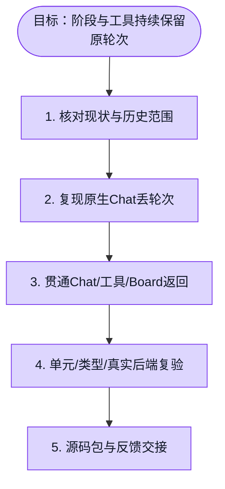

# 执行计划 — 保留学习轮次的阶段交接

> 规范：`.harness/instructions/execution-plan-visualization.md`。
> 改状态用 `node .harness/scripts/execution-plan.mjs set <本文件> <节点> <状态>`，
> 改完 `check` 一遍；不要手改 classDef 颜色。

## 我理解的目标
- **目标**：修复返回前序阶段后，原生Chat、工具与Board往返丢失反思版本；保留project、thread、资源与原轮次依据。
- **完成判据**：单元先复现再修复；整合、类型和设计检查通过；新原生构建与双停启/回读验证持续保留原反思版本。
- **不做什么**：不改Chat UI、不变更服务契约或权限、不按MBA历史材料新增三Agent/固定报告页数；真实模型、录音及课堂验收仍另计。
- **假设与待确认**：历史课程为另一MBA作业说明，仅参考人工判断；当前无运行中的重复agent任务，原数据保留。

## 执行计划

图例：⬜ 灰=未开始 · 🟨 黄=已开始 · 🟩 绿=已完成 · 🟪 紫=已测试（有证据） · 🟥 红=被堵塞

## 进度日志（append-only，每次改颜色追加一行）
| 时间 | 节点 | 状态变化 | 依据（命令 / 证据 / 堵塞原因） |
|---|---|---|---|
| 2026-11-15 | G, S1 | todo → doing | 接到目标，开始理解 |
| 2026-11-15 | S4 | doing → doing | 首次真实新构建与返回轮次通过，stop owner退出1使全流程失败；已加队列关闭屏障，38项runtime测试通过，继续新构建复验 |
