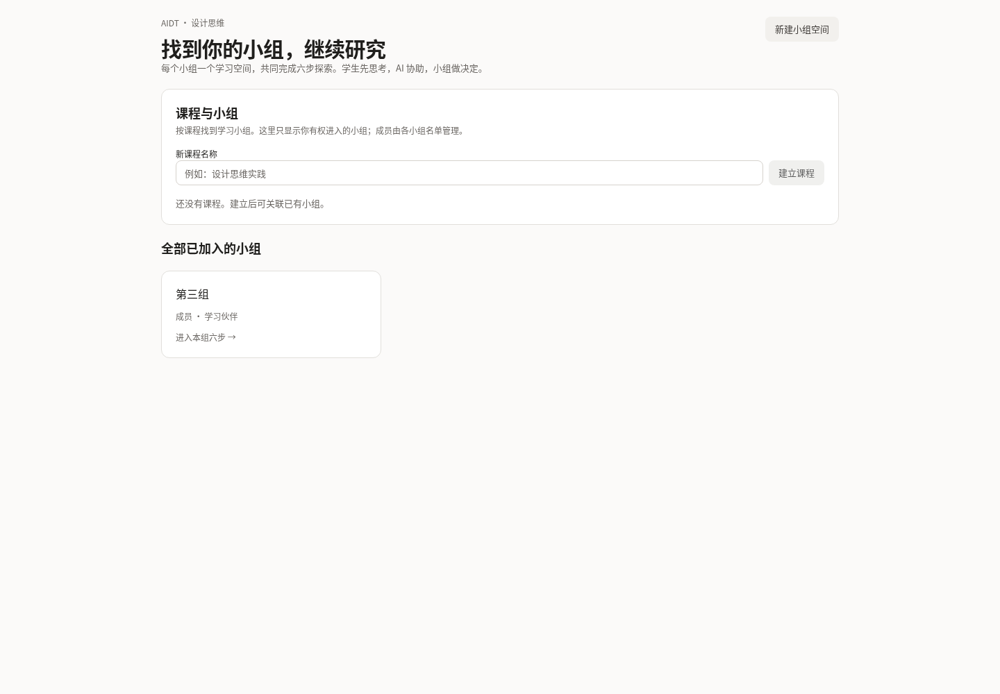
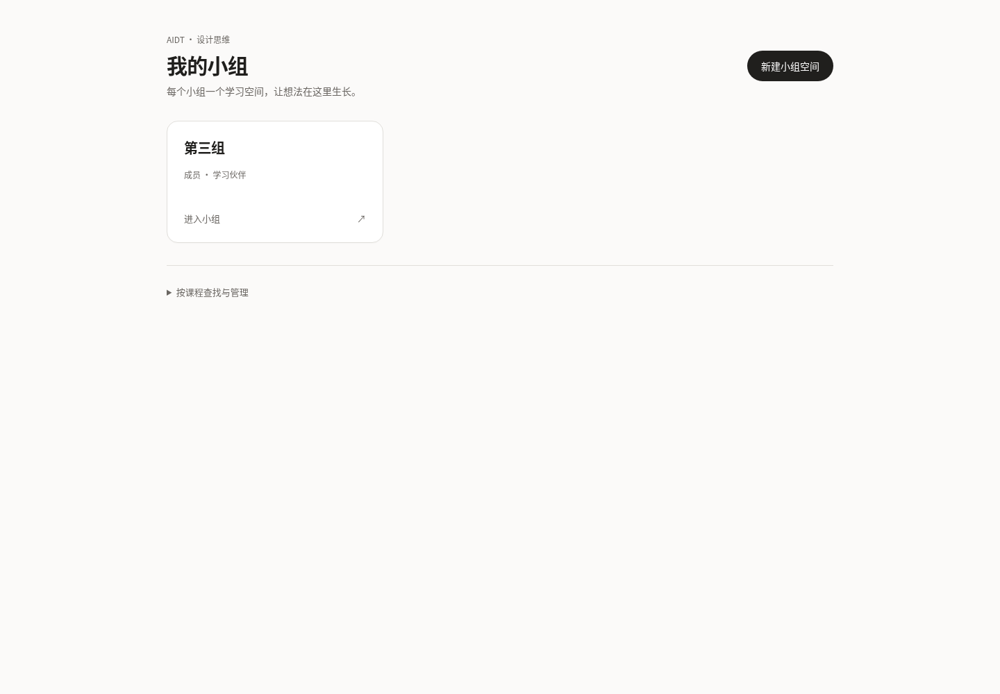
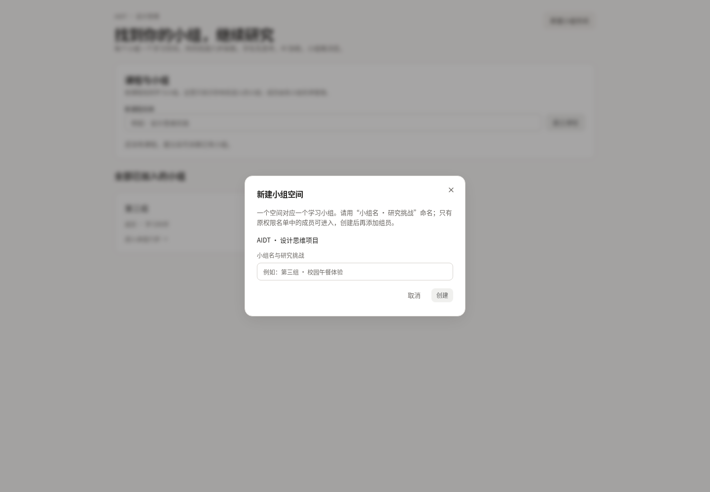
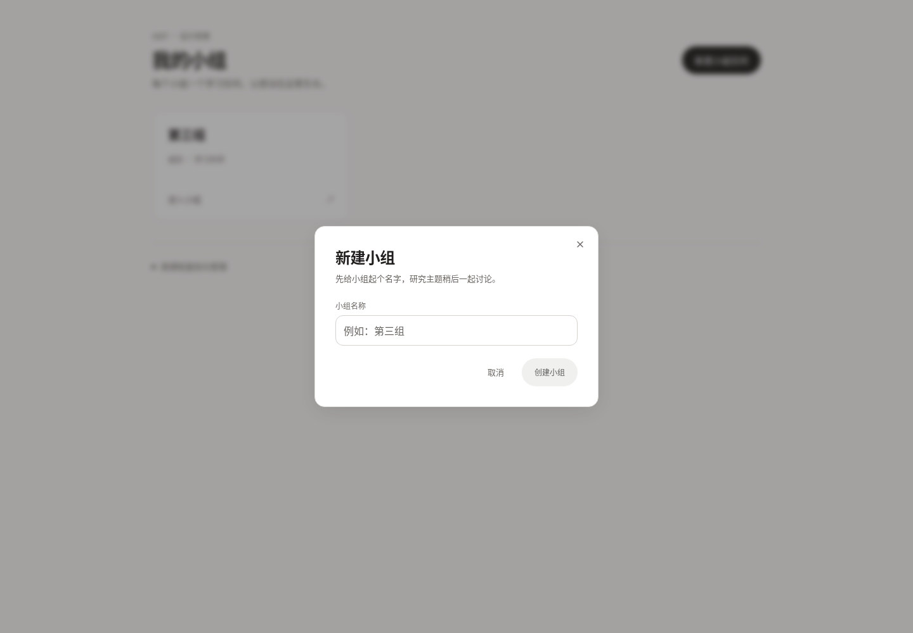
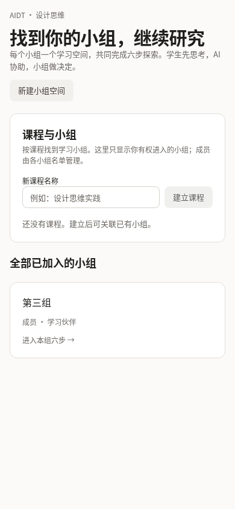
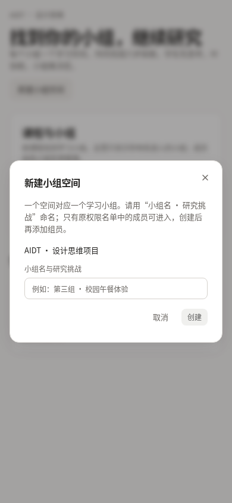
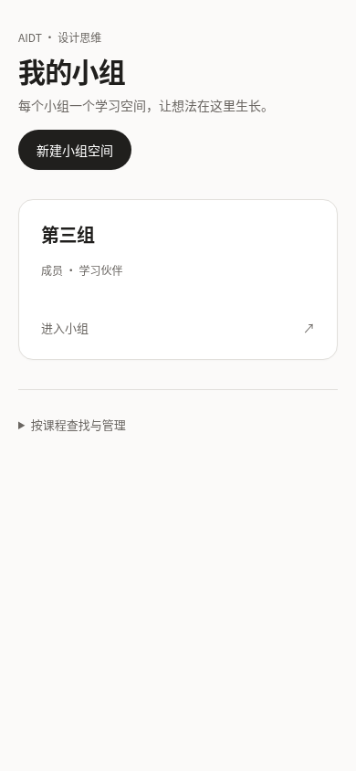
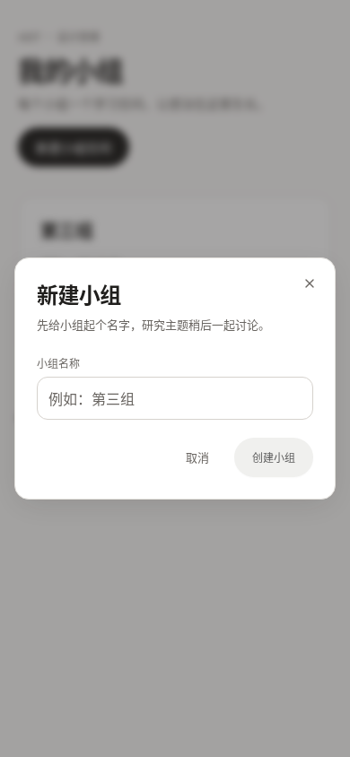

# AIDT UIUX simplification — 2026-11-20

Scope: the existing AIDT entry, group creation and project shell. User asked for a simpler, more polished interface and specifically no persistent workflow instruction after entering a project. This is implementation and local component evidence, not a new application, a redesign of canonical Chat, an online acceptance run or a classroom usability score.

## Evidence and method

Read the current repository instructions, project/chat module guides, UIUX standards and Product Design audit/router/context/browser guidance. Product Design context preflight returned `missing`; no saved design references were assumed. Cloud browser control tools were unavailable. The permitted project-runner route used the real `AidtHome`/`AidtCreateProjectForm` React components, synthetic member/group data and mocked service calls; rendered DOM was captured in headless system Chromium using the repository's actual Tailwind CSS and theme tokens. Desktop: 1440×1000. Mobile: 390×844. Every image below was saved and visually inspected during this run. No account, API, model or permission write was performed by this capture.

The project shell changes were checked through actual React component tests with native Chat stubbed. They establish layout ownership and navigation behavior, not a screenshot or end-to-end acceptance of the full authenticated Chat workspace.

## Captured flow and findings

| Step | Before finding | Implemented change | Local result |
| --- | --- | --- | --- |
| 1. Find a group | Course creation and its empty/error surface dominated the top of a page whose primary task was entering an existing group. | Put group cards first, make `我的小组` the clear heading and keep course browsing/management in a closed disclosure below groups. | Initial visible textboxes reduced from 1 unrelated course-name field to 0. Existing course functionality remains available. |
| 2. Open group creation | One field was already present, but its label coupled group identity to an as-yet-unresearched challenge. A fixed naming convention, type title and permissions paragraph repeated context. | Ask only for `小组名称`; research topic is explicitly deferred until discussion. Remove duplicate type text and shorten the dialog to one sentence and one primary action. | One visible input remains; no challenge, topic or course is required for creation. Existing create → tag → navigate and partial-failure retry logic remain intact. |
| 3. Use on phone | Creation buttons used the shared compact 28px style, while the instructional copy occupied more room than the action. | Use a 48px input, 44px creation/cancel targets, clear typography, semantic tokens and generous but bounded spacing. | Desktop/mobile screenshots show no horizontal overflow. Native dialog behavior is retained; assistive-technology and physical-device testing remain outstanding. |
| 4. Enter the project | Source/UI tests showed duplicate learning-guide disclosures, a separate task-instruction card, repeated toolbar actions and a reference shelf initially consuming the desktop workspace. | Remove the duplicate flow instructions and task card; show the current step plus direct outcome/tools/reference actions. References are closed by default and open explicitly. Keep optional revision history. | Component tests verify no workflow wall, one outcome entry, a closed reference shelf and no Chat remount when opening/resizing/closing references. Full authenticated workspace visual acceptance remains pending. |
| 5. Review a round | Saving previously exposed a direct next-step link. | Integrate the primary agent's `AidtRoundCompletion` in the outcome view instead of the save-only next-step link. | Confirmation behavior is covered by the primary agent's separate tests. This change does not lock browsing of earlier stages or invent teacher approval. |

### Screenshots

Step 1 before: 

Step 1 after: 

Step 2 before: 

Step 2 after: 

Step 3 before:  

Step 3 after:  

## Implemented iterations

1. Captured and inspected the original entry/dialog on two viewport sizes. Confirmed that simplification meant removing redundant decisions and text, not falsely claiming the form had many inputs.
2. Reworked group-first hierarchy, folded course management, simplified naming and removed persistent in-project flow explanation. Ran the existing entry/isolation/workspace suite: 54 passed, 1 failed because an old test targeted a removed duplicate workflow-return link. Updated that assertion to the existing six-step navigation, preserving the same project destination.
3. Added behavioral regression checks for a single group-name input, deferred research topic, closed course management, absent workflow wall, one outcome entry and a closed reference drawer. Reviewed new desktop/mobile captures and enlarged creation controls to 44px. Reran the five test files: **57 passed**.

These are three UI implementation/review iterations, separate from the ten-per-Skill authoring iterations. No claim of ten full browser sessions or a measured 9/10 learning experience is made.

## Validation

```bash
pnpm --filter web exec vitest run tests/ui/aidt-entry.test.tsx tests/ui/aidt-entry-isolation.test.tsx tests/ui/aidt-course-entry.test.tsx tests/ui/aidt-course-role-lifecycle.test.tsx tests/ui/project-aidt.test.tsx --maxWorkers=1 --minWorkers=1
# 5 files, 57 passed; uiux/tests-final.log

pnpm --filter web exec eslint features/aidt/components/aidt-create-project-form.tsx features/aidt/components/aidt-home.tsx features/aidt/components/aidt-course-entry.tsx features/aidt/components/project-aidt.tsx tests/ui/aidt-entry.test.tsx tests/ui/project-aidt.test.tsx
# exit 0

pnpm --filter web exec bash scripts/lint-design.sh
# exit 0; uiux/design-lint.log

git diff --check
# exit 0
```

Eight per-image JSON receipts record viewport, visible-field count and horizontal-overflow checks. The transient capture test was removed after creating evidence; no background browser, HTTP server, container or live account session was left running.

## Human review still needed

`9/10` is a user target, not an asserted result. Test whether a new student can find their group, create a named group without prematurely defining a research problem, start the native conversation and locate outcomes without reading workflow instructions. Then verify on a real phone, keyboard and screen reader, with real loading/failure states and a fully authenticated project. Member text chat and native AI Chat remain existing shared capabilities; this work did not replace, reimplement or independently accept their backend behavior.
