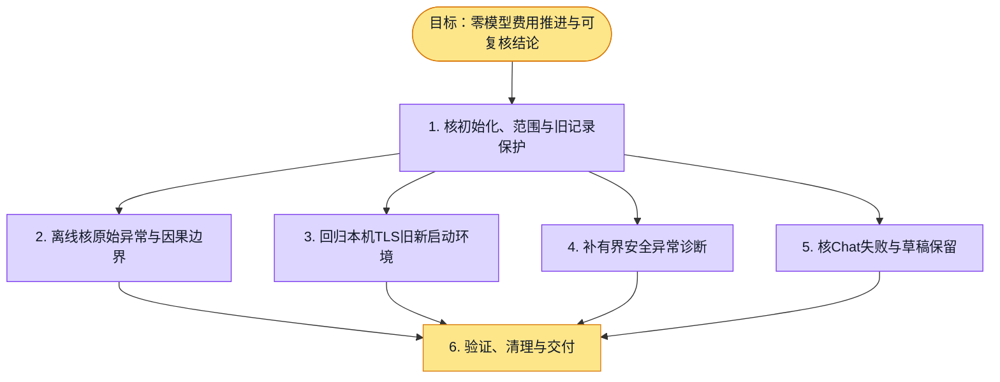

# S2零费用后续：因果核查与安全回归

目标：仅在无模型调用、无额外模型费用的范围核实S2证书因果边界，补安全诊断和失败体验回归。
完成判据：原始记录证据与机制回归分开；目标测试真实执行；无外部模型/财务/权限变更；资源释放。
边界：不自动重跑S2，不将loopback/HEAD当真实模型通过，不修改pending或旧失败。
当前原S2费用仍以最后已保全记录为准，供应商账单未知；不从离线快照推断新结算。

本轮仍由原6个Agent分工，不新建付费任务或绕过已耗尽max1。A1核历史启动/费用时点；A2离线只读异常记录；A3独立因果文字审阅；A4草稿失败回归；A5安全日志；A6本机TLS。
