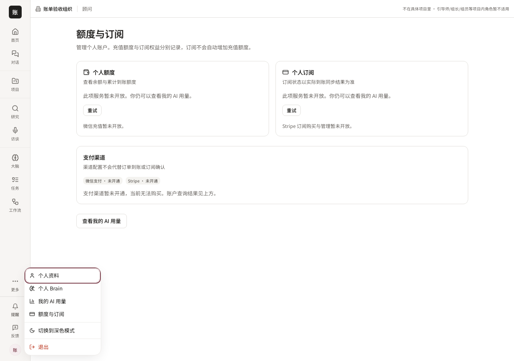
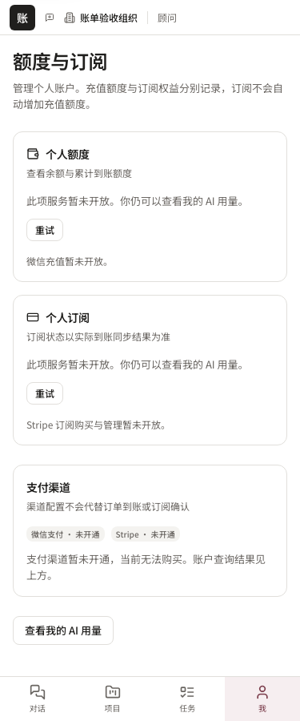
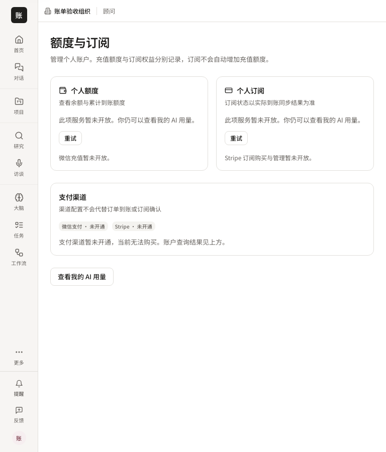
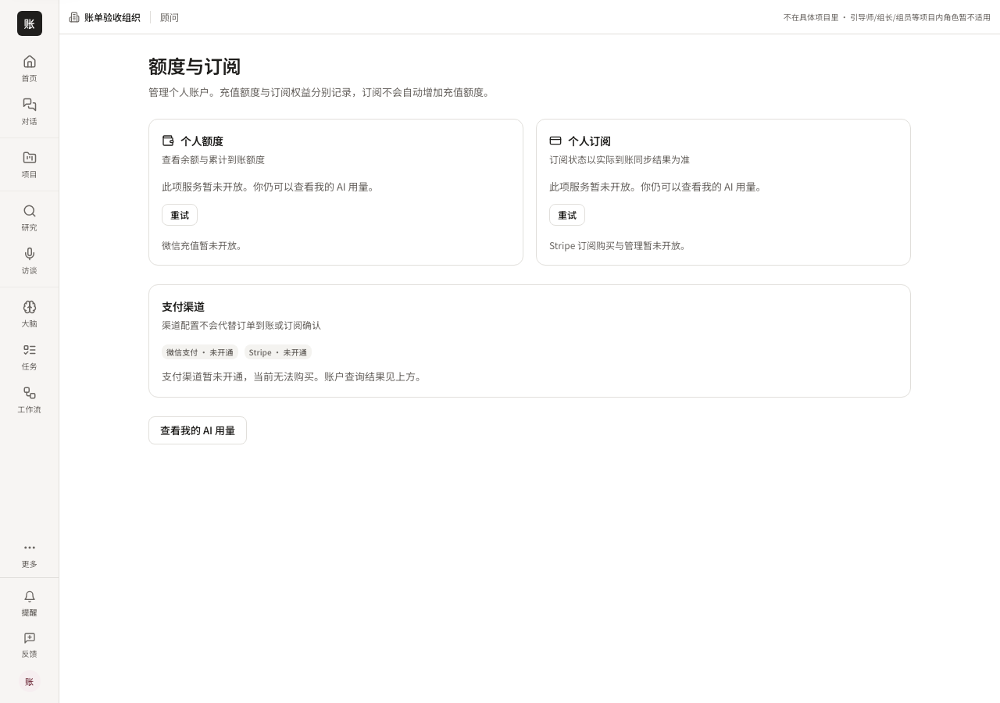

# 个人计费入口 — #5714

用户反馈的断点是生产菜单没有计费项，仅存在静态原型。正式 PersonalMenu 新增「额度与订阅」→ `/billing`，链接数据在 navigation.ts 单源声明；两束导航可达性指向该正式入口，原静态材料仍保留为预览。

本交付只提供入口与真实账户状态读取，不声称充值订单、Stripe 购买或 token 钱包扣费已经完成。界面不消费 billing mock，不展示假二维码；尚未配置渠道、HTTP404、网络失败与正常数据有独立状态。钱包失败不会被渲染成零余额，订阅失败不会被渲染成无订阅。个人钱包响应需匹配当前用户；所有账户读取使用实际 session token，并取消过期读取。匿名页面仍走 AppShell 登录守卫。

## 验证

- `component.log`：计费读取、错误重试、归属、取消、Stripe单独配置、菜单与匿名守卫、既有导航回归。
- `browser.log`：`pnpm --filter web exec playwright test --config playwright.billing-entry.config.ts`。真实 Chromium 加载实际 `/billing`，自然 Tab 到个人菜单，方向键到计费和主题项，主题切换后菜单保持打开，再进入计费页；375/768/1280无横向溢出。
- `lint.log`、`typecheck.log`、`navigation.log`：实际 Web lint/typecheck 与全局导航双向门。
- `red.log`：新组件尚未存在时验证失败，确认不是空跑。

浏览器 lane 使用明确的 localhost HTTP fixture（身份、空渠道和账户404），仅证明前端可达性、真实渲染、状态交互与布局。它不是生产登录、支付渠道、数据库余额或到账的 E2E 证据；组件测试的金额也只是响应 fixture，不是线上余额。截图为该 lane 的真实渲染像素。

## 相关修复

键盘走查发现原 ThemeToggle 未转发 ref 和按钮属性。Radix collection 实测六项，其中主题项 ref 为 null，导致方向键空引用而停留在菜单根。ThemeToggle 现转发 ref/属性并组合点击事件，真实浏览器覆盖计费与主题键盘操作。没有手动强制 focus 或弱化通过条件。

## 截图

本次 localhost Next 服务已停止；运行缓存按本 lane 独立目录清理。提交后仍需最新 CI 与独立审查，以及主线合入/发布；本记录不把本地验证当作线上已可见。

## 移动端与 CI 接线复审修正（2026-10-15）

移动端通过「我 → 个人资料 → 额度与订阅」进入，入口复用同一导航声明，仅在移动端显示；计费页保持「我」高亮。实际 Chromium 在 375 宽点击此路径，见 billing-mobile-entry.png、mobile-browser.log。mobile-component.log 为 5 文件 30 项通过，mobile-red.log 记录入口缺失时的失败；mobile-lint.log、mobile-typecheck.log、wiring.log 均成功。

接线清单由官方生成器提取新增 /billing 路由及其必要控制器事实，仅保留本路由增量。wired 分类不代表充值、订阅购买或 token 消费已经交付。当前仍等待最新 CI、独立复审和主线发布。
