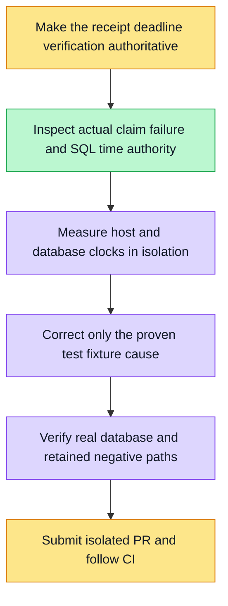

Investigate the existing expired browser receipt assertion blocking payment verification, then correct only a proven fixture-clock mismatch. Preserve production SQL/security deadlines, late completion/restart/concurrency/cancellation assertions and original timing budgets. Use owned isolated PostgreSQL; no OS clock changes or shared database mutation. Original F07 failure is not a passing result.

