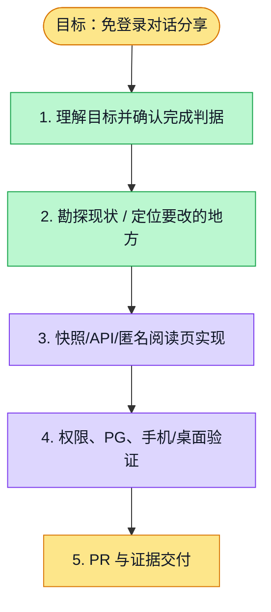

# 执行计划 — Chat 公开分享

> 规范：`.harness/instructions/execution-plan-visualization.md`。
> 改状态用 `node .harness/scripts/execution-plan.mjs set <本文件> <节点> <状态>`，
> 改完 `check` 一遍；不要手改 classDef 颜色。

## 我理解的目标
- **目标**：聊天生成分享链接，朋友无需账号即可在手机和电脑阅读。
- **完成判据**：API/PG/UI测试与真实匿名手机/桌面浏览器链路通过，PR门控绿。
- **不做什么**：首版整段只读快照，非图片附件不公开字节，不包含实时协作。
- **假设与待确认**：采用整段快照；用户要求直接开发并跳过身份确认。

## 执行计划

图例：⬜ 灰=未开始 · 🟨 黄=已开始 · 🟩 绿=已完成 · 🟪 紫=已测试（有证据） · 🟥 红=被堵塞

## 进度日志（append-only，每次改颜色追加一行）
| 时间 | 节点 | 状态变化 | 依据（命令 / 证据 / 堵塞原因） |
|---|---|---|---|
| 2026-10-13 | G, S1 | todo → doing | 接到目标，开始理解 |
