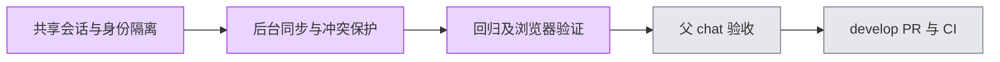

# 用户访谈跨步骤共享数据 — #5967

同一访谈在身份隔离的 layout 内共享 canonical 文档、访谈元数据和专家目录。route 保持深链及浏览器导航，只切换视图；暖缓存立即呈现，后台 GET 不清空内容。首载未知不显示伪零值。

可见页面每 30 秒刷新，focus/online/visibility 恢复时刷新；同资源请求与计时器去重。提交立即发布新快照，旧响应与报告身份回退被拒绝。账号/组织/token 切换清理缓存；迟到请求不能污染新身份。后台更新不会覆盖 dirty 文本或专家弹窗，保存前校验编辑基线，要求显式解决冲突。缓存读取与同步不触发初始化、访谈执行或模型 POST。

## 验证

- 在 apps/web 运行 `pnpm exec vitest run tests/ui/interview-*.test.tsx tests/lib/interview-session-cache.test.ts --maxWorkers 2 --minWorkers 1`：29 文件、271 测试通过（从 apps/web 展开 glob；实际命令见 tests.log）。
- `pnpm --filter web typecheck`、`pnpm --filter web lint`、`git diff --check`。
- `./init.sh`：基础快速路径通过，未执行 `--full` 全仓验证。
- `node docs/evidence/interview-session-5967/browser-check.cjs`：7 项真实 Chromium / Next.js 页面检查，见 browser-results.json 及截图。
- 独立 reviewer 复跑 cache/provider/editing/execution：4 文件、83 测试通过。

浏览器证据使用 HTTP/session 夹具，不代表真实 DB、鉴权、模型或生产环境验收。远端变化以轮询/恢复事件同步，不承诺实时推送；隐藏页面暂停轮询。跨身份隔离和报告旧响应反证由组件测试验证。

## 协作与交付

复用既有 worktree，基线 origin/develop `4b59fe4a171620ccaae894c22eea05ee05b08a7d`。使用人类指定 coord-user-research 身份；本任务获准跳过租约前置，未取得真实 lease；未修改全局校验器或产品鉴权。凭据空模板不入库。一个 issue 一个 develop PR，不自动合并。

