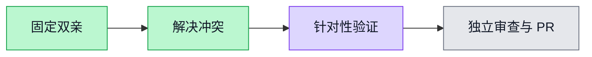

# main → develop integration — #5972

User requested integration with develop as base, preserving both histories and features.

- Base develop: `cd4da1616d8c8838a004aef038eb38c237f56a3f`
- Source main: `cd0e33e5e9a3bcbed609920d1bdbccf4818eb858`
- Branch: `codex/merge-main-into-develop`; normal `git merge --no-ff`, no squash/cherry-pick.
- Issue: https://github.com/boardx/workspacex/issues/5972

## Conflict decisions

The usage panel retains develop's Beijing inclusive date ranges, model selector, scope reset, loading/error states, human-readable ledger, native units and unknown-consumption handling. It adds main's default chart overview, separate-currency costs, chart bucket navigation, member/model/matrix/project drill-down. All drill-down paths preserve report snapshot and force personal scope. Member labels use the existing org member name resolver. Date filters clear old snapshots; reset clears group filters.

The panel tests retain develop's behavior coverage and adapt main's chart/cost/snapshot tests to readable ledger navigation. Added explicit Beijing bucket-to-ledger query assertion.

Cashier documentation retains develop's retest and branch correction history. Three differing main PNGs are retained with `-main` suffix and linked from the original README. The original paths retain develop evidence. Sprint 21/06 handoff retains the develop correction plus common main historical record. Cashier runtime changes were equivalent and merged automatically.

Auto-merged `.github/workflows/image-release.yml` and `scripts/registry-images.py` match main exactly. Thus main's reviewed source override/US release additions are preserved along with the shared develop automatic DevApp trigger. No new release policy was introduced by resolution.

## Verification

- `./init.sh`: exit 0, default quick initialization (not full suite); `init.log`.
- `pnpm --filter web exec vitest run tests/ui/ai-usage-panel.test.tsx tests/ui/ai-usage-format.test.ts tests/lib/ai-usage-chart.test.ts --maxWorkers=1 --minWorkers=1`: 20 passed, `usage-tests.log`.
- `pnpm --filter web typecheck`: exit 0, `typecheck.log`.
- `pnpm --filter web lint`: exit 0, `lint.log`.
- `python3 -m unittest discover -s tests -p '*registry*.py'`: 40 passed, `registry-tests.log`.
- `python3 -m unittest discover -s tests -p '*image_release*.py'`: 14 passed, `image-release-tests.log`.
- `pnpm --filter @repo/api exec vitest run --config vitest.usage-unit.config.ts`: 70 files / 662 passed, `api-usage-unit-tests.log`.

The first direct API repository/scope test attempt was blocked by the existing database isolation guard before test execution (`api-usage-tests.log`), so no DB-backed repository claim is made. Used the existing DB-free usage unit lane instead. Initial UI test runs exposed the expected default-tab change: ledger assertions now explicitly activate Radix tabs through mouseDown. Final results above refer to current source.

No Docker stack, browser server, production action or provider call was started. Full browser and DB-backed repository acceptance remain outside this focused merge verification. Remote CI and independent review are pending; this is not a completion claim for the remote lifecycle.

## Independent review round 1 — overview coverage correction

Reviewer identified an integration regression: the default overview inherited literal zero Token presentation while develop's ledger/report guard correctly distinguished unreported/native-only consumption. The overview now calls the existing `recordedTotal` authority. Trend buckets share `recordedBucketTotal` in the same formatting module: known values remain numeric, pure unknown/native reports use the report guard, and zero buckets in mixed partial reports say `用量待确认` because the trend API has no per-bucket coverage counters. Ambiguous Token bars are omitted; call-count bars and drill-down remain available. No API contract or aggregation semantics changed.

Added four default-overview cases covering unknown-only, native-only, reported zero, and a zero bucket in a mixed report, including accessible chart labels and monthly aggregation. Initial new-test run: 4 failed / 13 passed (`review-usage-red.log`). Final panel/format/chart run: 24 passed (`review-usage-tests.log`). Web typecheck and full web lint both exit 0 (`review-typecheck.log`, `review-lint.log`). The original merge commit and both parents remain intact; this fix is a subsequent commit. Independent rereview and remote CI remain pending.
