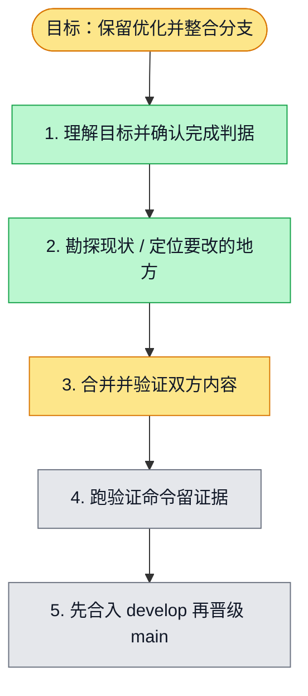

# 执行计划 — 保留两边优化并整合 develop/main

> 规范：`.harness/instructions/execution-plan-visualization.md`。
> 改状态用 `node .harness/scripts/execution-plan.mjs set <本文件> <节点> <状态>`，
> 改完 `check` 一遍；不要手改 classDef 颜色。

## 我理解的目标
- **目标**：先将 main 同步至 develop，验证优化与修复保留，再晋级 main。
- **完成判据**：文件内容与祖先审计通过；用量/聊天测试与浏览器检查通过；两次 PR required gates 通过；最终 main 包含双方基线。
- **不做什么**：不执行 CN 生产发布、不强推、不覆盖分支、不回退优化。
- **假设与待确认**：沿用本会话工作树；用户已授权此次整合与晋级；main/develop SHA 见 baselines.json。

## 执行计划

图例：⬜ 灰=未开始 · 🟨 黄=已开始 · 🟩 绿=已完成 · 🟪 紫=已测试（有证据） · 🟥 红=被堵塞

## 进度日志（append-only，每次改颜色追加一行）
| 时间 | 节点 | 状态变化 | 依据（命令 / 证据 / 堵塞原因） |
|---|---|---|---|
| 2026-10-29 | G, S1 | todo → doing | 接到目标，开始理解 |
