# 语音 UI 三轮优化 — #5842

目标：沿既有设计系统统一风格与操作体验。范围为个人转录 `/rec` 历史/创建/工作区；项目预览分支和其他模块语音入口未扩展。

- Worktree：`/Users/shenyangjun/.codex/worktrees/4986/workspacex`；分支 `worker/coord-voice-5842-ui-three-rounds`。
- 开发基线：`0acfa6628f9380c64ece5732c066e999d2e57651`，本轮fetch后与origin/main一致，开工工作区干净。
- 最终产品SHA：`d350e07593f3f1c7732a16d256b4e8c5b84dfab7`。后续提交仅证据与语音模块知识回流，产品差异可用 `git diff d350e07593f3f1c7732a16d256b4e8c5b84dfab7..HEAD -- apps/web` 核实为空。
- 人类明确授权三轮连续实现；主会话已逐项看图/审diff，最终明确“三轮产品验收通过”，允许证据提交复用本次验收并自动建PR。PR/CI状态以GitHub实时信号为准，不代签、不自标passing、不合并。

## 计划与完成证据

```mermaid
flowchart LR
  G([三轮实现与产品验收]) --> S1[基线与范围] --> S2[R1 视觉层级] --> S3[R2 交互恢复] --> S4[R3 浏览器修正与复验] --> S5[主会话验收]
  classDef todo fill:#e5e7eb,stroke:#6b7280,color:#111827
  classDef doing fill:#fde68a,stroke:#d97706,color:#111827
  classDef done fill:#bbf7d0,stroke:#16a34a,color:#111827
  classDef tested fill:#ddd6fe,stroke:#7c3aed,color:#111827
  classDef blocked fill:#fecaca,stroke:#dc2626,color:#111827
  class G tested
  %% evidence G: R3 71 consumer + 2 browser PASS; main accepted product d350e0759
  class S1 tested
  %% evidence S1: git fetch origin main; base0acfa6628; worktree clean at start
  class S2 tested
  %% evidence S2: r1-component.log 27 PASS; d86beaa1b
  class S3 tested
  %% evidence S3: r2-component.log 65 PASS; review-component.log 60 PASS; 4ffbb2787
  class S4 tested
  %% evidence S4: r3-component.log 71 PASS; r3-final/command.log 2 PASS; d350e0759
  class S5 tested
  %% evidence S5: main reviewed d350e0759 and final normal/pending screenshots+JSON; explicit final acceptance in source chat
```



## 三轮独立记录

| 轮次 | 发现与实际修改 | SHA | 独立检查/结果 |
|---|---|---|---|
| R1 视觉层级 | 工具按钮统一WorkflowActionButton；改名/正文复用Input/Textarea；标题层级、桌面间距与窄屏换行一致 | `d86beaa1bf931953da0d6f5322df901af87b7367` | 2 files / 27 consumer tests PASS；[日志](./r1-component.log)。早期浏览器服务失败，无R1独立屏幕截图；不借用旧任务截图。后续当前产物截图复核视觉。 |
| R2 交互恢复 | 列表失败一个错误区与重新加载；无结果清筛选；复制拒绝捕获与反馈；录音/收尾返回说明 | `1f08c22877ac60c8518899f6fee15c62d2197a47` | 反证先红6/58并捕获未处理clipboard拒绝，[反证](./r2-red.log)；修复后4 files / 65 PASS，[回归](./r2-component.log)。 |
| R2 独立审查返工 | server recording不能误作本地采音锁，停止失败/重连异常仍可退出 | `4ffbb27873c0c401dbdaee7d1fc5b157ff743058` | 两状态反证先红2/28，[反证](./review-red.log)；含完整遗留停止失败→返回的两组60 PASS，[回归](./review-component.log)。独立复审关闭P2。 |
| R3 浏览器发现→修正 | 实测未保存草稿返回静默丢失、真实PATCH pending仍可离开、clear/reload后焦点为BODY；限制编辑/保存期间返回并说明，保留保存/取消出口，完成后恢复；恢复焦点仅放在用户触发回调，不在请求effect | `d350e07593f3f1c7732a16d256b4e8c5b84dfab7` | 先红4/62，[反证](./r3-red.log)；最终4 files / 71 PASS，[回归](./r3-component.log)；最终真实浏览器2/2 PASS，[日志](./r3-final/command.log)。独立增量审查无新发现；主会话最终验收通过。 |

R2仍保留既有反证：重连失败可返回取消重试；筛选请求失败不展示旧条件卡片。没有删除旧约束换绿。

## 真实浏览器结果

环境是本地dev + 真实登录/API/隔离PostgreSQL + fake media/确定性ASR。真实WebSocket、停止、API读回、刷新再开已验证；没有真实麦克风、付费ASR或生产发布验证。

- 原仓库core-loop第7步：11.5s PASS，创建→项目关联→录音→停止→持久化读回→刷新重开；原断言与30s预算未降低。
- 独立语音UI case：9.5s PASS；新增场景单独90s预算，避免挤占原core预算。桌面/375窄屏、长正文真实PATCH、空结果与清筛选、503注入后单一错误/重新加载、clipboard拒绝、录音返回限制、键盘改名均检查。
- 草稿保护最终：`disabled=true`、`navigatedAwayWithUnsavedDraft=false`、`pendingDisabled=true`。取消编辑与保存完成后返回恢复。见[最终观察](./r3-final/draft-return-observation.json)。
- clear/retry最终均聚焦 `INPUT[data-testid=rec-history-search]`，且是强断言；后台请求完成不抢焦点由consumer反证覆盖。见[最终观察](./r3-final/recovery-focus-observation.json)。
- 原错误观察及对应截图保留于[r3-before](./r3-before/)，不把r2e的“脚本2 PASS但观察为false”当产品验收。最终脚本已将这些性质升级为强断言。
- [执行配置](./r3-final/shots.config.ts.txt)、[场景源码](./r3-final/shots.spec.ts.txt)、[被测基线](./r3-final/baseline.txt)为原运行快照，不纳入默认CI重复执行core-loop。可按同一cache布局还原，使用 `WORKSPACEX_ISOLATION_SEED=coord-voice-5842 pnpm exec tsx .harness/scripts/with-test-isolation.ts -- pnpm --filter web exec playwright test --config <shots.config.ts路径> --grep '步骤 7' --workers=1`。配置沿用既有fullstack服务，Web使用next dev并在独立beforeAll预热路由。

### 最终代表截图（已实际查看）

| 状态 | 绝对路径 |
|---|---|
| 桌面正常详情（保存后） | `/Users/shenyangjun/.codex/worktrees/4986/workspacex/docs/evidence/rec-ui-5842/r3-final/desktop-save-complete-return-restored.png` |
| 375窄屏正常详情 | `/Users/shenyangjun/.codex/worktrees/4986/workspacex/docs/evidence/rec-ui-5842/r3-final/narrow-workspace.png` |
| 长正文 | `/Users/shenyangjun/.codex/worktrees/4986/workspacex/docs/evidence/rec-ui-5842/r3-final/narrow-long-content.png` |
| 筛选空态 | `/Users/shenyangjun/.codex/worktrees/4986/workspacex/docs/evidence/rec-ui-5842/r3-final/narrow-filter-empty.png` |
| 错误与重新加载 | `/Users/shenyangjun/.codex/worktrees/4986/workspacex/docs/evidence/rec-ui-5842/r3-final/narrow-failure.png` |
| 复制拒绝 | `/Users/shenyangjun/.codex/worktrees/4986/workspacex/docs/evidence/rec-ui-5842/r3-final/desktop-copy-failure.png` |
| 未保存草稿保护 | `/Users/shenyangjun/.codex/worktrees/4986/workspacex/docs/evidence/rec-ui-5842/r3-final/desktop-unsaved-draft-after-return.png` |
| 保存pending返回保护 | `/Users/shenyangjun/.codex/worktrees/4986/workspacex/docs/evidence/rec-ui-5842/r3-final/desktop-save-pending-return.png` |
| 窄屏键盘改名 | `/Users/shenyangjun/.codex/worktrees/4986/workspacex/docs/evidence/rec-ui-5842/r3-final/narrow-keyboard-rename.png` |

没有用误命名的历史页截图充当正常详情。首次R2当前产物的局部截图保留[r3-initial](./r3-initial/)供历史审查对照，其中窄屏图仍显示当时clipboard失败提示；最终正常态用上表。

## 原失败与环境调整

- IAB/Chrome读取超时、原生服务启动失败，早期只做静态分析。
- 生产lane首次合法等待14m17s；在build/产品断言前受控停止（143），改用现有next dev先例。主会话另报告问卷生产build600s超时，未把它写作语音自身构建失败。
- dev首次复用栈宿主端口不一致，seed连接拒绝、零测试；仅重建自己compose映射修复，见[日志](./dev-browser-r2.log)。
- /home冷编译6.5s超过原URL断言5s；保留[日志](./dev-browser-r2b.log)，以路由预热处理，未放宽原断言。
- 全局alert计数包含Next空announcer，收敛locator到rec-history-page，未降低模块只有一个错误的断言，见[日志](./dev-browser-r2c.log)。
- beforeEach预热消耗原core30s预算，移到独立beforeAll；原断言/预算保留，新增UI场景独立case，见[日志](./dev-browser-r2d.log)。
- 原trace仅本机诊断，可能包含隔离session响应，不入库。截图、日志、脱敏观察、源码快照入库；没有用组件测试代替浏览器。

## 最终验证与边界

```
WORKSPACEX_WEB_TEST_MAX_WORKERS=2 pnpm --filter web exec vitest run tests/ui/realtime-transcription-workspace.test.tsx tests/ui/realtime-transcription-history.test.tsx tests/ui/create-transcription-focus.test.tsx tests/ui/rec-review-navigation.test.tsx
pnpm --filter web typecheck
pnpm --filter web lint
./init.sh
```

全部退出0，分别见[r3-component.log](./r3-component.log)、[typecheck.log](./typecheck.log)、[lint.log](./lint.log)、[init.log](./init.log)。init为仓库快速路径，未冒充--full。生产构建/完整PR CI以PR实时结果为准。

无共享壳/全局token/其他模块/API/ASR/权限修改。基础personal-realtime-transcription及管理束既有签核保持；新的触屏单击改名入口未实施，保留原双击/键盘交互。agent未改签核状态或feature状态。

最终独占compose：`wsx-3b4190a1b63b20658b71`；DB `wsx_3b4190a1b63b20658b71`，API24434/Web25434/ASR29434。wrapper已down容器，自己的旧provider进程也已清理；root复查容器为空、最终端口无LISTEN，见[cleanup.json](./cleanup.json)。Next自动tsconfig hunk已只清理自己生成部分，无该文件diff；他人服务未动。

## 完整 base..交付HEAD 文件清单

下列清单包含证据提交；最终PR head会由GitHub给出。与产品SHA相比无新增apps/web差异。

```text
.agents/skills/mod-realtime-transcription/SKILL.md
apps/web/components/rec/realtime-transcription-workspace.tsx
apps/web/components/rec/transcription-history.tsx
apps/web/tests/ui/realtime-transcription-history.test.tsx
apps/web/tests/ui/realtime-transcription-workspace.test.tsx
docs/evidence/rec-ui-5842/cleanup.json
docs/evidence/rec-ui-5842/core-loop-r1.log
docs/evidence/rec-ui-5842/dev-browser-r2.log
docs/evidence/rec-ui-5842/dev-browser-r2b.log
docs/evidence/rec-ui-5842/dev-browser-r2c.log
docs/evidence/rec-ui-5842/dev-browser-r2d.log
docs/evidence/rec-ui-5842/init.log
docs/evidence/rec-ui-5842/lint.log
docs/evidence/rec-ui-5842/r1-component.log
docs/evidence/rec-ui-5842/r2-component.log
docs/evidence/rec-ui-5842/r2-red.log
docs/evidence/rec-ui-5842/r3-before/desktop-save-pending-return.png
docs/evidence/rec-ui-5842/r3-before/desktop-unsaved-draft-after-return.png
docs/evidence/rec-ui-5842/r3-before/desktop-unsaved-draft-before-return.png
docs/evidence/rec-ui-5842/r3-before/draft-return-observation.json
docs/evidence/rec-ui-5842/r3-before/recovery-focus-observation.json
docs/evidence/rec-ui-5842/r3-component.log
docs/evidence/rec-ui-5842/r3-final/baseline.txt
docs/evidence/rec-ui-5842/r3-final/command.log
docs/evidence/rec-ui-5842/r3-final/desktop-copy-failure.png
docs/evidence/rec-ui-5842/r3-final/desktop-edit-cancel-return-restored.png
docs/evidence/rec-ui-5842/r3-final/desktop-history.png
docs/evidence/rec-ui-5842/r3-final/desktop-recording-return-guard.png
docs/evidence/rec-ui-5842/r3-final/desktop-save-complete-return-restored.png
docs/evidence/rec-ui-5842/r3-final/desktop-save-pending-return.png
docs/evidence/rec-ui-5842/r3-final/desktop-unsaved-draft-after-return.png
docs/evidence/rec-ui-5842/r3-final/desktop-unsaved-draft-before-return.png
docs/evidence/rec-ui-5842/r3-final/draft-return-observation.json
docs/evidence/rec-ui-5842/r3-final/narrow-failure.png
docs/evidence/rec-ui-5842/r3-final/narrow-filter-empty.png
docs/evidence/rec-ui-5842/r3-final/narrow-history.png
docs/evidence/rec-ui-5842/r3-final/narrow-keyboard-rename.png
docs/evidence/rec-ui-5842/r3-final/narrow-long-content.png
docs/evidence/rec-ui-5842/r3-final/narrow-workspace.png
docs/evidence/rec-ui-5842/r3-final/recovery-focus-observation.json
docs/evidence/rec-ui-5842/r3-final/shots.config.ts.txt
docs/evidence/rec-ui-5842/r3-final/shots.spec.ts.txt
docs/evidence/rec-ui-5842/r3-initial/desktop-copy-failure.png
docs/evidence/rec-ui-5842/r3-initial/narrow-workspace.png
docs/evidence/rec-ui-5842/r3-red.log
docs/evidence/rec-ui-5842/report.md
docs/evidence/rec-ui-5842/review-component.log
docs/evidence/rec-ui-5842/review-red.log
docs/evidence/rec-ui-5842/typecheck.log
```

## 交接与后续

三轮产品与本地验证已完成，主会话已明确验收。自动创建关联#5842的单一PR，维护CI/review到绿后交coord-main合并；不自行合并、不关闭issue、不标passing。原历史收件箱task132未ACK，未自行接取。15分钟心跳配置保持，仅续租巡检与处理明确派工。
