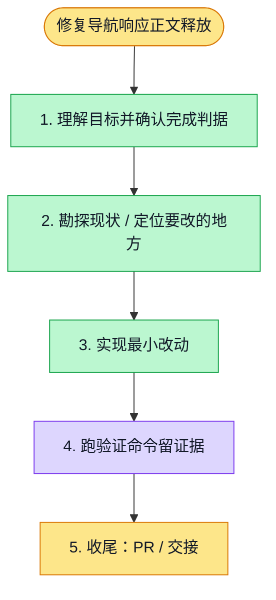

# 执行计划 — 问卷响应生命周期5811

> 规范：`.harness/instructions/execution-plan-visualization.md`。
> 改状态用 `node .harness/scripts/execution-plan.mjs set <本文件> <节点> <状态>`，
> 改完 `check` 一遍；不要手改 classDef 颜色。

## 我理解的目标
- **目标**：修复阻塞支付PR的问卷浏览器响应正文释放。
- **完成判据**：实际R1、webtype/lint、独立源码复核与当前PR必需CI通过。
- **不做什么**：只改问卷验证夹具，不改产品、断言、重试和超时。
- **假设与待确认**：独立PR入main后再更新5796基线。

## 执行计划

图例：⬜ 灰=未开始 · 🟨 黄=已开始 · 🟩 绿=已完成 · 🟪 紫=已测试（有证据） · 🟥 红=被堵塞

## 进度日志（append-only，每次改颜色追加一行）
| 时间 | 节点 | 状态变化 | 依据（命令 / 证据 / 堵塞原因） |
|---|---|---|---|
| 2026-10-18 | G, S1 | todo → doing | 接到目标，开始理解 |
