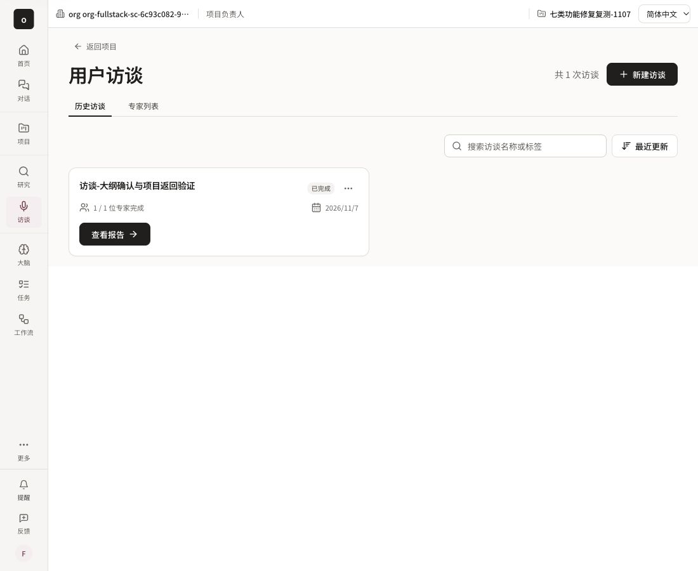

# Authorized Studio project context (#6375)

The real local fullstack browser path began inside project `prj-82e5ebbe-bac5-4ef4-8e04-26784ed289c7`. Query context and return links were correct but the shell said the user was outside a project. The fix admits only allowlisted content routes as candidate context, then confirms the candidate through the current organization's visible project list before displaying its name. It never grants membership, derives roles from the query or displays an unconfirmed internal ID.

- Candidate regression RED: 11 failed, 18 passed.
- Focused author verification: 5 files, 66 passed, including existing organization-switch/admin-role suites.
- Independent verification: 17 focused cases including late old-org response, leaving Studio, stale group/role suppression and query removal. No blocker.
- A subsequent strict TypeScript check found the new two-case table was passed as Vitest argument tuples. Object-shaped cases fix both the type and the real list payload. Corrected tests: 13 passed; focused TypeScript exit 0.
- Real CUA on integrated `e24007df215f51aace0bf74ad9f738175bebf66c`: project interview list displayed the authorized human-readable project name instead of the no-project hint. The screenshot is from real login/API/PostgreSQL. Model, ASR and mail are explicit loopback upstreams; this does not prove production permissions or real-model quality.

Author/reviewer archives and full browser records are preserved in the user's local audit artifact directory. This issue is complete only after required PR checks and protected merge queue integration; code review comments from another session on the same GitHub account are not FormalApproval.
