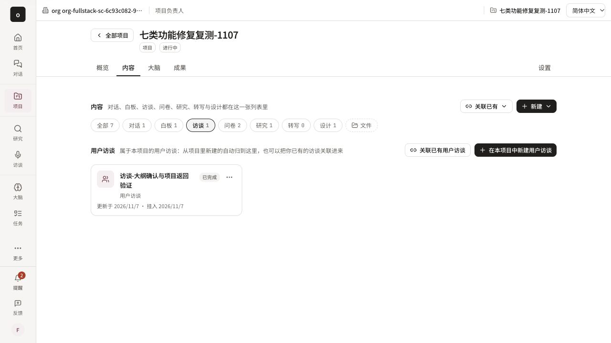

# Canonical project interview status (#6377)

Real CUA created and completed interview `itv-8a5ba8a4-3872-461d-af9a-59ff37c62ee4` in the disposable fullstack project. Interview home correctly showed completion and a report, but the project category card still displayed the raw legacy enum `topic_pending`.

Read-only PG diagnosis confirmed the current canonical revision/execution were complete while the legacy column retained its earlier value. The project read model now uses the existing Markdown history loader and canonical progress projection. Current revision/hash checks, legacy fallback, archive precedence and tenant/project visibility remain in force. The old status column is not rewritten. Project cards reuse the interview home's localized status-label source.

- Actual RED captured the old enum for canonical completion and raw Chinese/English card output.
- Author GREEN: related API/real isolated PG suites 34/34; UI suites 42/42. The reviewer database was dropped after validation.
- Independent GREEN: 12 UI cases and 4 added boundary probes (corrupt hash, legacy-only fallback, derived-only result with exact tenant/interview binding, archive without Markdown reads). Reviewer did not independently rerun PG and does not claim that.
- Exact implementation review: `002ba3867839302aa46bee3ac34569054b7f0f19`; all nine files matched the reviewed patch.
- Real CUA on integrated `d7a7844c26e6ff3184d99340f1c4a5a1dbe4e31b`: the same project interview card now displays localized completion, consistent with interview home. Actual API and PostgreSQL are used; model/ASR/mail/sandbox are explicit loopback upstreams, so no real-model or production-deployment claim is made.

Full integrated checks and required CI still govern merge. Independent same-account session comments are audit evidence, not FormalApproval.
