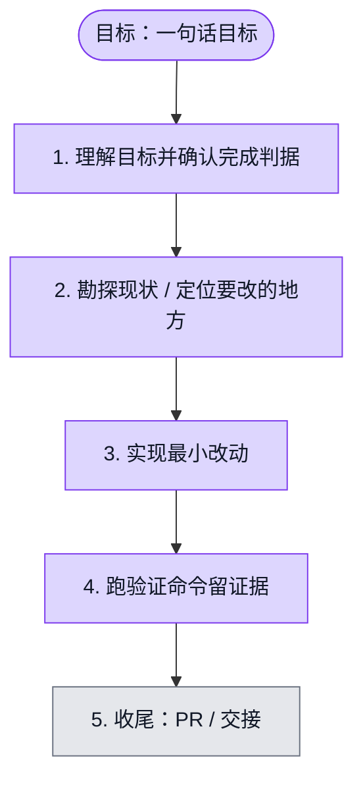

# 执行计划 — #6353 local microphone check

> 规范：`.harness/instructions/execution-plan-visualization.md`。
> 改状态用 `node .harness/scripts/execution-plan.mjs set <本文件> <节点> <状态>`，
> 改完 `check` 一遍；不要手改 classDef 颜色。

## 我理解的目标
- **目标**：显式触发的8秒本地短句检查、真实电平与设备名称、释放与清理
- **完成判据**：定向115项测试、lint、独立Chromium合成音频生命周期验证；命令见handoff.md
- **不做什么**：仅rec工作区、新组件与hook、rec i18n与对应测试；不修改ASR与服务器音频删除
- **假设与待确认**：真人短句准确率和应用壳人工复测由主会话执行

## 执行计划

图例：⬜ 灰=未开始 · 🟨 黄=已开始 · 🟩 绿=已完成 · 🟪 紫=已测试（有证据） · 🟥 红=被堵塞

## 进度日志（append-only，每次改颜色追加一行）
| 时间 | 节点 | 状态变化 | 依据（命令 / 证据 / 堵塞原因） |
|---|---|---|---|
| 2026-11-07 | G, S1 | todo → doing | 接到目标，开始理解 |
