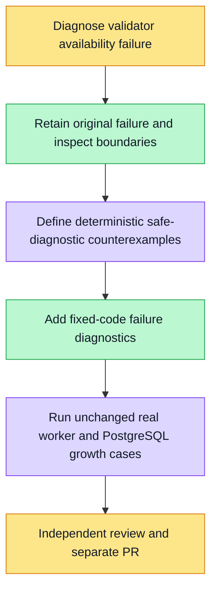

# Validator diagnostic baseline task #5798

Goal: distinguish the observed VALIDATOR_UNAVAILABLE cause without changing validation, deadlines, fresh worker heaps, admission limits, public error codes or financial source. This task does not claim the original failure is fixed.

Directly assigned payment verification is blocked on the baseline; the readiness exception is recorded in issue5798. Original source0579448 failed the imported5k real-PG case after977 successful files; the earlier original occurrence passed. Logs cannot establish the cause.

