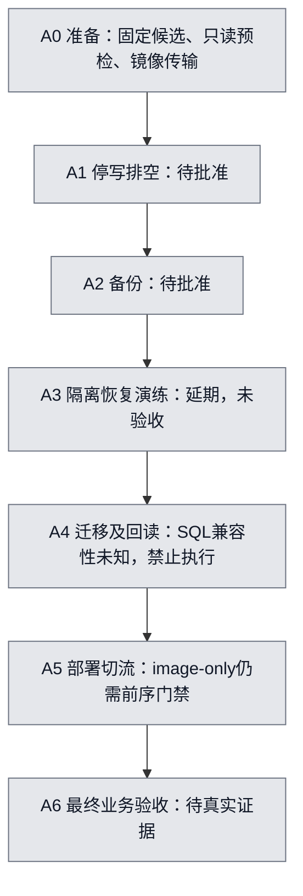

# Fixed-request CN release plan

Canonical plan and seven-step diagram for request `01a0ffe2-1628-7388-8735-7dd051b70032`.
Updated 2026-10-17 UTC for issue #5809. This reuses the existing persistent entry plan location;
previous entries described other candidates/host sessions and do not authorize this request.
No matching fixed-request A0–A6 diagram was found in the existing entry documentation;
the seven labels below come from the user's explicit task, not inferred production evidence.
Historical implementation details remain in [fixed-driver.md](fixed-driver.md).

Source `bc3d1254ce05c915801fb73fe6698072730a051c`; control
`5acebbb6741ed13c6379407aa0529c0eb8695b72`; build
[38852606085](https://github.com/boardx/workspacex/actions/runs/38852606085), attempt 1.
Target Shanghai ECS `i-uf6ga92ewloganobbln6`. These pins never follow main and this increment
never dispatches builds or production workflows. All production steps remain unstarted.

Yellow means actually executing, green completed, purple acceptance evidence, gray not started / awaiting approval.
Mock success never changes the production diagram. A1–A4 are outside this minimal simulation,
**deferred**, not passed or not applicable to the actual candidate. Four migrations include permission
changes; production SQL compatibility remains unknown. No migration is applied, removed or bypassed.

## Implemented boundary and reuse

`python3 scripts/fixed-cn-release.py inspect` is a bounded GitHub metadata read. It checks the exact
control/run/workflow/attempt and all 12 required artifact names, sizes and expiry times. It prints
`ready=false`, never source-byte verification. It does not call the Docker publisher's plan.
`probe-hash` hashes the new probe source without running it. The probe now inspects only current container/image/project/service fields, hashes admitted Compose/downloader files, and performs a bounded loopback API health GET without printing env or body contents. The old missing probe hash
`35fceac81a43100fb7ce84381dcf5e9b6cfd12b6150b0109016a37c98d57c799` grants no authority to this replacement.
New probe source: `scripts/fixed-cn-readonly-probe.sh`, fixed SHA256
`b4545e0f468bff7e381426c8e9670867d84ee0cd48dc85008639de9291855159`.
Any byte change requires fresh review and pin. The new probe has not run on production.

The offline stage engine is test-only Python API; there is deliberately no production adapter, arbitrary
command option, apply CLI or dispatch workflow. Its real CLI publisher integration reuses
`scripts/minimal-docker-release.py` and `tests/test_minimal_docker_release.py` with fake Docker and
loopback HTTP. The fixture now copies five real Docker-save-format tar fixtures through canonical candidate admission, then calls the actual image-only
Compose CLI, verifies health, and creates/reads a synthetic business artifact. This tests orchestration
and failure gates; it does not validate the real archive transfer/importer or production business journeys.
Existing `cn_image_archive.py` / `cn_candidate_publication.py` / `cn-release-fixed-driver.py`
remain the real archive, publication and seven-step authorities. Their gates are not relaxed.

Review of unfinished work: open PR #5504 (`codex/cloud-build-only`) is build-only;
#5768 changes web-only mount comparison, not the five-image route. Read the remote
`codex/cloud-release-oidc` preparation gate and `codex/cn-image-candidates-build-only`
workflow: preparation is privileged; build success is not transfer. No branch was blindly merged,
no replacement build was dispatched, and no existing workflow/production configuration was changed.

## Stage contracts (simulation scope)

| Stage | Input and gate | Timeout | Evidence / recovery |
|---|---|---:|---|
| candidate | fixed source/control/run, unique full artifact inventory, unexpired | 60 s | metadata observation; bytes remain unverified; expired originals block, never rebuild silently |
| readonly-preflight | trusted existing config and env hash snapshots in fixture | 30 s | snapshot hashes; actual host probe separately approved; never run publisher plan as read-only |
| image-transfer | five fixture archives | 120 s | destination byte hashes; actual GitHub→ECS/registry transfer unimplemented pending channel and admission |
| compose-image-only | existing publisher config/manifest, loaded exact image IDs, equal schema inventory | 180 s | existing publisher intent/receipt, one up, no build/pull/data-service change; uncertain writes require readback, no automatic retry |
| health | exact running image IDs and loopback health body | 30 s | publisher HTTP/version receipt; never replaces business acceptance |
| business | synthetic create/read artifact | 60 s | artifact hash, explicitly simulation; production requires canonical journeys/browser/output evidence |

Every stage persists intent before invocation, then exact evidence bytes and hash receipt. Missing,
failed, mismatched or late evidence stops the chain. Exclusive attempt-directory creation rejects
repeated invocation before any adapter call. Preserve incomplete intent and reconcile actual state;
do not retry under a new attempt to conceal uncertain execution. Stage engine supports only a
main-thread isolated process (SIGALRM deadlines), not a resident service. No automatic rollback,
restore, container cleanup or retry on production is introduced.

## Evidence ledger

| UTC observation | SHA / command | Receipt | Meaning |
|---|---|---|---|
| 2026-10-17 03:49–03:55 | `gh api repos/boardx/workspacex/actions/runs/38852606085[/artifacts]` | [metadata.json](evidence/fixed-cn-5809/metadata.json) | exact control and successful run; 12 originals listed, expires 04:50:00–04:57:52 UTC on Oct 17 |
| 2026-10-17 03:51 | artifact 12026330469 download via GitHub API | [availability.json](evidence/fixed-cn-5809/availability.json) | redirected blob GET forbidden; original bytes not obtained; no five-image download attempted |
| 2026-10-17 | pinned pnpm 9.15.0, `npm_config_ignore_scripts=true ./init.sh` (cache paths in verification) | [verification.md](evidence/fixed-cn-5809/verification.md) | basic initialization passed; lifecycle/native build scripts skipped, not full-repo validation |
| 2026-10-17 | test commands / exit codes | [verification.md](evidence/fixed-cn-5809/verification.md) | isolated results only; no production acceptance |

The expiry check always uses the current UTC time and the API flag; this ledger is not a live readiness
claim. After expiry, original artifacts are blockers. Preservation/transfer of originals was not performed.
A replacement build or candidate requires explicit user direction, not automatic fallback.

## Minimum permissions and approval actions still pending

Current work uses only existing GitHub authentication. No Mac channel or keys, Aliyun identity,
IAM/OIDC/token/runner authorization, secret copy or permission expansion is created.

1. GitHub: existing repository read for code, Actions run/artifact read for inventory/download, and
   branch/PR write for review. CI here declares only `contents: read`, uses GitHub-hosted Linux,
   no secrets, no environments, no id-token or self-hosted runner.
2. Separately approve exact new probe bytes and a bounded invocation on this ECS. A future read-only
   channel should scope Describe/command access to the one Shanghai target and command digest;
   an ability to execute arbitrary root commands is broader than a read-only identity. No such channel
   currently exists; do not assume approval or grant it automatically.
3. Separately review and approve toolkit upload/install (exact paths/hash/owner/CAS), then separately
   approve application image upload/import for the five original pinned archives and fixed destination.
   Object write/registry push and host image load are distinct from probe access; retain each receipt.
4. Approve A1–A4 only after actual baseline/env/mount/DB inventory, current-epoch backup, isolated
   recovery and the four migrations' SQL/permission compatibility review. Keep existing env, mounts,
   secrets and database services unchanged. An image-only diff does not exempt these gates.
5. Separately approve A5 exact image-only deployment/cutover after preceding evidence; then A6 real
   business/browser acceptance. An uncertain A5 must be reconciled before separately approved recovery.

None of those production actions is authorized by mock success or this PR. This is a reviewable,
tested orchestration skeleton, not an executable approved end-to-end production release.

## Follow-up adapter completion and exact-head CI correction

The first PR revision lacked implementation glue, not merely credentials: its transfer stage copied
synthetic text and its business stage read a local JSON file. That revision is not the completed
process. The following code is now implemented without production calls:

- `scripts/fixed_cn_bundle.py`: canonical plan/set/tar verification, fixed source/control/run binding,
  five bounded archive copies, reparse/rehash destination, retained partial intent on failure,
  original receipt expiry enforcement, and conversion into the existing image-only publisher manifest.
  `fixed-cn-release.py stage-local --request REQUEST.json` is runnable with local original-format
  inputs. The request has exactly `bundle`, `plan`, `planSha256`, `candidate`,
  `candidateSha256`, `inventory`, `output`. Inventory is an inspect observation no older than five
  minutes. Original independently reviewed hashes are required; no TTL refresh or new build occurs.
- `scripts/fixed_cn_host_commands.py`: exact argv generation for the existing protected host
  download-check/download and publication-check/publication entries. Each takes a separately
  approved SHA; generation does not validate approval, installation or execute anything. Existing
  root entries still enforce the actual authority. No arbitrary shell commands or destinations.
- The real GitHub Docker fixture now traverses all six stages: actual running-image inspection,
  config snapshot, five actual `docker image save` archives and byte-copy verification, actual
  image-only Compose CLI, actual loopback HTTP health, and HTTP retrieval/validation of a synthetic
  report output. It retains `sourceIsBC=false`, synthetic application revision `aaaa…`, and
  `productionAccepted=false`. It exercises the orchestration with real Docker/HTTP, not the real app.

Missing implementation still: automatic remote invocation for this fixed request, binding approved
cloud upload/download/publication outputs into A0–A6, and an approved target-specific business
acceptance driver. These are not just absent configuration. Existing native OSS upload, protected
ECS download/publication and fixed seven-step drivers contain the underlying operations, but their
complete fixed-request connection is not implemented or advertised as runnable. Concrete production
commands cannot be finalized until independently approved original acquisition/policy/SDK/installed
closure/approval hashes and current baseline/SQL evidence exist. No adapter removes those gates.

Original network refusal: `gh api repos/boardx/workspacex/actions/artifacts/12026330469/zip`
redirected to the GitHub Actions artifact store on `productionresultssa12.blob.core.windows.net`
and returned Forbidden. No alternate URL, proxy, unauthenticated fallback or retry was used.
The user would need to authorize the environment's normal authenticated GitHub artifact-blob
network access; this is separate from approved read-only ECS access and from write operations.
At the observed time all 12 API artifacts still reported expired=false; their listed expiration
remains 2026-10-17 04:50:00–04:57:52 UTC, not a claim that they are already expired.

CI correction: run 39000739379 was associated with PR head cc6e0ce58 but default checkout tested
PR merge commit `123c02ea…`, not direct head. Its successful 11+13 tests and old standalone Docker
fixture apply to that merge baseline. The workflow now explicitly checks out
`${{ github.event.pull_request.head.sha }}` for future exact-head tests. Only the new run's observed
result may establish the revised exact-head pass. Full repository checks still use their own
configured checkout baseline; none is relabeled as exact-head.
