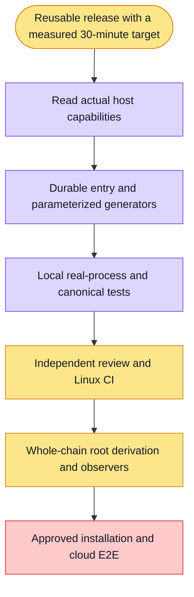

# Persistent CN release entry (#5623)

Implement a bounded executor and parameterized continuation generators on the existing Shanghai runner. Preserve canonical admission and stage bindings. Persist intent before execution, supervise the actual process tree, and reconcile uncertain writes without replay. Complete the one-request whole-chain connection and real public acceptance before claiming the user's goal achieved.

No installation, sudo or IAM change occurs during development. Unknown execution does not permit retries under a different package or stage name. The stage dispatcher and four-phase derivation are implemented; whole-chain approved generation, live readiness and terminal/business observers remain explicit work, not completed production capability.
