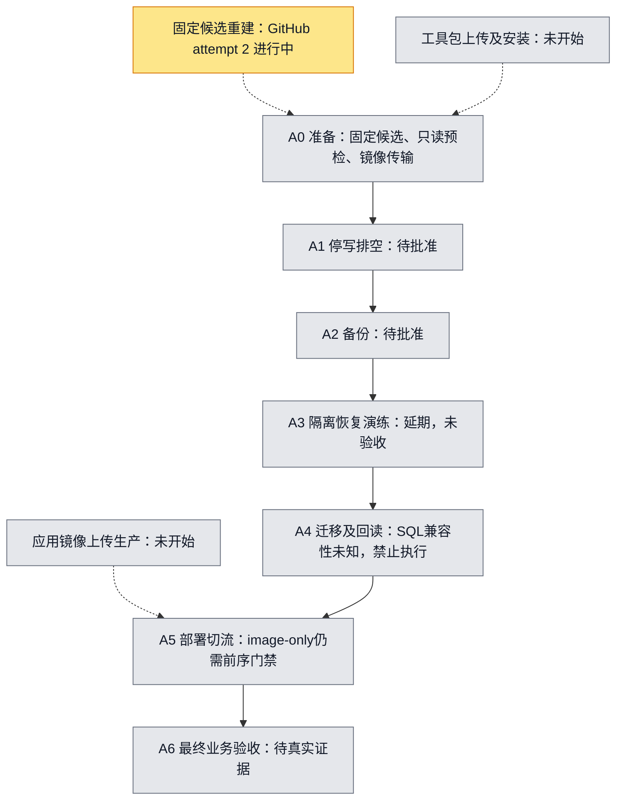

# Fixed-request CN release plan

Canonical plan and seven-step diagram for request `01a0ffe2-1628-7388-8735-7dd051b70032`.
Updated 2026-10-17 UTC for issue #5809. This reuses the existing persistent entry plan location;
previous entries described other candidates/host sessions and do not authorize this request.
No matching fixed-request A0–A6 diagram was found in the existing entry documentation;
the seven labels below come from the user's explicit task, not inferred production evidence.
Historical implementation details remain in [fixed-driver.md](fixed-driver.md).

Source `bc3d1254ce05c915801fb73fe6698072730a051c`; control
`5acebbb6741ed13c6379407aa0529c0eb8695b72`; build
[38852606085](https://github.com/boardx/workspacex/actions/runs/38852606085), original attempt 1 (expired), authorized rebuild attempt 2.
Target Shanghai ECS `i-uf6ga92ewloganobbln6`. These pins never follow main and this increment
never dispatches builds or production workflows. All production steps remain unstarted.

Yellow means actually executing, green completed, purple acceptance evidence, gray not started / awaiting approval.
Mock success never changes the production diagram. A1–A4 are outside this minimal simulation,
**deferred**, not passed or not applicable to the actual candidate. Four migrations include permission
changes; production SQL compatibility remains unknown. No migration is applied, removed or bypassed.

## Implemented boundary and reuse

`python3 scripts/fixed-cn-release.py inspect` is a bounded GitHub metadata read. It checks the exact
control/run/workflow/attempt and all 12 required artifact names, sizes and expiry times. It prints
`ready=false`, never source-byte verification. It does not call the Docker publisher's plan.
`probe-hash` hashes the new probe source without running it. The probe now inspects only current container/image/project/service fields, hashes admitted Compose/downloader files, and performs a bounded loopback API health GET without printing env or body contents. The old missing probe hash
`35fceac81a43100fb7ce84381dcf5e9b6cfd12b6150b0109016a37c98d57c799` grants no authority to this replacement.
New probe source: `scripts/fixed-cn-readonly-probe.sh`, fixed SHA256
`b4545e0f468bff7e381426c8e9670867d84ee0cd48dc85008639de9291855159`.
Any byte change requires fresh review and pin. The new probe has not run on production.

The offline stage engine is test-only Python API. Separate, explicitly approved library adapters
are described below; there is no arbitrary command option, production apply CLI or dispatch workflow. Its real CLI publisher integration reuses
`scripts/minimal-docker-release.py` and `tests/test_minimal_docker_release.py` with fake Docker and
loopback HTTP. The fixture now copies five real Docker-save-format tar fixtures through canonical candidate admission, then calls the actual image-only
Compose CLI, verifies health, and creates/reads a synthetic business artifact. This tests orchestration
and failure gates; it does not validate the real archive transfer/importer or production business journeys.
Existing `cn_image_archive.py` / `cn_candidate_publication.py` / `cn-release-fixed-driver.py`
remain the real archive, publication and seven-step authorities. Their gates are not relaxed.

Review of unfinished work: open PR #5504 (`codex/cloud-build-only`) is build-only;
#5768 changes web-only mount comparison, not the five-image route. Read the remote
`codex/cloud-release-oidc` preparation gate and `codex/cn-image-candidates-build-only`
workflow: preparation is privileged; build success is not transfer. No branch was blindly merged,
no replacement build was dispatched, and no existing workflow/production configuration was changed.

## Stage contracts (simulation scope)

| Stage | Input and gate | Timeout | Evidence / recovery |
|---|---|---:|---|
| candidate | fixed source/control/run, unique full artifact inventory, unexpired | 60 s | metadata observation; bytes remain unverified; expired originals block, never rebuild silently |
| readonly-preflight | trusted existing config and env hash snapshots in fixture | 30 s | snapshot hashes; actual host probe separately approved; never run publisher plan as read-only |
| image-transfer | five fixture archives | 120 s | destination byte hashes; actual fixed-driver transfer adapter implemented; original bytes/channel/admission remain blocked |
| compose-image-only | existing publisher config/manifest, loaded exact image IDs, equal schema inventory | 180 s | existing publisher intent/receipt, one up, no build/pull/data-service change; uncertain writes require readback, no automatic retry |
| health | exact running image IDs and loopback health body | 30 s | publisher HTTP/version receipt; never replaces business acceptance |
| business | synthetic create/read artifact | 60 s | artifact hash, explicitly simulation; production requires canonical journeys/browser/output evidence |

Every stage persists intent before invocation, then exact evidence bytes and hash receipt. Missing,
failed, mismatched or late evidence stops the chain. Exclusive attempt-directory creation rejects
repeated invocation before any adapter call. Preserve incomplete intent and reconcile actual state;
do not retry under a new attempt to conceal uncertain execution. Stage engine supports only a
main-thread isolated process (SIGALRM deadlines), not a resident service. No automatic rollback,
restore, container cleanup or retry on production is introduced.

## Evidence ledger

| UTC observation | SHA / command | Receipt | Meaning |
|---|---|---|---|
| 2026-10-17 03:49–03:55 | `gh api repos/boardx/workspacex/actions/runs/38852606085[/artifacts]` | [metadata.json](evidence/fixed-cn-5809/metadata.json) | exact control and successful run; 12 originals listed, expires 04:50:00–04:57:52 UTC on Oct 17 |
| 2026-10-17 03:51 | artifact 12026330469 download via GitHub API | [availability.json](evidence/fixed-cn-5809/availability.json) | redirected blob GET forbidden; original bytes not obtained; no five-image download attempted |
| 2026-10-17 | pinned pnpm 9.15.0, `npm_config_ignore_scripts=true ./init.sh` (cache paths in verification) | [verification.md](evidence/fixed-cn-5809/verification.md) | basic initialization passed; lifecycle/native build scripts skipped, not full-repo validation |
| 2026-10-17 | test commands / exit codes | [verification.md](evidence/fixed-cn-5809/verification.md) | isolated results only; no production acceptance |

The expiry check always uses the current UTC time and the API flag; this ledger is not a live readiness
claim. After expiry, original artifacts are blockers. Preservation/transfer of originals was not performed.
A replacement build or candidate requires explicit user direction, not automatic fallback.

## Minimum permissions and approval actions still pending

Current work uses only existing GitHub authentication. No Mac channel or keys, Aliyun identity,
IAM/OIDC/token/runner authorization, secret copy or permission expansion is created.

1. GitHub: existing repository read for code, Actions run/artifact read for inventory/download, and
   branch/PR write for review. CI here declares only `contents: read`, uses GitHub-hosted Linux,
   no secrets, no environments, no id-token or self-hosted runner.
2. Separately approve exact new probe bytes and a bounded invocation on this ECS. A future read-only
   channel should scope Describe/command access to the one Shanghai target and command digest;
   an ability to execute arbitrary root commands is broader than a read-only identity. No such channel
   currently exists; do not assume approval or grant it automatically.
3. Separately review and approve toolkit upload/install (exact paths/hash/owner/CAS), then separately
   approve application image upload/import for the five original pinned archives and fixed destination.
   Object write/registry push and host image load are distinct from probe access; retain each receipt.
4. Approve A1–A4 only after actual baseline/env/mount/DB inventory, current-epoch backup, isolated
   recovery and the four migrations' SQL/permission compatibility review. Keep existing env, mounts,
   secrets and database services unchanged. An image-only diff does not exempt these gates.
5. Separately approve A5 exact image-only deployment/cutover after preceding evidence; then A6 real
   business/browser acceptance. An uncertain A5 must be reconciled before separately approved recovery.

None of those production actions is authorized by mock success or this PR. This is reviewable adapter code with isolated evidence; it is not an approved or verified production release.

## Follow-up adapter completion and exact-head CI correction

The first PR revision lacked implementation glue, not merely credentials: its transfer stage copied
synthetic text and its business stage read a local JSON file. That revision is not the completed
process. The following code is now implemented without production calls:

- `scripts/fixed_cn_bundle.py`: canonical plan/set/tar verification, fixed source/control/run binding,
  five bounded archive copies, reparse/rehash destination, retained partial intent on failure,
  original receipt expiry enforcement, and conversion into the existing image-only publisher manifest.
  `fixed-cn-release.py stage-local --request REQUEST.json` is runnable with local original-format
  inputs. The request has exactly `bundle`, `plan`, `planSha256`, `candidate`,
  `candidateSha256`, `inventory`, `output`. Inventory is an inspect observation no older than five
  minutes. Original independently reviewed hashes are required; no TTL refresh or new build occurs.
- `scripts/fixed_cn_host_commands.py`: exact argv generation for the existing protected host
  download-check/download and publication-check/publication entries. Each takes a separately
  approved SHA; generation does not validate approval, installation or execute anything. Existing
  root entries still enforce the actual authority. No arbitrary shell commands or destinations.
- The real GitHub Docker fixture now traverses all six stages: actual running-image inspection,
  config snapshot, five actual `docker image save` archives and byte-copy verification, actual
  image-only Compose CLI, actual loopback HTTP health, and HTTP retrieval/validation of a synthetic
  report output. It retains `sourceIsBC=false`, synthetic application revision `aaaa…`, and
  `productionAccepted=false`. It exercises the orchestration with real Docker/HTTP, not the real app.

The three earlier implementation gaps are now implemented in `scripts/fixed_cn_remote.py` and
`scripts/fixed_cn_receipts.py`; they are effectful library adapters, not production calls made by this PR.
The existing fixed root driver still owns acquisition/publication and A0–A6. No new runner or authority
is introduced. Runtime readiness remains unverified until independently approved originals, existing
credential capability, installed protected closure, baseline/SQL evidence and A5 approval exist.

Original network refusal: `gh api repos/boardx/workspacex/actions/artifacts/12026330469/zip`
redirected to the GitHub Actions artifact store on `productionresultssa12.blob.core.windows.net`
and returned Forbidden. No alternate URL, proxy, unauthenticated fallback or retry was used.
The user would need to authorize the environment's normal authenticated GitHub artifact-blob
network access; this is separate from approved read-only ECS access and from write operations.
At the observed time all 12 API artifacts still reported expired=false; their listed expiration
remains 2026-10-17 04:50:00–04:57:52 UTC, not a claim that they are already expired.

CI correction: run 39000739379 was associated with PR head cc6e0ce58 but default checkout tested
PR merge commit `123c02ea…`, not direct head. Its successful 11+13 tests and old standalone Docker
fixture apply to that merge baseline. The workflow now explicitly checks out
`${{ github.event.pull_request.head.sha }}` for future exact-head tests. Only the new run's observed
result may establish the revised exact-head pass. Full repository checks still use their own
configured checkout baseline; none is relabeled as exact-head.

## Executable remote and business adapters (current revision)

`fixed_cn_remote.EcsRpc.from_existing_credential(existing_credential, approved_principal_arn)`
constructs the official SDK with explicit existing credentials, HTTPS endpoint pinning, disabled
redirects/proxies/retries, and a bounded STS GetCallerIdentity check for the exact approved principal
and account. It does not discover default credentials, create tokens, IAM, OIDC, policies or runners.
Its mutation API is only RunCommand on the one Shanghai ECS; its result API is only
DescribeInvocationResults. RunCommand accepts only a fixed protected-entry command generated from
reviewed inputs. There is no arbitrary shell command field or production CLI dispatch.

`fixed_cn_remote.execute(...)` consumes an independently pinned
`fixed-cn-transport-approval-v1` packet and the original plan. Required fields are visible in `admit`:
fixed source/control/run/target, approved principal, operation/sequence, original plan/set hashes,
protected-entry approval hash, tool revision, command hash, bounded issue/expiry/maxSeconds,
predecessor hash and user-authorization evidence hash. These packets are consumed, never issued by
this code. The host's independent protected root approvals remain mandatory.

The executor fsyncs approval/intent before one RunCommand, uses the packet hash as the provider's
**idempotency request key** (not an authentication token), persists invocation IDs, polls only those
IDs/target, rejects foreign/duplicate/truncated/nonzero/late results and hashes original output.
Lost submission responses preserve an uncertain journal with no resubmit or cancellation.
`reconcile` requires the original approval pin and only queries a known persisted invocation;
an absent ack requires independent provider reconciliation. A repeated output directory rejects
before any remote call. No toolkit upload or installation is mixed into these operations.

`fixed_cn_receipts.run_approved_pipeline(...)` is the actual callable orchestration entry:

1. Validate the separately approved original root release and A5 writer approval, plan/set/provenance
   pins, exact original build run, fixed identity and **pinned canonical migration-diff evidence**.
   Unknown, changed or migration-required SQL is rejected before any RPC. This runtime image-only
   route does not apply, remove or bypass the four migrations; a migration release remains a separate
   approved route. Current real compatibility is still unknown and therefore blocked.
2. Consume the approved `release-run` packet and invoke `/usr/local/bin/workspacex-cn-fixed-release`.
   The existing driver owns its complete ordered 17 stages, including backups, hold/clear and actual
   six-journey execution. A waiting/A5/partial/MVP response stops; the adapter does not advance it.
3. Make two separately approved `business-readback` calls through the already protected canonical
   observer. These read existing owned-run/terminal state, never log in or repeat journeys. Distinct
   sequence values produce distinct approved request keys and invocation IDs. The fixed observer
   path is bound to the approved installed tool revision. `@previous` is supported only for these
   read-only packets; each actual predecessor hash is derived from the preceding validated receipt.
4. Strictly consume the unchanged canonical business receipt, all six exact checks, three distinct
   owned runs, stable-window/live-inventory hashes, A5 binding/hold/switch identity, original clock
   and ordered root-stage evidence. A health response or handwritten passed flag is insufficient.
   The result reports only `sixJourneyReceiptFieldsValid` and `canonicalReadbackBytesMatch`;
   `productionAccepted=false` is mandatory. Offline JSON validation does not authenticate its source.

Callers supply the existing credential capability, original approved input bytes/pins, the three
approved transport packet tuples, original root/A5/provenance/migration bytes, original authorization
evidence bytes (`authorization_evidence_raw`), and a new output folder. Tests show the exact call in `tests/test_fixed_cn_remote.py`. The PR workflow only runs those
isolated tests; it never constructs a live credential object or invokes this production entry.

**Remaining blockers are runtime inputs/access and verification**, rather than those three adapters:
original artifact bytes/independent provenance, restored normal authenticated GitHub artifact-blob
read access, existing approved principal/channel, root-installed exact driver/SDK/browser closure,
protected independent approvals, current baseline and genuine SQL compatibility/restore/readback
proof. Full canonical journeys and provider behavior have not been exercised on production. The
existing root preflight may discover additional target capability gaps; those must stop the chain.
No production step changes color on the strength of the isolated protocol tests.

Protocol references checked against the official API contract:
[RunCommand](https://www.alibabacloud.com/help/en/ecs/developer-reference/api-ecs-2014-05-26-runcommand),
[DescribeInvocationResults](https://www.alibabacloud.com/help/en/ecs/developer-reference/api-ecs-2014-05-26-describeinvocationresults).
This is not a proposal to grant those permissions: none was created or expanded.

## Independent takeover review (2026-10-17)

Remote `e147fbb975a9eb9acd6d3904ec64784466213ac1` was verified as one commit ahead of
`e2cd22818c1f0a9a41efbcc71e0a75d2424d5424`, with the latter as merge base. Its changes
were retained in an independent cloud worktree. Dedicated exact-head CI
[39003972970](https://github.com/boardx/workspacex/actions/runs/39003972970) passed
16+8+11+13 tests and the real Docker six-stage fixture (synthetic source, no production acceptance).

The independent review adds these gates and recovery behavior:

- Every effectful `execute` call must receive original root-entry approval bytes and original user
  authorization evidence bytes. Hash, candidate-set, plan, target and fixed source/control bindings
  are checked before creating output or making RPC calls. The implemented execution authority
  supports only the fixed root driver and canonical business readback; four low-level download/
  publication operations still offer argv generation but fail execution authority admission. The
  root driver owns those transfers. No generic root command channel is introduced.
- All three packet principals and the current A5 approval window are checked before the first RPC.
  SDK debug mode is rejected before importing the SDK or making an identity call.
- A verified failed process retains bounded original stdout and a private failed-command record.
  In particular the actual driver's exit-2 `WAITING_FOR_WRITER_APPROVAL` stops without readbacks,
  a success receipt, automatic retry, cancellation or a release-complete claim. Unknown/truncated/
  mismatched outcomes still retain uncertainty. Process termination does not prove release terminality.
- The one-shot pipeline requires an already valid independently installed A5 approval. A first run
  awaiting that approval is a distinct reviewed phase; inspect its persisted failed output and actual
  host state, obtain the independently scoped A5 approval, then separately approve any continuation.
  Never invent future switch/hold hashes or automatically resubmit a waiting/uncertain command.
- `reconcile` queries only the persisted invocation, verifies actual start/finish within the original
  approval window, and restores exact missing local output/success receipt bytes without overwrite.
  It may retrieve a timely original execution after approval expiry, but never starts or advances a
  stage. Offline receipt validation uses the original completion time; new execution still requires
  a currently valid approval. All journals remain local evidence, not signed attestations.
- `business()` is a pure structural/byte validator and returns no A6-verified claim. Only the effectful
  pipeline adds `providerQueriesPerformed=true`, and that is still not production acceptance. Its RPC
  capability must come from the explicit authenticated official SDK adapter in a protected runtime;
  injected fixture clients or caller-supplied JSON do not establish live provider provenance.

Original artifacts are now incomplete: at 04:57:39 UTC only the candidate-set metadata ZIP was listed,
with the other eleven required entries absent. The remaining set listed expiry 04:57:52 UTC. See
[artifact-incomplete.json](evidence/fixed-cn-5809/artifact-incomplete.json). No original bytes were
downloaded, preserved, replaced or rebuilt. This is an independent hard blocker in addition to the
prior Forbidden response. A0–A6 remain gray; toolkit upload/install and application image transfer
are separately unexecuted. Four SQL migrations remain unknown and blocked.

Takeover test commands, failures and final results are in the verification receipt. The coordination
lease was not claimed: `harness tick` failed because COORD_GATEWAY_URL is absent. No credential or
permission was created to repair it. The user-directed scope remains PR #5810 / issue #5809.

### Final artifact and invocation boundary update

The parent independently observed an empty artifact list at 05:03 UTC. This worktree's read-only
GitHub connector recheck at **2026-10-17 05:09:11 UTC** also returned `artifacts: []` for build
38852606085: [artifact-empty.json](evidence/fixed-cn-5809/artifact-empty.json). The earlier one-entry
snapshot remains historical evidence, not availability. No byte download was retried. Recovering
approved original bytes or explicitly choosing a new candidate/build is a future user decision;
the implementation never substitutes either automatically.

The callable main path is `fixed_cn_receipts.run_approved_pipeline`: its approved `release-run`
invokes the already protected fixed root driver, whose ordered `consume`, `publication-stage`,
`check-plan`, `publish` stages reuse canonical acquisition/publication before the later A0–A6 gates.
Two separately approved readbacks follow only after full driver completion. Toolkit installation,
installed SDK/browser closure and all fixed host requests/approvals must already exist. The four
low-level download/publication operations are **argv-only** in this increment: direct `execute`
rejects them with `REMOTE_ENTRY_AUTHORITY_UNSUPPORTED`. They are not standalone runnable adapters,
and they are not required by the main path because the protected root driver owns those effects.

Code source `44bdd04b16dde9eb3fa920a3e68e0ca1e951ea6b` passed direct-head CI
[39004591383](https://github.com/boardx/workspacex/actions/runs/39004591383): 55 isolated tests and
the real Docker six-stage fixture; checkout/git-log lines confirmed that SHA. The fixture reports
`sourceIsBC=false`, `productionAccepted=false`, `cleanupVerified=true`. This final update changes
documentation/evidence only. Repository-wide CI and direct-head results are kept distinct in the
same draft PR; no production node changes color.

## Same-source rebuild authorization and production gate check (2026-10-17)

The user now explicitly authorized continuing and one ordinary release after the expired same-source
rebuild, subject to all existing gates. This supersedes the earlier no-rebuild instruction for this
fixed source only; it grants no new IAM/runner/credential/probe/toolkit installation/SQL authority.
Application source remains BC and control remains 5ace. Main and PR source are not candidates.

Duplicate readback found original build run 38852606085 attempt 1 completed/success and no fixed
release workflow runs. The original plan log (job 116816952492) confirmed the exact BC source,
5ace control and original pinned bases/source contracts. Current main differs, so dispatching the
main-only workflow would not preserve fixed control. Instead one full rerun of the existing build-only
run was submitted at 10:46 UTC. GitHub preserves original SHA/ref/inputs/privileges for reruns.
Submission returned exit 0 and `{}`; independent readback confirmed **attempt 2** queued then running,
with unchanged head SHA. [Build attempt 2](https://github.com/boardx/workspacex/actions/runs/38852606085/attempts/2).
The exclusive local intent and submission response are preserved in
[evidence/fixed-bc-rebuild-20261017](evidence/fixed-bc-rebuild-20261017/intent.json). No second submit,
production run, workflow dispatch from moving main, debug logging or security-setting change occurred.

The fixed-request metadata, archive and provenance adapters now pin `RUN_ATTEMPT=2` in one source
constant, not either attempt or a moving latest value. Original attempt-1 inventories/provenance
remain rejected. Fresh plan/set hashes and root-installed approvals will be required; no old receipt
or TTL is relabeled as current. This source-only change does not install the adapters on production.

Channel checks are **blocked/unverified**, not evidence that an identity or runner is absent:

- `GET /repos/boardx/workspacex/actions/secrets` returned HTTP 403, Resource not accessible by
  integration. No retry, alternate secrets endpoint, token creation or permission expansion.
- `GET /repos/boardx/workspacex/actions/runners` returned the same HTTP 403. No retry or runner change.
- Existing environment metadata shows production-cn-promotion requires reviewer approval plus a
  branch policy. The existing fixed release workflow uses the dedicated self-hosted
  `workspacex-cn-production` runner and a separately approved root-installed `release_sha256`.
  Neither actual runner availability nor a matching fresh root approval/installed closure is proven.
- The four migration compatibility results remain unknown. The ordinary image-only approval cannot
  authorize migration, RLS/GRANT changes, data cleanup, new credentials or a new probe.

Therefore production mutation is stopped at its prerequisite gate while the independent build and
artifact verification proceed. Seven production steps remain gray. Build artifacts stored on GitHub,
toolkit transfer/install, application-image transfer and production execution are distinct states.
The final six business journeys remain required. The rebuild alone cannot establish production readiness.
