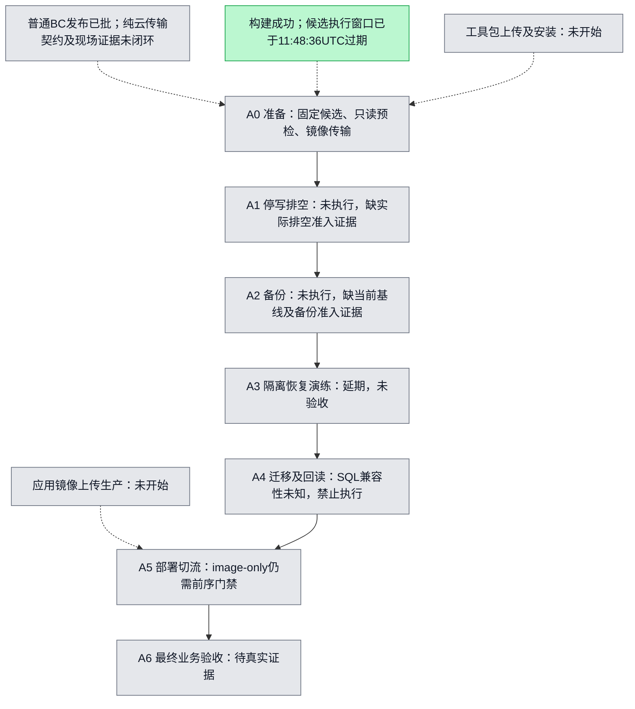

# Fixed-request CN release plan

Canonical plan and seven-step diagram for request `01a0ffe2-1628-7388-8735-7dd051b70032`.
Updated 2026-10-17 UTC for issue #5809. This reuses the existing persistent entry plan location;
previous entries described other candidates/host sessions and do not authorize this request.
No matching fixed-request A0–A6 diagram was found in the existing entry documentation;
the seven labels below come from the user's explicit task, not inferred production evidence.
Historical implementation details remain in [fixed-driver.md](fixed-driver.md).

Source `bc3d1254ce05c915801fb73fe6698072730a051c`; control
`5acebbb6741ed13c6379407aa0529c0eb8695b72`; build
[38852606085](https://github.com/boardx/workspacex/actions/runs/38852606085), original attempt 1 (expired), authorized rebuild attempt 2.
Target Shanghai ECS `i-uf6ga92ewloganobbln6`. These pins never follow main and this increment
never dispatches builds or production workflows. All production steps remain unstarted.

本图按用户指定只使用四种状态：黄=实际执行；灰=未开始、具体权限/门禁证据未具备；绿=完成；紫=有验收证据。
普通固定 BC 发布已获用户批准，不重复等待普通发布批准。C0 的灰色表示具体依赖阻塞，原因见节点下方说明及本文门禁清单。
构建完成只标 B0 绿色；生产 A0–A6 均为灰色，没有生产验收紫色。
Mock success never changes the production diagram. A1–A4 are outside this minimal simulation,
**deferred**, not passed or not applicable to the actual candidate. Four migrations include permission
changes; production SQL compatibility remains unknown. No migration is applied, removed or bypassed.

## Implemented boundary and reuse

`python3 scripts/fixed-cn-release.py inspect` is a bounded GitHub metadata read. It checks the exact
control/run/workflow/attempt and all 12 required artifact names, sizes and expiry times. It prints
`ready=false`, never source-byte verification. It does not call the Docker publisher's plan.
`probe-hash` hashes the new probe source without running it. The probe now inspects only current container/image/project/service fields, hashes admitted Compose/downloader files, and performs a bounded loopback API health GET without printing env or body contents. The old missing probe hash
`35fceac81a43100fb7ce84381dcf5e9b6cfd12b6150b0109016a37c98d57c799` grants no authority to this replacement.
New probe source: `scripts/fixed-cn-readonly-probe.sh`, fixed SHA256
`b4545e0f468bff7e381426c8e9670867d84ee0cd48dc85008639de9291855159`.
Any byte change requires fresh review and pin. The new probe has not run on production.

The offline stage engine is test-only Python API. Separate, explicitly approved library adapters
are described below; there is no arbitrary command option, production apply CLI or dispatch workflow. Its real CLI publisher integration reuses
`scripts/minimal-docker-release.py` and `tests/test_minimal_docker_release.py` with fake Docker and
loopback HTTP. The fixture now copies five real Docker-save-format tar fixtures through canonical candidate admission, then calls the actual image-only
Compose CLI, verifies health, and creates/reads a synthetic business artifact. This tests orchestration
and failure gates; it does not validate the real archive transfer/importer or production business journeys.
Existing `cn_image_archive.py` / `cn_candidate_publication.py` / `cn-release-fixed-driver.py`
remain the real archive, publication and seven-step authorities. Their gates are not relaxed.

Review of unfinished work: open PR #5504 (`codex/cloud-build-only`) is build-only;
#5768 changes web-only mount comparison, not the five-image route. Read the remote
`codex/cloud-release-oidc` preparation gate and `codex/cn-image-candidates-build-only`
workflow: preparation is privileged; build success is not transfer. No branch was blindly merged,
no replacement build was dispatched, and no existing workflow/production configuration was changed.

## Stage contracts (simulation scope)

| Stage | Input and gate | Timeout | Evidence / recovery |
|---|---|---:|---|
| candidate | fixed source/control/run, unique full artifact inventory, unexpired | 60 s | metadata observation; bytes remain unverified; expired originals block, never rebuild silently |
| readonly-preflight | trusted existing config and env hash snapshots in fixture | 30 s | snapshot hashes; actual host probe separately approved; never run publisher plan as read-only |
| image-transfer | five fixture archives | 120 s | destination byte hashes; actual fixed-driver transfer adapter implemented; original bytes/channel/admission remain blocked |
| compose-image-only | existing publisher config/manifest, loaded exact image IDs, equal schema inventory | 180 s | existing publisher intent/receipt, one up, no build/pull/data-service change; uncertain writes require readback, no automatic retry |
| health | exact running image IDs and loopback health body | 30 s | publisher HTTP/version receipt; never replaces business acceptance |
| business | synthetic create/read artifact | 60 s | artifact hash, explicitly simulation; production requires canonical journeys/browser/output evidence |

Every stage persists intent before invocation, then exact evidence bytes and hash receipt. Missing,
failed, mismatched or late evidence stops the chain. Exclusive attempt-directory creation rejects
repeated invocation before any adapter call. Preserve incomplete intent and reconcile actual state;
do not retry under a new attempt to conceal uncertain execution. Stage engine supports only a
main-thread isolated process (SIGALRM deadlines), not a resident service. No automatic rollback,
restore, container cleanup or retry on production is introduced.

## Evidence ledger

| UTC observation | SHA / command | Receipt | Meaning |
|---|---|---|---|
| 2026-10-17 03:49–03:55 | `gh api repos/boardx/workspacex/actions/runs/38852606085[/artifacts]` | [metadata.json](evidence/fixed-cn-5809/metadata.json) | exact control and successful run; 12 originals listed, expires 04:50:00–04:57:52 UTC on Oct 17 |
| 2026-10-17 03:51 | artifact 12026330469 download via GitHub API | [availability.json](evidence/fixed-cn-5809/availability.json) | redirected blob GET forbidden; original bytes not obtained; no five-image download attempted |
| 2026-10-17 | pinned pnpm 9.15.0, `npm_config_ignore_scripts=true ./init.sh` (cache paths in verification) | [verification.md](evidence/fixed-cn-5809/verification.md) | basic initialization passed; lifecycle/native build scripts skipped, not full-repo validation |
| 2026-10-17 | test commands / exit codes | [verification.md](evidence/fixed-cn-5809/verification.md) | isolated results only; no production acceptance |

The expiry check always uses the current UTC time and the API flag; this ledger is not a live readiness
claim. After expiry, original artifacts are blockers. Preservation/transfer of originals was not performed.
A replacement build or candidate requires explicit user direction, not automatic fallback.

## Ordinary release approved; specific permission and evidence gates remain

Current work uses only existing GitHub authentication. No Mac channel or keys, Aliyun identity,
IAM/OIDC/token/runner authorization, secret copy or permission expansion is created.

1. GitHub: existing repository read for code, Actions run/artifact read for inventory/download, and
   branch/PR write for review. CI here declares only `contents: read`, uses GitHub-hosted Linux,
   no secrets, no environments, no id-token or self-hosted runner.
2. 普通固定 BC 发布已获用户批准；新的探针执行不在该普通批准内。当前没有已验证的固定 ECS
   只读通道证据，不能将 secrets/runner 元数据读取 403 解释为通道不存在，也不能自动创建通道、
   新凭据或扩大权限。若需新探针，仍缺该探针精确字节及有界执行范围的独立批准。
3. 工具包上传/安装尚缺精确路径、哈希、owner/CAS 及根安装准入回执；应用镜像上传/导入尚缺
   原始制品字节、匹配哈希、固定目标和受保护入口的范围绑定。两者分开记录，不重复询问普通发布
   批准，也不把普通批准当作工具安装、对象写入或镜像导入所需安全权限的替代。
4. A1–A4 均未执行。缺实际 baseline/env/mount/DB 清单、当前 epoch 的排空及备份证据、隔离恢复
   证据和四份 SQL/权限兼容性证据。保持现有 env、挂载、密钥及数据库服务不变；普通镜像发布
   批准不授权数据库迁移、RLS/GRANT 调整或数据清理。
5. A5 普通固定版本 image-only 发布/切流的用户批准已记录；尚缺前序门禁、匹配的新根批准对象及
   已安装闭包证据，故未调用。A6 仍须完整真实业务/浏览器验收，不缩减六条旅程。若 A5 状态不确定，
   先按原意图只读对账，不能自动重放；恢复动作也不能借普通发布批准自动执行。

Mock success and this PR neither grant additional safety permissions nor satisfy these evidence gates.
The ordinary fixed-BC release has user authorization; this document does not ask for it again.
Implementation, completed builds, isolated tests and production acceptance remain distinct.

## Follow-up adapter completion and exact-head CI correction

The first PR revision lacked implementation glue, not merely credentials: its transfer stage copied
synthetic text and its business stage read a local JSON file. That revision is not the completed
process. The following code is now implemented without production calls:

- `scripts/fixed_cn_bundle.py`: canonical plan/set/tar verification, fixed source/control/run binding,
  five bounded archive copies, reparse/rehash destination, retained partial intent on failure,
  original receipt expiry enforcement, and conversion into the existing image-only publisher manifest.
  `fixed-cn-release.py stage-local --request REQUEST.json` is runnable with local original-format
  inputs. The request has exactly `bundle`, `plan`, `planSha256`, `candidate`,
  `candidateSha256`, `inventory`, `output`. Inventory is an inspect observation no older than five
  minutes. Original independently reviewed hashes are required; no TTL refresh or new build occurs.
- `scripts/fixed_cn_host_commands.py`: exact argv generation for the existing protected host
  download-check/download and publication-check/publication entries. Each takes a separately
  approved SHA; generation does not validate approval, installation or execute anything. Existing
  root entries still enforce the actual authority. No arbitrary shell commands or destinations.
- The real GitHub Docker fixture now traverses all six stages: actual running-image inspection,
  config snapshot, five actual `docker image save` archives and byte-copy verification, actual
  image-only Compose CLI, actual loopback HTTP health, and HTTP retrieval/validation of a synthetic
  report output. It retains `sourceIsBC=false`, synthetic application revision `aaaa…`, and
  `productionAccepted=false`. It exercises the orchestration with real Docker/HTTP, not the real app.

The three earlier implementation gaps are now implemented in `scripts/fixed_cn_remote.py` and
`scripts/fixed_cn_receipts.py`; they are effectful library adapters, not production calls made by this PR.
The existing fixed root driver owns acquisition/publication and its seventeen normal stages.
It does not itself establish A3 isolated-restore acceptance or the missing A4 compatibility decision;
those original-scope gates must be independently closed. No new runner or authority is introduced. Runtime readiness remains unverified until independently approved originals, existing
credential capability, installed protected closure, baseline/SQL evidence and A5 approval exist.

Original network refusal: `gh api repos/boardx/workspacex/actions/artifacts/12026330469/zip`
redirected to the GitHub Actions artifact store on `productionresultssa12.blob.core.windows.net`
and returned Forbidden. No alternate URL, proxy, unauthenticated fallback or retry was used.
The user would need to authorize the environment's normal authenticated GitHub artifact-blob
network access; this is separate from approved read-only ECS access and from write operations.
At the observed time all 12 API artifacts still reported expired=false; their listed expiration
remains 2026-10-17 04:50:00–04:57:52 UTC, not a claim that they are already expired.

CI correction: run 39000739379 was associated with PR head cc6e0ce58 but default checkout tested
PR merge commit `123c02ea…`, not direct head. Its successful 11+13 tests and old standalone Docker
fixture apply to that merge baseline. The workflow now explicitly checks out
`${{ github.event.pull_request.head.sha }}` for future exact-head tests. Only the new run's observed
result may establish the revised exact-head pass. Full repository checks still use their own
configured checkout baseline; none is relabeled as exact-head.

## Executable remote and business adapters (current revision)

`fixed_cn_remote.EcsRpc.from_existing_credential(existing_credential, approved_principal_arn)`
constructs the official SDK with explicit existing credentials, HTTPS endpoint pinning, disabled
redirects/proxies/retries, and a bounded STS GetCallerIdentity check for the exact approved principal
and account. It does not discover default credentials, create tokens, IAM, OIDC, policies or runners.
Its mutation API is only RunCommand on the one Shanghai ECS; its result API is only
DescribeInvocationResults. RunCommand accepts only a fixed protected-entry command generated from
reviewed inputs. There is no arbitrary shell command field or production CLI dispatch.

`fixed_cn_remote.execute(...)` consumes an independently pinned
`fixed-cn-transport-approval-v1` packet and the original plan. Required fields are visible in `admit`:
fixed source/control/run/target, approved principal, operation/sequence, original plan/set hashes,
protected-entry approval hash, tool revision, command hash, bounded issue/expiry/maxSeconds,
predecessor hash and user-authorization evidence hash. These packets are consumed, never issued by
this code. The host's independent protected root approvals remain mandatory.

The executor fsyncs approval/intent before one RunCommand, uses the packet hash as the provider's
**idempotency request key** (not an authentication token), persists invocation IDs, polls only those
IDs/target, rejects foreign/duplicate/truncated/nonzero/late results and hashes original output.
Lost submission responses preserve an uncertain journal with no resubmit or cancellation.
`reconcile` requires the original approval pin and only queries a known persisted invocation;
an absent ack requires independent provider reconciliation. A repeated output directory rejects
before any remote call. No toolkit upload or installation is mixed into these operations.

`fixed_cn_receipts.run_approved_pipeline(...)` is the actual callable orchestration entry:

1. Validate the separately approved original root release and A5 writer approval, plan/set/provenance
   pins, exact original build run, fixed identity and **pinned canonical migration-diff evidence**.
   Unknown, changed or migration-required SQL is rejected before any RPC. This runtime image-only
   route does not apply, remove or bypass the four migrations; a migration release remains a separate
   approved route. Current real compatibility is still unknown and therefore blocked.
2. Consume the approved `release-run` packet and invoke `/usr/local/bin/workspacex-cn-fixed-release`.
   The existing driver owns its complete ordered 17 stages, including backups, hold/clear and actual
   six-journey execution. A waiting/A5/partial/MVP response stops; the adapter does not advance it.
3. Make two separately approved `business-readback` calls through the already protected canonical
   observer. These read existing owned-run/terminal state, never log in or repeat journeys. Distinct
   sequence values produce distinct approved request keys and invocation IDs. The fixed observer
   path is bound to the approved installed tool revision. `@previous` is supported only for these
   read-only packets; each actual predecessor hash is derived from the preceding validated receipt.
4. Strictly consume the unchanged canonical business receipt, all six exact checks, three distinct
   owned runs, stable-window/live-inventory hashes, A5 binding/hold/switch identity, original clock
   and ordered root-stage evidence. A health response or handwritten passed flag is insufficient.
   The result reports only `sixJourneyReceiptFieldsValid` and `canonicalReadbackBytesMatch`;
   `productionAccepted=false` is mandatory. Offline JSON validation does not authenticate its source.

Callers supply the existing credential capability, original approved input bytes/pins, the three
approved transport packet tuples, original root/A5/provenance/migration bytes, original authorization
evidence bytes (`authorization_evidence_raw`), and a new output folder. Tests show the exact call in `tests/test_fixed_cn_remote.py`. The PR workflow only runs those
isolated tests; it never constructs a live credential object or invokes this production entry.

**Remaining blockers are runtime inputs/access and verification**, rather than those three adapters:
original artifact bytes/independent provenance, restored normal authenticated GitHub artifact-blob
read access, existing approved principal/channel, root-installed exact driver/SDK/browser closure,
protected independent approvals, current baseline and genuine SQL compatibility/restore/readback
proof. Full canonical journeys and provider behavior have not been exercised on production. The
existing root preflight may discover additional target capability gaps; those must stop the chain.
No production step changes color on the strength of the isolated protocol tests.

Protocol references checked against the official API contract:
[RunCommand](https://www.alibabacloud.com/help/en/ecs/developer-reference/api-ecs-2014-05-26-runcommand),
[DescribeInvocationResults](https://www.alibabacloud.com/help/en/ecs/developer-reference/api-ecs-2014-05-26-describeinvocationresults).
This is not a proposal to grant those permissions: none was created or expanded.

## Independent takeover review (2026-10-17)

Remote `e147fbb975a9eb9acd6d3904ec64784466213ac1` was verified as one commit ahead of
`e2cd22818c1f0a9a41efbcc71e0a75d2424d5424`, with the latter as merge base. Its changes
were retained in an independent cloud worktree. Dedicated exact-head CI
[39003972970](https://github.com/boardx/workspacex/actions/runs/39003972970) passed
16+8+11+13 tests and the real Docker six-stage fixture (synthetic source, no production acceptance).

The independent review adds these gates and recovery behavior:

- Every effectful `execute` call must receive original root-entry approval bytes and original user
  authorization evidence bytes. Hash, candidate-set, plan, target and fixed source/control bindings
  are checked before creating output or making RPC calls. The implemented execution authority
  supports only the fixed root driver and canonical business readback; four low-level download/
  publication operations still offer argv generation but fail execution authority admission. The
  root driver owns those transfers. No generic root command channel is introduced.
- All three packet principals and the current A5 approval window are checked before the first RPC.
  SDK debug mode is rejected before importing the SDK or making an identity call.
- A verified failed process retains bounded original stdout and a private failed-command record.
  In particular the actual driver's exit-2 `WAITING_FOR_WRITER_APPROVAL` stops without readbacks,
  a success receipt, automatic retry, cancellation or a release-complete claim. Unknown/truncated/
  mismatched outcomes still retain uncertainty. Process termination does not prove release terminality.
- The one-shot pipeline requires an already valid independently installed A5 approval. A first run
  awaiting that approval is a distinct reviewed phase; inspect its persisted failed output and actual
  host state, obtain the independently scoped A5 approval, then separately approve any continuation.
  Never invent future switch/hold hashes or automatically resubmit a waiting/uncertain command.
- `reconcile` queries only the persisted invocation, verifies actual start/finish within the original
  approval window, and restores exact missing local output/success receipt bytes without overwrite.
  It may retrieve a timely original execution after approval expiry, but never starts or advances a
  stage. Offline receipt validation uses the original completion time; new execution still requires
  a currently valid approval. All journals remain local evidence, not signed attestations.
- `business()` is a pure structural/byte validator and returns no A6-verified claim. Only the effectful
  pipeline adds `providerQueriesPerformed=true`, and that is still not production acceptance. Its RPC
  capability must come from the explicit authenticated official SDK adapter in a protected runtime;
  injected fixture clients or caller-supplied JSON do not establish live provider provenance.

Original artifacts are now incomplete: at 04:57:39 UTC only the candidate-set metadata ZIP was listed,
with the other eleven required entries absent. The remaining set listed expiry 04:57:52 UTC. See
[artifact-incomplete.json](evidence/fixed-cn-5809/artifact-incomplete.json). No original bytes were
downloaded, preserved, replaced or rebuilt. This is an independent hard blocker in addition to the
prior Forbidden response. A0–A6 remain gray; toolkit upload/install and application image transfer
are separately unexecuted. Four SQL migrations remain unknown and blocked.

Takeover test commands, failures and final results are in the verification receipt. The coordination
lease was not claimed: `harness tick` failed because COORD_GATEWAY_URL is absent. No credential or
permission was created to repair it. The user-directed scope remains PR #5810 / issue #5809.

### Final artifact and invocation boundary update

The parent independently observed an empty artifact list at 05:03 UTC. This worktree's read-only
GitHub connector recheck at **2026-10-17 05:09:11 UTC** also returned `artifacts: []` for build
38852606085: [artifact-empty.json](evidence/fixed-cn-5809/artifact-empty.json). The earlier one-entry
snapshot remains historical evidence, not availability. No byte download was retried. Recovering
approved original bytes or explicitly choosing a new candidate/build is a future user decision;
the implementation never substitutes either automatically.

The callable main path is `fixed_cn_receipts.run_approved_pipeline`: its approved `release-run`
invokes the already protected fixed root driver, whose ordered `consume`, `publication-stage`,
`check-plan`, `publish` stages reuse canonical acquisition/publication before the later A0–A6 gates.
Two separately approved readbacks follow only after full driver completion. Toolkit installation,
installed SDK/browser closure and all fixed host requests/approvals must already exist. The four
low-level download/publication operations are **argv-only** in this increment: direct `execute`
rejects them with `REMOTE_ENTRY_AUTHORITY_UNSUPPORTED`. They are not standalone runnable adapters,
and they are not required by the main path because the protected root driver owns those effects.

Code source `44bdd04b16dde9eb3fa920a3e68e0ca1e951ea6b` passed direct-head CI
[39004591383](https://github.com/boardx/workspacex/actions/runs/39004591383): 55 isolated tests and
the real Docker six-stage fixture; checkout/git-log lines confirmed that SHA. The fixture reports
`sourceIsBC=false`, `productionAccepted=false`, `cleanupVerified=true`. This final update changes
documentation/evidence only. Repository-wide CI and direct-head results are kept distinct in the
same draft PR; no production node changes color.

## Same-source rebuild authorization and production gate check (2026-10-17)

The user now explicitly authorized continuing and one ordinary release after the expired same-source
rebuild, subject to all existing gates. This supersedes the earlier no-rebuild instruction for this
fixed source only; it grants no new IAM/runner/credential/probe/toolkit installation/SQL authority.
Application source remains BC and control remains 5ace. Main and PR source are not candidates.

Duplicate readback found original build run 38852606085 attempt 1 completed/success and no fixed
release workflow runs. The original plan log (job 116816952492) confirmed the exact BC source,
5ace control and original pinned bases/source contracts. Current main differs, so dispatching the
main-only workflow would not preserve fixed control. Instead one full rerun of the existing build-only
run was submitted at 10:46 UTC. GitHub preserves original SHA/ref/inputs/privileges for reruns.
Submission returned exit 0 and `{}`; independent readback confirmed **attempt 2** queued then running,
with unchanged head SHA. [Build attempt 2](https://github.com/boardx/workspacex/actions/runs/38852606085/attempts/2).
The exclusive local intent and submission response are preserved in
[evidence/fixed-bc-rebuild-20261017](evidence/fixed-bc-rebuild-20261017/intent.json). No second submit,
production run, workflow dispatch from moving main, debug logging or security-setting change occurred.

The fixed-request metadata, archive and provenance adapters now pin `RUN_ATTEMPT=2` in one source
constant, not either attempt or a moving latest value. Original attempt-1 inventories/provenance
remain rejected. Fresh plan/set hashes and root-installed approvals will be required; no old receipt
or TTL is relabeled as current. This source-only change does not install the adapters on production.

Channel checks are **blocked/unverified**, not evidence that an identity or runner is absent:

- `GET /repos/boardx/workspacex/actions/secrets` returned HTTP 403, Resource not accessible by
  integration. No retry, alternate secrets endpoint, token creation or permission expansion.
- `GET /repos/boardx/workspacex/actions/runners` returned the same HTTP 403. No retry or runner change.
- Existing environment metadata shows production-cn-promotion requires reviewer approval plus a
  branch policy. The existing fixed release workflow uses the dedicated self-hosted
  `workspacex-cn-production` runner and a separately approved root-installed `release_sha256`.
  Neither actual runner availability nor a matching fresh root approval/installed closure is proven.
- The four migration compatibility results remain unknown. The ordinary image-only approval cannot
  authorize migration, RLS/GRANT changes, data cleanup, new credentials or a new probe.

Therefore production mutation is stopped at its prerequisite gate while the independent build and
artifact verification proceed. Seven production steps remain gray. Build artifacts stored on GitHub,
toolkit transfer/install, application-image transfer and production execution are distinct states.
The final six business journeys remain required. The rebuild alone cannot establish production readiness.

### Rebuild terminal result and exact stop point

Run 38852606085 attempt 2 completed **success** at 2026-10-17T10:55:14Z with unchanged
5ace control. All five exports and collect passed. The original existing collect job downloaded
all five archives inside its GitHub runner and passed `Validate complete non-authorizing candidate
collection`; it uploaded set artifact **12098488839**, 5237 bytes. This is the existing build's
normal collection, not an alternate download endpoint or a production transfer.

The updated metadata inspector exited 0 and admitted exactly twelve unique nonempty unexpired
attempt-2 artifact names. See [metadata.json](evidence/fixed-bc-rebuild-20261017/metadata.json),
[artifacts.json](evidence/fixed-bc-rebuild-20261017/artifacts.json) and
[build-run.json](evidence/fixed-bc-rebuild-20261017/build-run.json). It deliberately reports
ready=false, sourceBytesVerified=false, downloadVerified=false, productionExecuted=false.
The log-only summary preserves reported image/archive hashes and candidate expiry but is explicitly
**not** original artifact bytes or a canonical consumer input; no candidate JSON is reconstructed
from logs to bypass the failed download.

The build's candidate receipt expires **2026-10-17 11:48:36.413148 UTC**, earlier than the ZIP
retention (Oct 18). That TTL is never refreshed or interpreted as the ZIP's retention time.
Logged releaseReady=false and productionReady=false remain unchanged.

Code SHA **72737b5de6584cc1146d3a3e7c87d8047ee03560** passed exact-head dedicated CI
[39026516292](https://github.com/boardx/workspacex/actions/runs/39026516292): 24 remote + 9 archive +
11 admission/orchestration + 13 publisher tests (57 total), plus the real Docker six-stage fixture,
cleanupVerified=true, sourceIsBC=false and productionAccepted=false. The extra 18 canonical-driver
regressions passed locally (75 local tests total). Repository-wide CI remains independent.

**Production invocation count remains zero.** A0–A6 were not executed. Production image transfer,
toolkit upload/install and live business verification are unstarted. The dependent action stopped
is fixed-root `release-run` on Shanghai ECS i-uf6ga92ewloganobbln6: original downloaded inputs,
existing authenticated transport/runner availability, matching fresh root-installed approval/closure,
current baseline/backup/restore evidence and genuine four-migration compatibility are unproven.
The ordinary release authorization is preserved; no second confirmation is being requested for
ordinary release, and no expanded permission/SQL/probe action is substituted for missing gates.
A future authorized operator must supply those existing-channel proofs through protected stores;
secrets or new credential values must not be pasted into chat. No production call was denied or
left uncertain because none was submitted. The one build submission was confirmed and completed.

## Four-color plan clarification and timestamped handoff

This documentation-only update follows the user's explicit four-color status vocabulary. C0 is gray
with its concrete blocker description, not a new red state. The ordinary fixed-BC release is already
authorized; no repeated ordinary-release confirmation is implied by A1/A2 or the gate list. Original
A0–A6 and the complete final business acceptance scope are preserved. Build/test success is not
production acceptance, and there is no production purple node.

At **2026-10-17 11:13:56 UTC**, the parent's independent CI check for source head
**1b08a4cb78cff670832ce1be0864c92afd8ef61c** reported **5 success, 1 skipped**, with
[harness run 39026827015](https://github.com/boardx/workspacex/actions/runs/39026827015) still running.
This is a timestamped observation, not a claim that later heads or all repository checks have passed.

The parent separately reported that the original Mac session performed a read-only ESA `GetRoutine`
successfully at **2026-10-17 11:11:45 UTC**. That observation proves only the website's ESA
authentication for that read; it does **not** verify the production ECS channel, dedicated runner,
root approval objects, installed closure or SQL compatibility. This documentation task did not read
that Mac session, access a Mac, run ESA/ECS calls, modify the website, trigger a build or invoke
production. Its scope is solely this plan and diagram.

Validation for this four-color user override: one Mermaid graph, only todo/doing/done/tested node
states and style definitions, C0/A0–A6 gray, B0 completed rather than accepted, all seven stage labels
preserved, and whitespace checks. The repository's generic five-color plan checker requires an
unused red definition; that template requirement is superseded here by the user's explicit
four-color instruction. No checker, source, test or workflow file is modified.

## Pure-cloud overall design review — NO-GO (2026-10-17 11:22 UTC)

The user's latest prerequisite is **review the entire design before execution**. Current disposition
is **NO-GO for starting the current formal production route**. Ordinary fixed-BC publication already has user authorization; this
verdict is about unresolved implementation/evidence gates, not another request for that approval.
This review made no production, rebuild, workflow-dispatch, role-assumption or permission-change call.

Every formal BC stage must run exclusively on GitHub Actions or Aliyun services: inspection,
credential use, original artifact acquisition/transit, approvals/receipts, deployment and real browser
acceptance. Mac execution, Mac credentials, Mac downloads/relay and a Mac-dependent fallback are
excluded. This workspace is a code/evidence review client, not a proven GitHub/Aliyun production
runner. The separately reported website ESA read is not BC ECS identity evidence and is not reused.
The independent website work is outside this plan and is not paused or modified by this review.

### Verified facts versus missing production evidence

| Area | Verified within its actual scope | Concrete gap / GO prerequisite |
|---|---|---|
| Fixed identity | BC application SHA, producer control 5ace, run 38852606085 attempt 2 completed success; original plan/source checkout and canonical build collection bind them | Separately freeze orchestration workflow revision and installed tool/SDK/browser revision; do not conflate either with the application or producer control. No application checkout may follow main |
| Twelve artifacts | Read-only current API check still lists twelve attempt-2 entries, all unexpired; the existing build collect job validated real archives inside GitHub | This review client's normal set ZIP download of artifact 12098488839 failed Forbidden/0 bytes at 11:19:09 UTC. No retry/alternate endpoint. Consumer must obtain original plan/set/five ZIP bytes through a proven normally authorized GitHub/Aliyun route, hash before/after transfer and reparse archives; metadata or reconstructed log JSON cannot substitute |
| Deadline | Candidate receipt expiry is 2026-10-17T11:48:36.413148Z; ZIP retention is longer | No clock reset, relabeled receipt, silent proof refresh or automatic rebuild. Admission and each dependent action must remain within genuine original deadlines; stop if insufficient time, never rush through a gate |
| GitHub→HK OSS transfer | Existing workflow uses hosted Linux, protected production-cn-build and an existing OIDC role name | The reviewed uploader and proof generator still require sourceRunAttempt=1, suffix -1, provider attempts/1 and prefix runs/<run>/1. They do not admit this run's attempt 2. Its checked-in plan is for old f0eb/run38386036159, not BC. The recorded role policy scopes still older run38146134231/1 objects; it is not a live RAM policy attestation. A reviewed exact attempt-2 closure/plan and actual permission evidence are missing |
| Other acquisition code | cn_candidate_github.py supports an explicit runAttempt in its provider policy | This is not proof that a protected installed cloud path actually selects and executes that route for BC attempt 2. Supply its complete pinned cloud workflow/entry closure, original inputs, authority and cloud receipts before treating it as an alternative; no ad hoc relay around the denied download |
| Cloud execution identity | Fixed release workflow declares production-cn-promotion and a self-hosted Linux label | Labels/main-only scheduling do not prove Aliyun location, runner online status, Cloud Assistant capability or root-entry installation. Need current account/region/instance and principal identity, exact root-owned entry/closure hashes and matching approved request. Prior secrets/runner list 403 is not retried and is not proof of absence. Website ESA authentication proves none of these |
| A1/A2 baseline/drain/backup | Fixed driver has hold/stop/sessions, host backup and RDS backup stages | Need current baseline image/config/env/mount/DB inventory, same-epoch drain/session-zero, immutable host manifest and actual completed RDS backup ID/readback. Actual DB resource ID/permissions and live success remain unverified |
| A3 isolated restore | Source exposes separate PG/restore capabilities, and the driver has backup stages | The 17 normal stages contain no explicit isolated restore rehearsal. Host-backup readback explicitly requires restoreTested=false, not restore acceptance. Require an independently approved cloud isolated-restore receipt tied to the same baseline, backup bytes/IDs, original epoch, target isolation and successful readback. No restore is executed or implicitly authorized by this review |
| A4 four SQL compatibility | Image-only adapter validates pinned migration evidence and rejects changedFiles != [] or schemaMigrationRequired != false | Current production baseline/schema/migration inventory, four-file compatibility and required permission decisions are unknown. Never forge an empty diff or remove SQL. This adapter is usable only if the canonical diff is genuinely empty and no schema migration is required. Even a compatible live schema does not make an honest four-file source diff empty: a nonempty diff still needs a separately reviewed admission/route. Any actual migration needs separate approval and remains prohibited here |
| Rollback/recovery | Source has separately approved recovery, durable lock/status/reconcile and baseline business contracts | Need actual baseline digests/pointers, preserved env/mount/data scope, installed recovery closure and same-epoch recovery/old-version business evidence. Post-clear A6 failure may require separately authorized rehold/stop; held-only rollback does not establish safety. No automatic DB restore, cleanup or recovery is authorized |
| A5 timing/authority | Protected driver can wait for a writer approval or use an independently installed conditional-writer mechanism | One-shot run_approved_pipeline requires writer approval before its first RPC, including switchReceipt/heldHealth/holdRaw/binding hashes generated only by an earlier switch. It is not a proven from-zero closed loop. Need verified actual predecessor plus approved cloud continuation, or a complete cloud two-phase handoff/installed conditional policy; never invent future hashes |
| Failure/idempotency | Tested code persists intent/ack, uses fixed IDs, stops on uncertainty, avoids replay and permits bounded read-only reconciliation | Need proof the actual cloud runtime durably preserves approved scope and journals despite runner loss, and has a legitimate read-only locator when submit ack is lost. Local fsync/fixtures alone do not prove a recoverable cloud operation. Never re-submit under a new attempt to hide uncertainty |
| A6 actual acceptance | Contract retains login, hello, ASR, GitHub feedback read, skill tool and PDF download; three distinct owned runs, stability window and original readback | Need real cloud browser/model/provider runtime, exact BC running-image inventory, scoped QA authority/credentials, original six-journey receipt plus three persisted runs and stable-window/live readbacks. CI/Docker fixtures, health=200 and caller-supplied JSON are not production acceptance |

The complete A0–A6 scope is mandatory. In particular, **17-stage CHAIN_COMPLETED alone cannot
establish A3/A4**: those independent original-scope receipts/decisions must exist and be bound into
the overall admission. No production step changes color based on source files or synthetic tests.

Source-checkable findings (immutable reviewed source; no invocation):

- [HK uploader metadata/plan/source binding](https://github.com/boardx/workspacex/blob/41aa8271cd6d312af01ce5fece2b1c96f40b4e0f/scripts/cn-hk-original-artifact-upload.py#L43): explicit attempt-1 suffix, sourceRunAttempt==1, prefix and provider path. [Proof generator](https://github.com/boardx/workspacex/blob/916e25ddb42009c05c02720c8cc831c6ea17ad51/scripts/cn-hk-generate-proof.py#L13) also pins runAttempt==1.
- [Normal 17 stages](https://github.com/boardx/workspacex/blob/916e25ddb42009c05c02720c8cc831c6ea17ad51/.harness/scripts/vm/cn-release-advance.py#L26) and [backup restoreTested=false checks](https://github.com/boardx/workspacex/blob/916e25ddb42009c05c02720c8cc831c6ea17ad51/scripts/cn-release-runtime-readback.py#L148).
- [Image-only SQL gate and A5 bound fields](https://github.com/boardx/workspacex/blob/916e25ddb42009c05c02720c8cc831c6ea17ad51/scripts/fixed_cn_receipts.py#L50), followed by [pre-RPC writer authority admission](https://github.com/boardx/workspacex/blob/916e25ddb42009c05c02720c8cc831c6ea17ad51/scripts/fixed_cn_receipts.py#L151).
- [New normal download failure](evidence/cloud-review-20261017/set-download-result.json). It is a single new target check, not a retry of the previously denied plan ZIP; no bytes were obtained and no provider error body or signed URL is serialized.

### Required cloud phase boundary before any production GO

1. **Preparation only:** select the actually supported, reviewed attempt-2 cloud acquisition route;
   prove normal original-byte access, actual existing identity and installed closure; freeze all
   application/producer/orchestration/tool revisions, artifact IDs/hashes and immutable scope. Supply
   current baseline/SQL facts and verified backup/isolated-restore/rollback capabilities, resource
   scope and stage gates for the original seven steps. Actual current-epoch A2/A3 receipts must be
   produced at their proper stages, not invented before execution. Merely editing the outer metadata
   RUN_ATTEMPT constant does not repair the HK uploader/proof/installed-route contract.
2. **Protected staged execution, only after plan GO:** the reviewed cloud controller must execute
   A1/A2, then stop before switch until A3 has a genuine independent same-epoch isolated-restore
   receipt and A4 has the real compatibility decision. Current 17-stage one-shot sequencing does
   not prove that pause/admission exists; it must be closed before plan GO. Only then use the exact
   installed root scope/cloud caller for held switch and bind actual switch/health/hold receipts; a genuine
   WAITING_FOR_WRITER_APPROVAL exit remains incomplete and preserves failed stdout/intent. It is not
   success and never automatically restarts under a new request. The original clock stays unchanged.
3. **Approval/continuation handoff:** a protected cloud reader must retrieve the actual same-attempt
   receipt bytes and independently approved A5 object. If a preinstalled conditional policy is used,
   prove its exact approved raw hash, live-chain revalidation, atomic one-time materialization and
   installed pointer; do not precompute its future derived writer bytes. Current library calls and
   local fixtures do not demonstrate that end-to-end live handoff.
4. **Continuation plus A6:** only a separately scoped valid continuation may advance the same durable
   root request after actual status review. Never replay an uncertain submission. Prove all six real
   business journeys and two canonical original-byte readbacks from the cloud. If the handoff cannot
   finish within original root/candidate windows, stop; do not move hashes or deadlines forward.

This is an implementation/admission checklist, **not approval to perform those phases now**. No
source or workflow fix is made in this review, and no production, restore or migration is executed.

### Conditional minimum cloud-access proposal — not configured or authorized

First prefer proving an already authorized existing channel. Do **not** request GitHub secret/admin
runner listing permission merely to work around the earlier 403s. The actual minimum cannot be
activated until current principal, protected command/request pins, ACR/RDS resource IDs and installed
closure are known; an environment label or a saved policy JSON is insufficient.

| Need, only if existing scope is insufficient | Exact bounded resource/action proposal | Lifetime and risk/control |
|---|---|---|
| Original-byte acquisition | Existing GitHub-hosted job's native token with contents:read/actions:read for boardx/workspacex, run38852606085 attempt2 and its recorded artifact IDs. Only normal authenticated artifact API download and its normal signed HTTPS redirect; no Mac, token export, proxy, alternate endpoint or log reconstruction | Single job, no permanent credential or new identity. Must establish why normal authorization succeeds on the intended cloud principal; current review-client Forbidden is not silently bypassed |
| HK object transfer | Existing bucket workspacex-hk-release-cache-1177216024653153 in cn-hongkong; bucket GetBucketInfo/GetBucketAcl and object PutObject/GetObject only for runs/38852606085/2/{plan,set,api,web,agent,sandbox,postgres}.zip and {proof,policy}.json | Any change to current live policy requires explicit security confirmation first. No List/Delete/ACL/bucket policy mutation; no-overwrite writes and hash readback. Expiry no later than 11:48:36.413148 UTC for this candidate, at most 30 minutes, and insufficient time means NO-GO. Existing attempt-1 code must be fixed/reviewed before this route is usable |
| Shanghai fixed-entry invocation/status | Existing approved principal only, target acs:ecs:cn-shanghai:1177216024653153:instance/i-uf6ga92ewloganobbln6. Current adapter uses ecs:RunCommand plus ecs:DescribeInvocationResults, with a fixed protected-entry argv/request hash and principal bound in the packet | RunCommand is root-capable command execution, not merely read-only access. RAM instance scope alone does not enforce a script digest. Require immutable protected entry, exact command/approval hashes, protected GitHub review, one target/one invocation/no retry, and explicit safety confirmation for any additional grant. No SSH/AK/IAM/OIDC/runner/root installation is created by this proposal |

The [official RunCommand authorization contract](https://www.alibabacloud.com/help/en/ecs/developer-reference/api-ecs-2014-05-26-runcommand)
supports instance scoping and run-as conditions; it does not turn arbitrary root shell authority into
a digest-limited read. An already installed immutable command-ID route could be narrower, but no
actual command ID/current installed policy has been supplied and the current adapter does not
implement that alternative. It must not be advertised as executable or silently substituted.

No new ACR/RDS privilege is proposed with wildcard resources: their exact live resource IDs and
required existing grants are still missing. SQL/RLS/GRANT, restore/cleanup, new credential/OIDC/IAM,
new runner and root/probe installation remain separate safety decisions. The parent must obtain
security confirmation on a complete exact change before any such configuration; ordinary release
approval is not that confirmation. This review does not issue new credentials or assumptions.

### Review result and validation

**Overall plan NO-GO:** preserve the ordinary once-only release approval, but stop production until
pre-execution identity/input/compatibility/capability gates have current matching evidence and the
attempt-2, A2→A3→A4→switch and A5 cloud phase contracts are actually closed. Plan GO would permit
only the staged execution already authorized, not claim that future backup/restore/business results
already exist. During execution, each stage must wait for actual prior receipts; final acceptance GO
requires completed A6. No future receipt hash is an entry precondition that can be filled by fiction. The parent's separate website line continues independently.
There is no submitted production mutation or new uncertain production outcome to replay.

Only this plan and the sanitized failed-download evidence are changed. No source, workflow, runtime
or authorization configuration changes; no build/rebuild or production dispatch. The four-color
chart remains unchanged in semantics: completed build green, unresolved C0 and A0–A6 gray, no red
state and no production acceptance purple. The existing 75 local/57 CI fixture results remain
historical bounded evidence, not a live production feasibility attestation.

## Candidate window expired; development only (2026-10-17 11:49 UTC)

Build attempt 2 remains a successful historical build (B0 green), but its original candidate
execution window ended at **2026-10-17T11:48:36.413148Z**. Current disposition remains NO-GO.
No receipt deadline was refreshed, no new candidate build or production action was started, and
A0–A6 remain gray. Subsequent tool-code fixes and isolated tests do not reopen this execution window.
The frozen handoff patch ac98711c5a0fe6f2c0d7c6dae72ad8ffb7e75852ae38fd5fcd4086f13f4d5aa2
is retained unchanged; work continues in the same original worktree, with no replacement writer.

## Code repair handoff — isolated implementation, production still NO-GO

The earlier review sections above describe the then-current source. This increment repairs those
code contracts; it does not supersede the expired candidate or any production admission gate.
See [phase-adapter.md](phase-adapter.md) for callable interfaces, required protected inputs and
failure/recovery boundaries. No stored real plan, grant or historical artifact pin was rewritten.

- HK original-byte acquisition/proof now explicitly binds v3 attempt 1 or 2; legacy plans remain
  attempt 1. Actual authenticated attempt-2 downloads, HK object writes and production image
  transfer have **not** succeeded here. The recorded Forbidden is not retried or routed around.
- BC root routing requires independently approved A3 isolated restore and A4 four-file SQL
  compatibility receipts from the actual A2 backup epoch **before switch staging and switch**.
  Original raw provider/readback/schema/SQL/authorization bytes must be present and hash-match.
  Nonempty migration diffs remain blocked; this increment neither executes nor waives migrations.
- Explicit cloud-call phase adapters preserve original identity/window and actual held receipt hashes.
  An A3/A4 pause can advance only with a fresh approved packet; a held-health pause needs a fresh
  actual-hash A5 writer approval and fresh continuation packet. BC conditional auto-approval is disabled.
  A6 still uses the canonical six-journey observer and two identical original-byte readbacks.
- Lost acknowledgement remains uncertain and cannot be replayed in a different output directory.
  A persisted acknowledged invocation can be reconciled read-only; restoring its pause record cannot
  approve or resume anything. Same packet/same private journal rejects repeat submission.
- Source installation closure includes the adapters and protected evidence directory proposal.
  The offline proposal generator retains explicit safety policy/tool/journal inputs and grants no
  authority. No root tool installation, sudo change, identity or access configuration was performed.

Production remains NO-GO: expired candidate; inaccessible original artifact bytes; absent verified
existing cloud identity/capability; unverified installed tool/probe closure; absent current baseline,
actual A2/A3 receipts, four-SQL compatibility evidence and same-epoch A5 approval; six real business
journeys unexecuted. Ordinary once-only release approval does not authorize any new safety change.
B0 stays historically green; tool upload, application image upload and A0–A6 remain gray.

Isolated repair validation: 22 local suites / 229 tests plus canonical legacy-attempt-1 and
BC-v3-attempt-2 proof integration modes passed on frozen Python bytes. The expanded legacy
conditional-writer suite is environment-limited locally (`UNSAFE_PARENT`, foreign-owned `/`);
its original failure is retained. Exact source `384c3b7830cfb2afcdb7eee70f30f37d08fe50c8`
subsequently passed GitHub run [39031167276](https://github.com/boardx/workspacex/actions/runs/39031167276):
23 suites / 241 tests, both canonical proof modes and the real Docker six-stage fixture;
cleanup verified, synthetic source, productionAccepted=false. This includes the 12 legacy tests
that were environment-limited locally. Wider repository checks are tracked separately. See
[evidence/contract-repair-20261017/verification.md](evidence/contract-repair-20261017/verification.md).
These code-test results never change the production diagram.

### Follow-up audit: switch-boundary pause contract

Independent review found that the root's post-staging A3/A4 revocation pause (`switch`, 13 completed
stages) was rejected by the caller, which accepted only `switch-stage` (12). This failed closed but
left that pause outside explicit recovery/continuation. The follow-up aligns checkpoint, begin and
recover to both actual pre-switch boundaries, rejects stage regression, and adds a root-return →
phase save/recover → still-revoked wait → restored same-evidence → A5 explicit-resume regression.
Prior 241-test CI receipts remain historical for their exact commits; they do not attest this edit.

A3/A4 remains an independently approved evidence **consumer**, not a provider-specific parser or
restore executor. Authentic live capture, installed closure/executor, candidate bytes, current
baseline and real business acceptance are still missing. No real timing proves that backup, isolated
restore, SQL review, independent approvals and final acceptance fit the original 30-minute window.
Code and fixture durations cannot establish production feasibility. Candidate remains expired;
A0–A6 remain gray, production calls 0, NO-GO.

Follow-up frozen local regression passed **22 suites / 230 tests**, both canonical proof modes,
compilation, diagram and diff checks. The new phase suite has 12 tests, including the composed
13-stage pause/recovery/explicit-resume case. Commands and logs:
[evidence/switch-pause-repair-20261017](evidence/switch-pause-repair-20261017/verification.md).
New exact-head GitHub CI and real Docker results must be taken from the PR checks/receipt comment;
the earlier 241-test result is not attributed to this follow-up. No production status changes.
