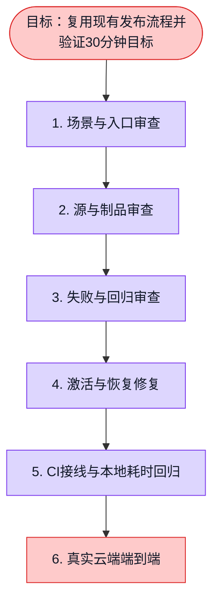

# 中国发布五轮审查与下一次发布入口（#5617）

目标是把 **用户请求到生产真实业务通过** 控制在 30 分钟以内。这里交付的是
现有流程的缺陷修复、可复用离线回归入口和场景/耗时审计；不是已完成的真实云端
端到端发布验收。权威流程仍为
[CN release SOP](../../.agents/skills/workspacex-cn-release/references/release-sop.md)
（相对仓库根为 `.agents/skills/workspacex-cn-release/references/release-sop.md`）。

## 五轮实际审查

每轮检查不同故障面，保留失败和未验收边界。没有把离线替身测试称为生产 E2E。

| 轮次 | 发现 | 修复 / 处置 | 验证 |
|---|---|---|---|
| 1：入口与场景 | SOP 已有六场景，但 hotfix 优先级与跳门容易混淆；配置/seed 可被用于掩盖代码改动 | `cn-release-audit.py classify` 使用 exact baseline/source 的真实 Git diff，第一条命中，hotfix 不改变门；config/seed 不能夹带源码 diff | 六场景、优先级、hotfix、配置夹带代码反证 |
| 2：源、制品和身份 | 仅比较新 SQL 文件会漏掉删除/改名；无 SQL diff 不能证明启动无清理/seed；已有 HK 链是特定 run 的九对象范围 | 禁用 rename 推断、读取完整 NUL 路径 diff；数据库敏感目录/依赖变化不能用 `none` 隐藏；复用现有 artifact/HK/host 真实脚本测试，保留九对象限制 | 实际临时 Git 仓库 → CLI，包括 SQL 删除/改名、移动 HEAD 拒绝、工作树改动不污染 exact commit |
| 3：失败和重跑 | 零测试/跳过可被 unittest 记为 exit 0；只测 happy path 不能证明 hold/恢复/未知上传结果 | 统一有预算的回归入口，清除云凭据环境，失败继续收集；超时杀死并 join 自己的进程组，耗尽预算未运行项为失败；零测试/skip 不算通过 | 真实子进程失败、超时、凭据隔离；现有 lost-response、重复结果、hold 和跨进程 lock 测试 |
| 4：真实验收和超时 | 旧 TS activation `Object.values({}).every(...)` 可假绿；缺少 canonical lock 字段可能通过；慢 baseline 之后仍开始 drain；无效时钟未拒绝；恢复指针被当成恢复业务 | 六业务字段共享严格 schema；canonical 严格字段；baseline await 后马上检查 deadline；无效时钟拒绝；恢复必须独立旧版浏览器六旅程，否则 `rollback-unproven` | 33 项 Vitest + 9 项 Node 测试；late action 先结束再回滚，绝不与后台写并发 |
| 5：调用链、CI、预算 | Promise-only activation 的 AbortController 未传动作，不能实际停止挂起动作；零散测试没统一入口；某些 Node 契约未被 CI 调用；流程时间可能排除排队/审批 | legacy production factory 在 startup 与调用入口阻断；不影响已有 A-route/shell；CI 接入回归及新增 Node 测试；timeline 同时报日历与执行耗时，缺上海/公网业务事件拒绝；独立审查补上回退方向、TTL 和严格版本类型 | 130 项 Python unittest + 1 proof 集成、34 项 Vitest、32 项 Node、typecheck、controller 精确字节检查；真实云 E2E 与 30 分钟仍待实测 |

第 4 轮发现的 Promise-only 适配器不是安全的进程监督器。仅使用
`Promise.race(timeout)` 会让未停止的写操作与回滚并发，不能作为修复。
`preparedActivationAction` 和 legacy `bindTypedProductionOperations` 现在返回
`PREPARED_ACTIVATION_SUPERVISED_TRANSPORT_NOT_IMPLEMENTED`，且在任何 transport
调用前失败。低层单元状态机仍可用于契约测试，但不再通过该 factory 进入生产。
未来解除此门必须实现并证明：每个动作的剩余预算、停止整个进程组、join 后再恢复、
独立旧版业务验收。不能用一个配置 boolean 声称具备这些能力。

## 不同情况如何发布

以下沿用 SOP 六场景；hotfix 是优先级，不是第七种放宽权限的通道。

| 情况 | 路径 | 可以复用 / 省去 | 不能省去 |
|---|---|---|---|
| 生产故障 / 刚激活失败 | 紧急恢复 exact baseline | 不构建新版本、不等新功能 CI | 原 digest/入口闭包、恢复后真实业务、恢复不确定时保留锁 |
| hotfix，无迁移，已 prepared | 场景 4，安排最前 | 重用未漂移的 seal、prepare、影子验收；不再 build/pull | TTL、baseline CAS、锁、drain、exact 运行身份、公网业务、可证明回滚 |
| 普通代码改动，无数据库迁移 | 场景 4/5/6，按准备程度选择 | 无 pending migration 才不执行迁移；复用未变服务构建缓存 | 当前数据库 ledger/漂移读回、启动副作用评估、全套稳定密钥/配置连续性 |
| 兼容新增迁移 | 常规通道，但保留既有兼容性证明 | 不把所有兼容迁移一律变维护窗口 | 精确 migration plan、备份、隔离 old/new read/write 兼容证明、迁移后读回 |
| 破坏性/未知迁移、密钥轮换、基础设施变化 | 场景 2 维护窗口 | 可提前构建、演练与静态准备 | 当前 epoch 备份、停写屏障、恢复闭包、检查点授权；不承诺统一 30 分钟 |
| 仅配置或幂等 seed，代码/schema 未变 | 场景 3 | 不构建 OCI | 配置快照、幂等反证、数据版本/锁、业务验收 |
| exact 制品齐备但 receipt 过期/漂移 | 场景 5 | 重用原 immutable image，不重 build | 真实刷新 prepare/证明，禁止修改旧 issuedAt/expiresAt 假装新鲜 |
| 全冷发布 | 场景 6 | affected 计算、并行 build、缓存 | source/identity/CI、seal、真实运输读回、prepare、activation、业务验收 |

静态 Git 变更分类**不能证明数据库没有写操作**。API 启动可能执行旧日志清理、
初始化 seed、任务恢复和 worker；镜像回退不能恢复已删除的数据。分类器返回
`planningOnly=true, admissionReady=false`。输入的 `sealed/valid` 是待复核声明，
必须经过现有 canonical verifier 的实时绑定与 TTL 校验，不能作为授权或收据。

## 可复用命令

固定 source/baseline，创建如下结构的 JSON；不要使用移动分支名：

```json
{
  "schemaVersion": 1,
  "sourceSha": "<exact 40 lowercase hex>",
  "baselineSha": "<exact 40 lowercase hex>",
  "urgency": "hotfix",
  "productionHealthy": true,
  "changeKind": "code",
  "migrationRisk": "none",
  "infrastructureChanged": false,
  "stableSecretsChanged": false,
  "artifactState": "sealed",
  "preparedState": "valid"
}
```

```sh
python3 -B scripts/cn-release-audit.py classify --repo . request.json
python3 -B scripts/cn-release-audit.py test --suite all --budget-seconds 300
pnpm exec vitest run packages/cloud-deploy/test/cn-fast-safe-release.test.ts packages/cloud-deploy/src/cn-maintenance-host/public_acceptance.test.ts --maxWorkers=1 --minWorkers=1
node --import tsx --test packages/cloud-deploy/src/cn-maintenance-host/actions_test.ts packages/cloud-deploy/src/cn-maintenance-host/typed_operations_test.ts packages/cloud-deploy/src/cn-maintenance-host/a_route_factory_test.ts
python3 -B scripts/cn-release-audit.py timeline measured-events.json
```

Python 回归入口目前覆盖 scenario/artifact/transport/host/recovery 五组，11 个
现有命令；其中 130 项 unittest（18 项新测试）和一个 synthetic 七 ZIP → 原始
verifier → 新 proof → bundle admission 集成脚本。本机最终完整运行 7.332 秒，
**这不是发布耗时**。所有 provider 边界为替身，不访问云、不拉 Docker 镜像。
TS 的 34 项 Vitest 与 32 项 Node 契约使用独立 checkout 自己的锁定依赖。
独立审查同时纠正了 recovery 的祖先方向（允许精确回退）、receipt 在 await 期间过期、
以及 JSON `true` 被 Python 当作版本 `1` 的边界。实际回滚仍以运行身份/证据绑定验证，
不能从 Git 祖先关系推断生产恢复。

时间线 JSON 包含 `schemaVersion=1`、`attemptId`、`sourceSha`、六场景之一
`scenario`、含时区的 `requestedAt` 和 `events`。每个 event 必须有
`name/at/sourceSha/attemptId/evidenceSha256/status`，且 `status=passed`。
冷发布需要有序的 `runner.started → build.sealed → hk.readback →
shanghai.admitted → preactivate.passed → activation.started → runtime.identity →
public.business`；最终业务事件必须为最后一项。维护场景还需要 backup/migration
读回事件。证据内容仍须由独立原始证据 verifier 审核，时间线只校验结构/身份/时钟，
输出永远不会自行声明 `productionAvailable=true`。

## 30 分钟如何实现与验收

规划预算可分为：排队/预检 3 分钟，受影响服务并行构建及 seal 10 分钟，
GitHub → 香港私有 OSS → 上海运输和校验 7 分钟，离线 prepare 5 分钟，
activation + 公网业务 5 分钟。**这是目标分配，尚无真实样本证明可实现**。
若当前 run 的构建、带宽或备份达不到预算，不把耗时转移到未计时的“准备”名目里。
预先 prepared 的发布应同时报告完整准备 lead time 与批准到可用时间。

优化顺序：

1. 运输认证、endpoint、IAM 精确权限和 Linux 所需工具在 release 请求前实际预检。
2. Devapp 验收与生产晋级同一 immutable digest；避免 CI 绿后又重新 build 全五镜像。
3. 在准备阶段完成源闭包、目标/回滚镜像、工具、浏览器运行时；activation 内不安装包。
4. 并行只读预检与独立服务构建；只有一个正式 mutation 执行者持有发布锁。
5. 大文件只走 GitHub → 香港 → 上海。Mac 仅接收小脱敏收据。
6. 每次记录请求、runner、seal、HK 读回、上海入场、activate、运行身份及公网业务事件。

不能以压缩耗时为由删除 source/digest 校验、停写/drain、当前 baseline、可恢复备份
或业务验收。已有五镜像候选不需要因认证失败重建；认证修复后复核同一制品身份即可。

## 仍未完成的真实交付边界

- 当前审查时，真实 run `38156223016` 的 OIDC claims 已通过，但 Alibaba STS
  交换失败，尚未实际 HK PUT。认证诊断由主发布执行者单独修复，不在本 PR 擅自扩 IAM。
- 香港 workflow/plan 的 `38146134231`、control SHA、prefix、九对象权限是刻意的一次
  授权闭包；下一 run 不能只改一个 source SHA 就当作通用运输。需生成新精确计划、
  对应最小对象权限并经过现有授权流程，不能改成通配桶权限。
- 当前临时 continuation 里的上海 consumer、publish、hold/backup/switch/clear 工具
  尚未全并入一条持久 GitHub 单入口。本 PR 没有声称完成此迁移。
- 真正完成仍要求 GitHub → HK → 上海 → 新运行身份 → 公网六业务的真实证据，
  并对至少一次真实失败执行可证明的回滚/恢复；当前离线测试不替代它。
- 30 分钟目标没有真实成功样本；维护/破坏性变更单独安排窗口。下次应先补齐上述链路，
  再使用 timeline 的日历时钟验收，而不是从构建完成才计时。

## 执行计划


