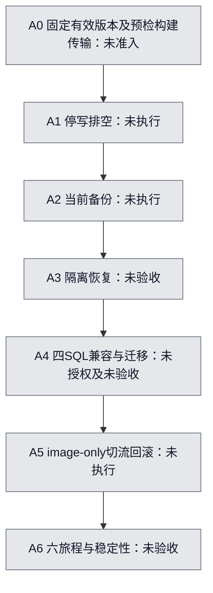

# GitHub → CN production: implementation and measured acceptance

Updated 2026-10-18. Direct user request; sole implementation owner is the delegated cloud worker.
Refs #5813; previous fixed-candidate implementation remains draft PR #5810. This plan adds no
execution authority and does not supersede the [release SOP](../../.agents/skills/workspacex-cn-release/references/release-sop.md).

## Current facts and release identity

Control baseline is main `f11a2c802158641181afcf403a52cf94bffcf5a6`, diagnostic PR #5814 merged.
Its PR head `2516c21f80c4e4f1df96ce6d2c3255a029f401e3` passed five required checks, independent
ACCEPT and subsequently fullstack-smoke (run 39079217276/job 117532572856). This is not main's
complete CI: main has separate chat-read, meeting-room and license failures reported by the parent.
These require exact logs/triage before selecting a release; this plan does not waive them.

The only previously fixed application source remains `bc3d1254ce05c915801fb73fe6698072730a051c`,
producer control `5acebbb6741ed13c6379407aa0529c0eb8695b72`, build 38852606085. Its artifacts
and execution window expired on Oct17. The original authenticated download was Forbidden;
no alternate download, rebuild or candidate substitution is authorized. There is **no admitted
current production release version**. Freeze a new explicitly selected exact source/control/build
attempt, five image digests and source/plan/set hashes only after authorization and Devapp gates.
Baseline revision must come from current runtime readback, never historical labels or main.

Diagnostic execution count remains zero at handoff. The existing connector supports GitHub reads,
branches and PRs but has no dispatch/environment-review mutation. Cloud Chromium navigation was
rejected with ERR_CERT_AUTHORITY_INVALID: no retry, certificate bypass or replacement credentials.
The approved diagnostic and production release are separate scopes. No Aliyun identity or privileged
entry installation has been verified. No Mac channel, new identity or permission will be created.

## Iterations and stopping rules

1. **Measure before optimizing (this increment).** Read the existing durable executor's original
   identity, intent and chained receipts without running a stage. Preserve hash and timestamp
   bindings, show missing stages and gaps, include time before runner start. Reports are untrusted
   measurement projections and always productionAccepted=false; they are never approval objects.
2. **Close executor and version inputs.** Obtain one supported normal dispatch interface and existing
   required review; use the already approved diagnostic exactly once. Verify runner identity,
   capabilities and installed entry hashes from that receipt. Triage main failures and select/freeze
   the next release explicitly. Unknown execution outcome means read-only reconciliation, no retry.
3. **Build and transfer.** Reuse build-cn-image-candidates and canonical admission. Build five services
   in parallel with a pinned source/lockfile/Dockerfile/platform cache key; cached output still needs
   complete identity/layer verification. Record cold and warm durations separately. Export once,
   verify after transfer and import. Toolkit source/installation approval and application-image
   upload/import are separate intents, channels and receipts. No toolkit hash substitutes for image
   provenance. Verify original artifacts before any cloud transfer; never use the expired BC set.
4. **A0–A4 closure.** Reuse existing phase adapter/driver and independent observer. Read-only baseline
   pins env/mount/DB/service/images/Nginx and rollback identities; stop on drift. Drain before current
   epoch backups; independently restore into isolated disposable data targets. Validate all four
   original SQL files and permission compatibility against that restored baseline, then rehearse
   migration and startup/failure recovery. Unknown/destructive SQL remains blocked pending a specific
   maintenance authorization. Do not remove SQL or reinterpret it as image-only compatibility.
5. **A5 and recovery.** Existing image-only Compose must preserve env, mounts, secrets and DB services;
   prepare never switches traffic. CAS baseline and exact digests before approved switch. No build,
   dependency install or source fetch during activation. Capture bounded activation and actual old
   image/Nginx/Compose recovery plus old-version browser evidence under a separately authorized drill.
   An uncertain switch is reconciled against original intent; never automatically replayed.
6. **A6 and repeatability.** Canonical business observer owns all six journeys: login, hello/SSE, ASR,
   GitHub feedback read, skill/tool, PDF download. Require runtime identity, owned/distinct runs,
   real authenticated browser/output readbacks and stable window, not healthz or synthetic JSON.
   First run the complete chain and repeated independent rounds in an isolated full-scale cloud
   environment with the same frozen control/case closure and fresh baseline/evidence each time.
   Then run at least one explicitly approved necessary real production attempt. The three owned
   business runs are not authority to perform three production releases. No automatic retry or
   reuse of writer approval. Preserve failures and clock starts. Three observations are evidence,
   not P95; SOP requires20 successful samples before statistical percentile claims.

## Budget and full clock

Target is **1800 seconds from GitHub accepting the release request to durable final A6 stable evidence**.
Also report user-request-to-A6 calendar time, including any delay before GitHub acceptance.
No prepared/cached-only run can establish a cold GitHub-build-to-production result. Record source
freeze, workflow creation, queue enter/leave, reviewer request/approval, runner start, build service
start/finish/cache hit, toolkit and image transfer intervals, A0–A6 intent/finish, recovery trigger/end,
and final observer persistence in UTC. Preserve provider clocks and reconcile clock skew; missing
timestamps mean unmeasured. Bind the authoritative UTC source and measured cross-host offset/error
bound; runner monotonic time cannot erase startup wait. Do not restart requestedAt on resume,
approval, cache hit or rerun.

| Phase | Planning budget | Required evidence |
|---|---:|---|
| A0 source/preflight/build/seal and independent transfers |600s|original build attempts, cache hit/miss, five verified images, toolkit receipt, current baseline|
| A1 stop/drain |60s|actual hold/drain/session observation|
| A2 backup |120s|same-epoch backup association and completion|
| A3 isolated restore |240s|independent restored-state consistency proof|
| A4 compatibility/migration/readback |180s|four SQL hashes, actual restored rehearsal and approved target readback|
| A5 prepare/switch/readback |120s|CAS, image-only diff, exact runtime and rollback evidence|
| A6 six journeys/stability |300s|canonical browser/output receipt and stable window|
| Queue, approvals, gaps and measurement reserve |180s|separate intervals included in1800s total|

Sum=1800s; these are engineering targets, **not measured promises**. Active phase time is the union
of execution intervals, not the sum of parallel service jobs. Queue and approval unions are reported
separately, their overlap once, with unclassified gaps retained; all remain in calendar lead time.
Report end-to-end and execution figures together. Final A6 stable evidence and reporting/upload
latency must be included. If evidence is incomplete, report elapsed lower bound, never successful
completion. The existing driver's1800s deadline begins at its requestedAt and does not by itself
prove this user clock or upstream build/queue time. Current unknown SQL invokes SOP maintenance
window budgets60–120m: until compatibility and safety are independently resolved, a30m production
claim is blocked. Never skip backup/restore or shorten browser stability to meet the target.
A30m overrun is a performance failure, never permission to hard-kill necessary safety recovery.
After writes, a stale backup must not overwrite new production data. Isolated restores prohibit
real outbound notifications and connections to production consumers. Capacity insufficient for
complete backup/restore is a measured blocker, not permission for sampling or an older backup.

## Evidence closure and fault matrix

Every run must bind source SHA, workflow SHA, target, five separate image digests, toolkit digest,
run ID, owner, original UTC start/end, command exit code, backup ID, isolated restore target,
schema versions before/after migration, runtime instance digests, six journey results and stable
window samples. Missing, SKIPPED, UNKNOWN, empty or cross-attempt evidence fails closed. The
measurement reader verifies local original-byte hash links only; owner/target/canonical evidence
admission remains the existing privileged observer's responsibility and is not yet implemented
in a new production collector. No report can serve as approval or production admission.

| Fault injection | Required outcome and next increment |
|---|---|
| wrong/expired candidate, toolkit/image digest mismatch |reject before transfer; canonical admission tests, then full-scale run|
| concurrent/reentrant invocation, lost acknowledgement |retain original intent; read-only reconcile; no replay or cancellation|
| partial transfer or changed original bytes |stop before import; preserve partial evidence; independent toolkit/image gates|
| drain timeout, backup corruption, incomplete restore |hold retained; no switch; real full-volume integrity proof required|
| migration lock, incompatible SQL/permissions |stop before target write or approved recovery boundary; no SQL omission|
| readiness/switch fault, post-switch journey failure |exact baseline rollback only under authority; old-version browser evidence|
| report gap, identity/hash drift, clock reversal, oversize/symlink |measurement reader rejects; covered in this increment|
| >1800s, queue/approval overlap, incomplete final evidence |performance FAIL or UNVERIFIED; no hidden waits, no safety hard-kill|

First code increment command (read-only local snapshot, never a cloud executor):

```sh
python3 -B scripts/cn-release-measurement.py --attempt-dir /absolute/private/snapshot \
  --github-accepted-at <original-UTC> --user-requested-at <original-UTC>
python3 -B -m unittest discover -s tests -p test_cn_release_measurement.py -v
```

CLI always exits2: even a complete transport chain is not complete A3/A4/A6, timestamp provenance
or a verified stable-window end. Output is an explicitly untrusted lower-bound timing projection,
with immutable original requestedAt and hash-linked fixed17-stage files. No SDK, stage execution,
root path read, dispatch or recovery is added. Local test includes a real harmless executor child;
cloud root ownership is a bounded disposable-subtree fixture seam, not host permission proof.

## Minimum specific decisions/access still required

- Exact replacement candidate/build authorization; existing expired source is not silently rebuilt.
- Supported normal GitHub workflow_dispatch and existing production-cn-promotion reviewer action;
  no trigger rewrite, rerun substitution or TLS weakening. Use existing approved actors where possible.
- If existing identity cannot perform fixed target read/transfer/entry operations, request only the
  named operations/target/path/hash/expiry after actual capability evidence. No assumed broad RAM,
  sudo, Docker group, OIDC or persistent credential request. Root toolkit installation is separate.
- Database maintenance/migration, isolated restore resources and rollback drill require exact targets,
  SQL hashes, backup IDs, write scope, deadline and recovery bound before execution. None is granted
  by this implementation request. Do not create or clean cloud resources now.

## Seven-step production status



All production nodes stay gray. Code/test progress is reported separately and cannot change them.
First increment: init fast health passed with process-local pnpm9.15.0; readiness command exit0.
`python3 -B -m unittest discover -s tests -p test_cn_release_measurement.py -v`:16 tests PASS.
Workflow YAML parsed and diff whitespace checked. Initial14-test run exited1 with two fixture/helper
errors (sandbox root owner65534 and duplicate helper keyword); retained here rather than hidden.
Corrected only test helper/explicit disposable subtree seam; production directory protection unchanged.
These are offline/source results, not the30m production or full-scale recovery acceptance.
