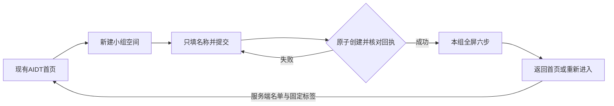

# AIDT 普通成员创建小组：原子初始化方案

状态：待人类审阅的设计提案。关联 [#6824](https://github.com/boardx/workspacex/issues/6824)、[#6818](https://github.com/boardx/workspacex/issues/6818)。基线：`ee4a8ff2b39d84b36bf1a1feec45b5f5652184b6`。

本提案没有签核结果，也没有修改运行代码、账号或权限。审阅对象是下述 UI、用例和 API 三件；批准后才实现新增契约。

## 请确认的具体变化

1. 普通组织成员可在现有 AIDT 首页点「新建小组空间」，只填小组名称；课程管理仍只对原来的管理角色开放。
2. AIDT 创建请求给现有 `POST /projects` 增加可选 `profile: "aidt"`。服务器在同一创建事务中保存项目、创建者 owner 和固定 AIDT 标签；不让普通成员取得管理标签、归档、改名、课程或其他项目的权限。
3. 不传该字段的普通项目创建行为、请求形状和既有重放指纹保持原样。没有新表、迁移或生产配置变更；发布时 Web/API 要使用同一已验证版本。

## 已核实的故障与存储边界

- `AidtHome` 把「创建小组」限制为 org lead/admin，并把同一布尔传给课程 `canManage`。
- 现有 `canCreateProject` 已允许 consultant（产品显示名为普通成员），另允许 lead/admin；非成员和身份服务故障都拒绝。
- 现有 AIDT 表单是 `POST /projects` → `findProject` → `PATCH /projects/:id/tags`。后一步的应用用例只认 org lead/admin，不认 project owner，因此仅显示按钮不能修好创建。
- `PgProjectRepository.create` 已在一个 `db.withTenant(orgId)` 事务中保存重放指纹、项目、general 子类型及 `general_project_members` 的创建者 owner；创建者身份取自服务端 principal。
- 标签保存在现有 **`project_tags` 表**，不是 `projects` 的列。迁移 `20260816000000_f185_project_tags.sql` 已有 `(project_id, tag)` 主键、`(project_id, org_id)` 复合外键、租户 RLS 和 app_rw INSERT 权限。可直接在原创建事务内插入固定标签；不新增写入入口，不修改表结构、RLS、数据库授权或封闭的 projects 列集。

## ① UI

保留 `/aidt` 现有首页、活动介绍、工作坊列表及名称弹窗，不替换首页、不新建向导。

- 「新建小组空间」依据已解析身份显示给 consultant/lead/admin，和现有项目创建规则一致。身份尚未就绪或不满足既有创建角色时不显示。
- 单独保留 `canManageCourses`：lead/admin 才看到课程建立、关联及管理文案；不能因普通成员可以创建小组而把课程管理也打开。
- 弹窗仍只有「小组名称」和「创建小组」。不增加 profile 选择器、技术字段或额外确认步骤。
- 创建成功且从现有授权查询核到固定 AIDT 标签后，进入 `/aidt/<projectId>` 的全屏六步页。
- 失败保留名称与重试按钮，不导航成功页。若已拿到创建回执但列表查询失败，重试同一回执的查询；若请求回执丢失，服务端重放机制返回同一项目。不会再发管理员专用 tags PATCH。
- 返回 `/aidt`、刷新、重新登录后，由真实项目标签及本人的项目成员关系重新加载小组，不用 localStorage 伪持久化。

可见流程：



## ② 用例与边界

| 场景 | 应有结果及验证 |
| --- | --- |
| 普通成员首次创建 | 实际 `identity/me?orgId` 为 consultant；正常首页按钮提交；服务端落 general 项目、创建者 owner、固定 AIDT 标签；进入六步页。 |
| 管理员及 lead 创建 | 保留可用的首页和课程入口；AIDT 同走新原子路径，不再依赖后续 tags PATCH。 |
| 返回、刷新、重新登录 | 仍能从 AIDT 列表找到刚创建的小组；真实 `/collaborators` 中创建者是 owner；显示该项目的六步，不是一个临时 demo。 |
| 普通项目创建 | 旧请求不带 profile，项目无新增 AIDT 标签，旧重放指纹保持不变；普通项目入口不被重定向到 AIDT。 |
| 非组织成员、错误组织、身份查询失败 | 复用现有 membership 核对与失败拒绝；不创建项目、owner 或标签，不泄露其他组织资源。 |
| 无效 profile、任意 tags 或错误 kind/蓝本组合 | 严格拒绝，写入前结束；只允许指定的 AIDT general 空白创建组合。 |
| 项目/子类型/owner/标签任一写入失败 | 整个同一事务回滚，重放指纹也回滚；没有已创建却不能在 AIDT 找到的残留项目。 |
| 双击、网络超时、请求重放 | 同一 actor/org/name/kind/blueprint/profile 重放同一 ID，owner/标签不重复；UI 防重复提交只作为辅助。 |
| 同名普通项目与 AIDT 项目 | profile 纳入 AIDT 指纹，两类不误重放为彼此；未带 profile 的旧指纹完全不变。 |
| 非创建者或既有项目 | 新字段仅用于创建，无 projectId、actorId、ownerId 或任意 tags 参数；不能把他人的现有项目改为 AIDT，也不能借创建取得其访问权。 |
| 管理员后来归档或修改已建项目标签 | 不通过重放偷偷恢复、重新授权或重新打标签；保留原有项目生命周期与 tags 权限。若已有重放回执不再满足 AIDT 入口条件，显示实际状态并提示负责人处理，不暗中转换或新建重复项目。 |

新增能力不包含邀请成员、跨组访问、课程管理、放宽 tags PATCH、改名或归档。新创建者 owner 沿用现有创建事务规则，不新增角色授予流程。

## ③ API 与内部实现契约

### 唯一对外字段

在现有 `project.operations.createProject.in` 的 strict object 增加：

```ts
profile: z.enum(["aidt"]).optional()
```

完整 AIDT 请求示例：

```json
{
  "orgId": "当前已选择组织的ID",
  "name": "第三组",
  "kind": "general",
  "blueprintVersionId": null,
  "profile": "aidt"
}
```

- path/method 保持 `POST /projects`，认证及组织成员规则保持原样。
- profile 只有 `"aidt"` 一个合法值；省略表示原来的创建行为。拒绝 null、空字符串、其他字符串、对象和数组。
- `profile: "aidt"` 仅支持 `kind: "general"` 且 `blueprintVersionId: null`。不把教学身份和工作坊蓝本初始化混用。
- strict object 继续拒绝客户端 `tags`、`actorId`、`ownerId`、`projectId` 等额外字段。服务器固定映射 `aidt → workspacex:aidt`，不接受任意初始标签。
- HTTP schema 拦截结构错误为现有字段校验 400；应用层再防御非法 profile/组合，建议新增精确原因 `INVALID_CREATION_PROFILE` 并映射 400，避免内部调用跳过 HTTP 后静默忽略未知 profile。该错误属于此次待审 API delta，不冒充已有契约。
- `createProject.out` 不变，仍返回既有 id/kind/status；不借此次处理既有 provenanceEventId 契约缺口。标签通过既有 list/find 查询回读。

### 事务与重放

1. controller 从 principal 取 actorId；转交已验证的可选 profile，应用层仍查目标组织 membership 并复用 `canCreateProject`。
2. 内部 `CreateProjectInput`、`CreateProjectCommand` 增加可选、从正式契约派生的 profile 类型，不增加任意 tags 端口。
3. `creationFingerprint` 对未传 profile 的请求保持原五元组的每个字节及 hash 原样；AIDT 请求在现有 NUL 分隔编码末尾加入一个明确 profile 分量。AIDT 与普通同名请求不互相重放，AIDT 重试仍为同一指纹。
4. 原有仓储 `create()` 的同一次 `withTenant` 内，在创建项目/子类型/owner 后，为新建分支插入唯一固定 `project_tags` 行。标签来源用正式契约的唯一映射；前后端不抄两份魔法字符串。
5. 标签插入失败直接抛出并回滚整个 `withTenant`，不使用独立 `updateTags()` 事务，不先提交再补偿；走现有安全错误投影，客户端保留名称可重试。
6. 重放只返回原项目，不修改现有标签、状态、成员或权限；不存在“重放顺便修复/恢复任意项目”的新能力。

### 兼容与迁移

- **不需要数据库迁移**：复用现有 projects/general_projects/general_project_members/project_creation_requests/project_tags 与既有 tenant 事务。实施前以仓库实际 general 子类型表映射为准，不另造表名。
- 不添加权限、环境变量或启动开关。不改 `updateProjectTags`、`renameProject`、archive/unarchive、课程鉴权的判据。
- 旧客户端不带 profile，走原语义；新 AIDT Web 对旧 strict API 会得到 400，不会退化创建普通项目。必须将含此字段的 Web 和 API 一起冻结到同一经验证版本。
- 实施时同步契约生成物及调用类型，不能依赖客户端绕过 strict 校验。

## 拟修改文件与验证计划

| 位置 | 最小改动 |
| --- | --- |
| `packages/contracts/src/project.ts` | 可选严格 profile 枚举、固定标签唯一映射、必要的 `INVALID_CREATION_PROFILE` 原因。 |
| `apps/api/src/interface/controllers/project.controller.ts` | 传递 profile、处理新增400原因；不接受任意标签或新 actor。 |
| `apps/api/src/application/project/create-project.ts`、`ports.ts` | 应用层校验与内部窄类型传递；保留原角色查询/失败拒绝。 |
| `apps/api/src/domain/project/create-project-rules.ts` | 兼容旧指纹的 profile 区分；不改 `canCreateProject` 或 `canManageProjectLifecycle`。 |
| `apps/api/src/infrastructure/project/pg-project-repository.ts` | 在现有创建事务的新建分支写固定 project_tags 行；不增加第二个创建点或读取其他人的内容。 |
| `apps/web/features/aidt/components/aidt-home.tsx` | 小组创建与课程管理两个UI投影分开；保留首页结构。 |
| `apps/web/features/aidt/components/aidt-create-project-form.tsx` | 创建请求带 profile，核对回执/标签，不再调用管理用 tags PATCH。 |
| `apps/web/features/aidt/lib/project-aidt.ts` | 引用正式契约固定标签映射，保持识别函数及普通项目行为。 |
| 现有项目/API/契约及 AIDT UI tests | 增加普通成员、失败原子性、旧请求兼容、拒绝场景与前端重入回归；同步已有验证断言，不削弱权限反证。 |

验证分层：

1. 契约与纯函数：旧 body/旧指纹不变；profile 合法/非法/组合拒绝；同名普通与 AIDT 不串重放。
2. 应用与隔离 PG：consultant 正常创建；owner 与标签同事务；标签写入故障后五类相关记录均不残留；重放同ID且不重新授权；非成员/跨组织/身份服务故障拒绝；现有 tags/rename/archive 反证保持拒绝。
3. UI 回归：普通成员能打开同一名称弹窗；课程管理仍隐藏；只发新创建请求和授权查询、不发 tags PATCH；失败重试/作用域切换/刷新与重新进入不伪成功；普通项目表单请求不变。
4. 根协调者负责 Live Dev：以预置普通非管理员 QA 账号核 `orgRole=consultant` → 首页正常创建唯一测试组 → 成员 owner/固定标签 → 返回列表/刷新/重新登录 → 全屏六步。仅使用独立合成测试项目，不改账号/权限，不使用真实用户项目。截图和回执另行交付，不能把 mocked UI 测试记为 Live 通过。

此提案的审阅通过不代表开发、测试、合并或发布已经完成。实施需将实际结果分别记录到 #6824，按仓库独立审与 CI 门控创建产品 PR。

> 本文件保留提交审阅时的方案快照；后续实现和实际验证结果见关联 issue 与产品 PR。
