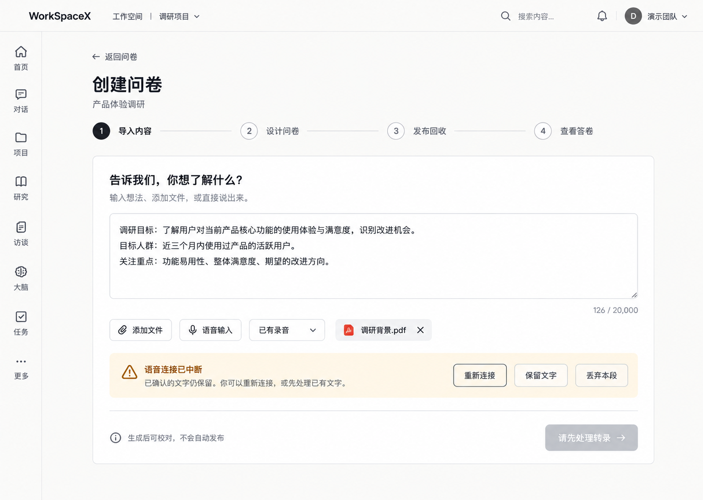

# 问卷导入重设计与语音诊断 — #5673

状态：第一阶段视觉方向待确认；真实 devapp ASR 根因未判定。不是业务实现，不是运行界面截图，也不是修复成功证据。

## 视觉方向

- 保留现有应用壳、导航、semantic tokens（暖灰背景、白卡、深色 primary、8px 圆角）；重设计范围仅问卷导入内容。
- 一处页标题/问卷名，一条紧凑步骤线；正文编辑器是主体，删除重复“AI生成”标题和多段技术说明。
- 文件、语音、已有录音收进同一工具栏；原生 file input 用可访问的触发按钮与可移除文件 chip 呈现。
- 连接/录音/收尾状态就地展示，临时文本只投影；落定后追加保留原文，不能跳 `/rec`。
- 错误与恢复动作为单一状态区；有待确认文字时提供重新连接/保留/丢弃，生成禁用。无已确认文字时不展示无效保留动作。
- footer 同时承担当前状态与唯一主操作。正常可生成时“分析并生成问卷”；录音、收尾、待恢复、文件读取、超限时禁用并解释原因。
- 维持现有文本/文件/语音输入兼容、共享长度上限、授权、停止收尾、离页清理和 Markdown 确认初始化，不自动发布。
- 图片是视觉方向，字符数与文件名为演示数据；实际实现以现有真实数据与状态机为准。未确认前不修改业务或公共 ASR。

## 只读诊断事实

- 基于 fetch 后 main `01f8470e3a56901ae430f30e48848281d5834c4f`；复用3120 worktree，保留旧 feature 分支，安全新分支 `worker/coord-survey-intake-redesign` 从 origin/main 创建。无 reset/stash/revert、无新 worktree。
- 用户截图显示新版 inline 组件已有，且错误/重连/保留/丢弃动作散落多行。图片中出现“服务暂时不可用”不足以判定 session、provider 或部署根因，用户转写未复制进本报告。
- 浏览器只读诊断连接先超时、后 Chrome binding 成功但 tabs 访问失败，无法取得该次真实 request/WS status/reasonCode/close；未重载/更改用户草稿、录音或请求模型。
- 静态 gateway：未/无效 bearer 握手401，principal resolver失败503；服务端 `ASR_PROVIDER_UNAVAILABLE` 可能来自 provider open/onError/finish、重复 start 或启动 pending audio buffer 上限。客户端非预期 WS close/error 也会投影同一原因。必须按真实网络/服务端日志相关联，不能从通用文案选择其中一个。
- 服务端现有脱敏诊断落点为 `[asr-draft] <reason>: <detail>`。请求主会话可用只读入口提供对应时段 reason/detail、status/close与运行版本，不输出 token、用户内容、供应商密钥或全量用户日志。

## 第一阶段验证与下一步

`pnpm --filter web exec vitest run tests/ui/interview-voice-input.test.tsx tests/ui/survey-inline-voice.test.tsx`：2 files / 19 tests PASS，覆盖预览/落定/原文/取消/异常保留、忙态、限长与卸载契约。测试使用受控 transport，不是线上根因或真人 ASR 成功证明。

`pnpm --filter web exec vitest run tests/lib/asr-draft-reconnect.test.tsx tests/lib/asr-draft-cleanup.test.ts tests/ui/use-asr-draft-error-reason.test.tsx`：3 files / 22 tests PASS。有限重连、停止清理与原因状态契约本地成立；不能替代线上证据。

待补：真实 devapp 网络/日志事实。主会话/人类确认视觉方向并确定最小修复范围后再实施；公共 ASR 文件由主会话按所有权分配。不通过隐藏错误声称修复，不另造 provider，不扩展全站录音。不自动部署。
