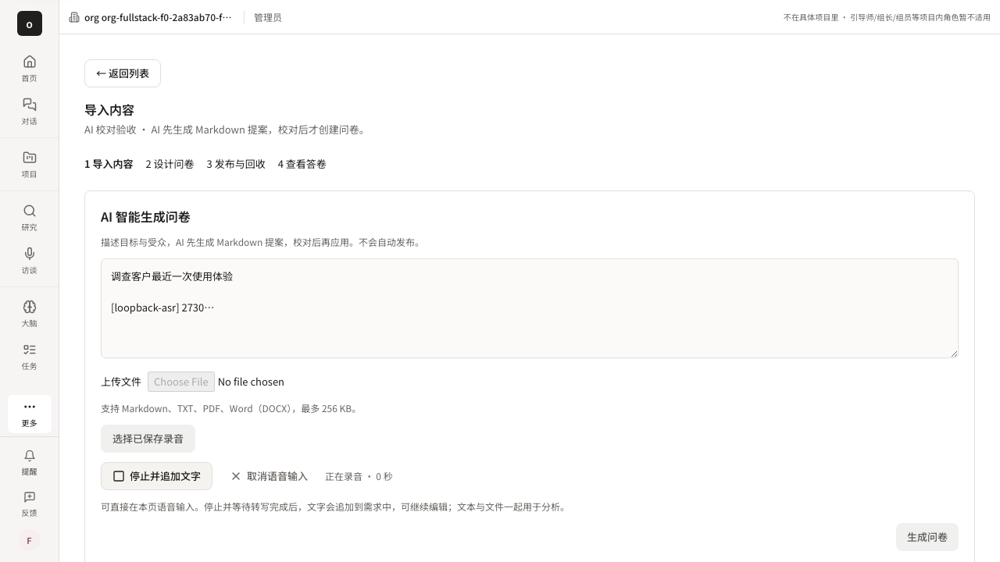
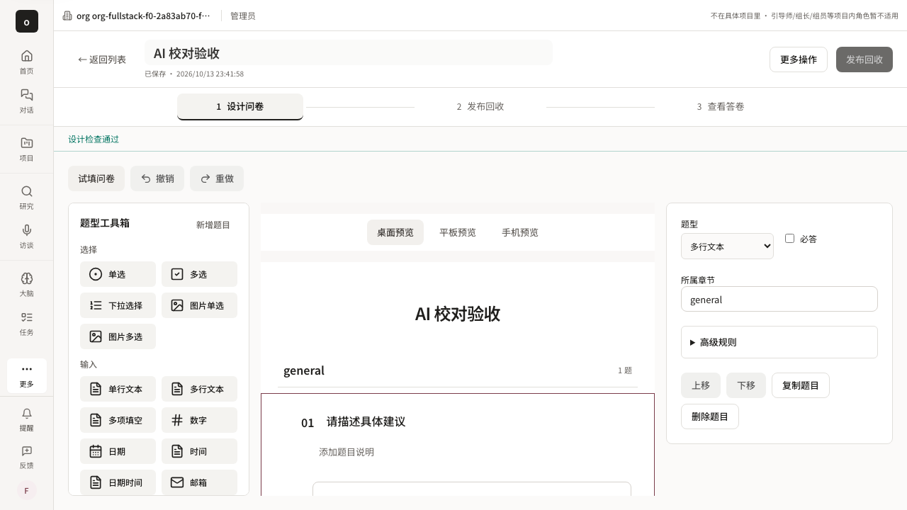

# Survey inline AI intake — issue #5660

Scope: `/studio/survey/new/import` now reuses `InterviewVoiceInput` on the page. No public ASR transport/hook, supplier, API, authentication, or database changes. Confirmed speech is appended to existing text only after stop settlement; transient speech is display-only. Recording/settlement/recovery disables generation and other input changes. Existing Markdown proposal correction and explicit canonical draft creation stay intact; publication is untouched.

## Verification and evidence boundary

- `./init.sh`: exit 0, default quick dependency health check, not full repository validation.
- `pnpm --filter web exec vitest run tests/ui/survey-inline-voice.test.tsx tests/ui/survey-ai-proposal.test.tsx tests/ui/survey-import-page.test.tsx tests/ui/interview-voice-input.test.tsx`: 4 files, 22 tests passed. Two original inline tests failed before integration because the microphone input was absent. Tests cover partial/final, stop settlement, no duplicate append, typed text plus file retention, cancel, permission/no-device errors, explicit recovery and unmount cleanup.
- `pnpm --filter web run typecheck`: exit 0.
- `pnpm --filter web run lint`: exit 0, including Next lint, generated light-scope consistency and design-token checks.
- `pnpm exec tsx .harness/scripts/with-test-isolation.ts -- pnpm --filter web exec playwright test --config=playwright.fullstack-smoke.config.ts --project=seeded survey-complete-flow.spec.ts --grep='AI 提案|inline 语音'`: normal journey passed; initial injected-failure journey failed because a global alert locator also matched the Next route announcer. The actual microphone-permission error was visible. The corrected locator scopes to the voice component and keeps the same error-content, input, route and retry assertions. Fault-only rerun passed: `pnpm exec tsx .harness/scripts/with-test-isolation.ts -- pnpm --filter web exec playwright test --config=playwright.fullstack-smoke.config.ts --project=seeded survey-complete-flow.spec.ts --grep='inline 语音'` exited 0 (one test, two injected capture-failure flows). Overall: one normal flow and two fault flows passed.

Normal journey: Chromium capture → authenticated ASR WebSocket → visible partial before stop → same import URL → stop → every captured track ended → editable final speech plus typed text and file → editable AI Markdown proposal → explicit apply → successful canonical source PUT → refresh restores the corrected question.

The browser uses Chromium synthetic audio, deterministic loopback ASR and a deterministic model. This proves browser capture, routing, ASR transport/UI and real API/database persistence. It does **not** prove human speech recognition quality, real supplier receipt, or a real generation model. Permission/device failure paths use explicit browser `getUserMedia` fault injection; they do not claim real hardware failures. Disconnect/recovery and leaving-page stream cleanup are covered by component/transport regressions, not new real-supplier browser evidence.

Screenshots from the successful final normal journey:

## Handoff and remaining work

Base main: `80ad4b0886cb065acdf602519831e1e35d0b31c0`. Existing worktree retained; branch `worker/coord-survey-inline-intake-5660`. Feature status is not changed or declared passing. Shared-component ownership remains with voice owner. Its pre-existing generic error suffix says “当前研究原文保留”; changing public wording is outside this task.

Browser work is complete. Deliver exact SHA to the main chat for independent review, create the linked PR after acceptance, and repair CI/review to green without merging. All completed isolation-wrapper-owned stacks were released; no unrelated resources may be stopped. Coordination gateway requests returned `fetch failed`, so current lease freshness is unknown; this is not authentication/renewal success and does not block the directly authorized feature.

Raw command output is archived in `assets/issue-5660/ui-tests.txt`, `browser-normal-and-locator-failure.txt` (preserves the initial locator failure), and `browser-capture-faults.txt`. The final fault rerun changes only the locator scope; no business-code changes followed the successful normal journey.
