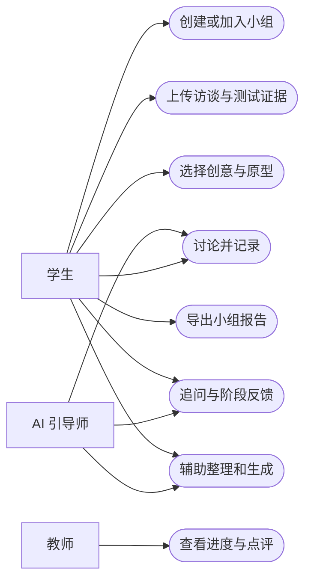
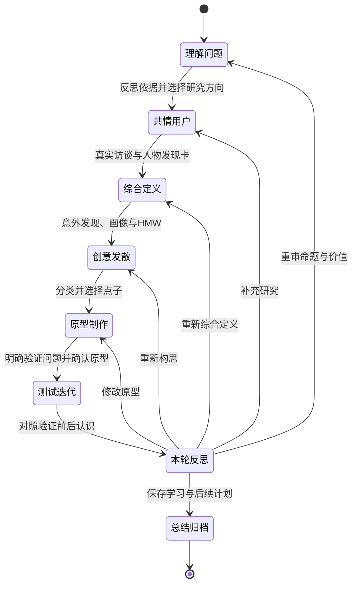
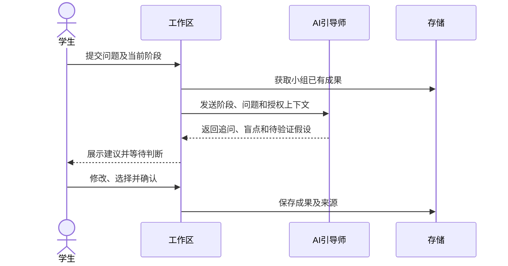
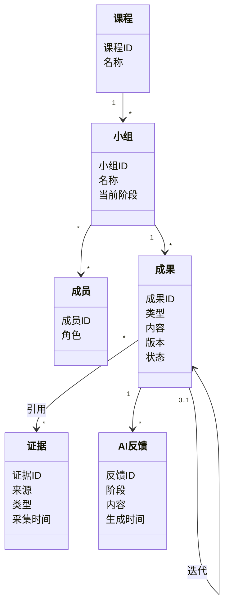

# 设计思维 AI 工作坊软件需求文档

本文依据讨论录音转写与现场照片整理，面向产品、教学和研发团队。状态：需求草案，供课程负责人确认。目标是在约 30 人试点课堂中，以一个设计思维智能体辅助小组完成从问题探索到测试迭代的学习闭环。学生负责观察、判断和选择，AI 负责提问、整理与辅助表达。

## 一、目标与范围

**核心场景：**线下同组讨论与线上远程小组讨论。个人上传与反馈可作为补充，但不是首要目标。首版优先学生端、一个智能体和六阶段工作流；教师评分、教师手册及规模化运营作为后续方向。

**成功结果：**小组能够保存每阶段成果、带着真实用户证据推进、选择创意并完成原型测试，最终获得一份可追溯的小组研究报告。先由可月老师试用反馈，再在约 30 人课堂试点；实际课次安排待确认。

**设计原则：**学生先思考再使用 AI；AI 不直接替代真实访谈或替学生做决策；模拟用户和推测必须明确标记，不能当作真实证据。照片中的六阶段及“自己做／与 AI 协同”是教学框架，便签部分字迹不清，不作为确定需求。

## 二、角色与用例

| 角色 | 目标 | 权限建议 |
| --- | --- | --- |
| 学生 | 参与小组、探索问题、上传证据、选择并迭代成果 | 访问所属小组并编辑其成果 |
| 教师 | 设置教学任务、查看进度、给予点评 | 查看授权班级成果；最终教学判断由教师作出 |
| AI 引导师 | 按当前阶段追问、归纳、提示盲点与生成草稿 | 在用户触发或约定时介入；不独立决策 |
| 管理员 | 配置课程与成员 | 课程管理；具体授权待确认 |



图 1：用例关系示意。教师端能力的首版深度待确认。

## 三、教学工作流



各阶段允许返回修订；阶段名称依据现场图整理，具体推进条件由教师确认。每个小组聚焦一个具体问题，初始大问题可拆出多个候选方向，由小组选择一个继续。

以下逐项规定每阶段的输入和输出。“讨论确定”指转写中明确提出并经后续讨论保留的内容；“本次反馈明确增加”指用户于 2026年11月15日提出的修订要求；“设计细化”指为落地补充的字段、界面与校验规则，需产品和教学负责人确认。字段中的必填、选择方式、版本状态均属设计细化，不冒充会议决定。例子均为教学示例，不是已采集的用户证据。

输入包括进入阶段时承接的材料，以及阶段内学生必须新提交的材料；输出分为过程反馈与正式交付。AI 草稿、提问和建议不自动成为小组结论。学生可以编辑、选择或重写后确认。所有材料应带小组、阶段、提交者、提交时间及来源；这里的元数据是统一设计细化，不要求学生重复填写。真实引文须可定位原材料，AI 推测须标为待验证。

### 阶段一 提出和理解问题

先反思问题为什么值得研究、从何而来，再把较宽泛的初始命题拆解为小组愿意研究的工作坊主题。此时允许假设和不确定性，不要求完成第三阶段的 HMW，也不把推测的原因当成调查结论。

#### 输入设计

##### S1 I1 原始命题卡

- **依据与用途：**讨论确定：学生先提出命题，按简单框架填写人、场景和要做的事或目标。

- **内容与字段：**原始命题原文；暂定用户；场景；用户要做的事／希望改善的体验。保留不清楚项，不强迫编造细分信息。

- **呈现与交互：**单张表单，先让学生输入；支持保存粗略草稿。AI 在提交后再追问。 提交后优先进入 S1 I4 的选题理由与来源追问，再开展命题拆解。

- **质量与校验：**命题原文不能空；缺少用户或场景时提示补充，允许标记待讨论。不能预填 AI 答案替代首次思考。

- **示例：**原始命题：改善大学生买奶茶的体验。用户：女大学生；场景：校园食堂；目标：选新款奶茶更容易。

##### S1 I4 选题理由与问题来源反思

- **依据与用途：**本次反馈明确增加：提交原始命题后，先反思它为什么值得研究，以及目前把它看作问题的依据。

- **内容与字段：**关联原始命题；为什么值得研究；可能影响谁、怎样影响；来源类型（亲自观察／听到抱怨／猜测，可多选）；对应的事件、原话或猜测说明；尚不确定的地方。来源细分和字段属于实现设计。

- **呈现与交互：**原始命题提交后显示两个问题：“为什么这是一个值得研究的问题？”“问题来自观察、听到抱怨，还是某种猜测？”学生先回答，再看 AI 反馈；修改命题时保留对应反思。

- **质量与校验：**理由和来源需填写，允许承认只是猜测或暂时说不清；不要求学生伪造证据。亲眼观察也不自动代表原因已证实，抱怨只代表听到的说法；AI 不把抽象命题标为已验证问题。

- **示例：**“改善奶茶选择体验”来自两位同学的抱怨，学生尚未观察实际购买；值得研究的理由是想理解犹豫怎样影响午休，尚不能断定犹豫由口味不明造成。

##### S1 I2 小组拆解讨论材料

- **依据与用途：**讨论确定：小组讨论用户类型、场景、方向，录音提交供 AI 提炼反馈。

- **内容与字段：**讨论文字或主动开启的录音；对关键用词的理解；考虑过的用户与场景；尚有分歧的方向。

- **呈现与交互：**讨论区附上传入口及开始／停止录音按钮；整理后让成员校正文意。

- **质量与校验：**至少有能反映讨论内容的文字或录音；音频不清晰需补充说明。不得默认持续录音，不把转写错误当真实意见。

- **示例：**把“大学生”拆成尝鲜者、固定口味购买者等候选，把购买拆成选择、排队、取餐等环节；这些仍是研究假设。

##### S1 I3 对追问的回答与方向选择

- **依据与用途：**讨论确定：学生针对反馈继续讨论，并最终自己重写命题。

- **内容与字段：**AI 问题对应回答；采纳或不采纳的方向；最终选择的用户和场景；拟研究目标。

- **呈现与交互：**逐问回答后进入命题重写框，保留原命题作对照。

- **质量与校验：**学生须明确选择本轮研究方向；不以 AI 推荐顺序自动选中，不要求证明尚未研究的原因。

- **示例：**选择研究：在校园食堂购买新款奶茶时经常犹豫的女大学生。

#### 输出设计

##### S1 O1 拆解反馈与可选研究方向

- **依据与用途：**讨论确定的过程输出：提炼讨论、指出其他可能用户和场景，提供选择。

- **内容与字段：**讨论要点；模糊词；尚未考虑的方向；追问；若有方向建议，提供多个可比较选项。

- **呈现与交互：**反馈卡与候选方向列表；每项标注来自讨论或 AI 补充。

- **质量与校验：**准确保留不同意见，不强行合成共识；多个方案是选择空间，不是多个必须并行的项目。

- **示例：**追问：你关心的是不知道选哪款，还是排队过久？两者需要不同的研究对象。

##### S1 O2 小组确认的工作坊主题命题

- **依据与用途：**讨论确定的正式交付：学生重写一个较明确的主体问题。

- **内容与字段：**用户；场景；要探索的活动或体验；完整命题文本；原始命题对照。 关联 S1 O3 问题反思记录；确认的是本轮研究方向，不表示命题已经被事实验证。

- **呈现与交互：**命题卡，状态为待确认／小组已确认；确认后传入第二阶段。

- **质量与校验：**较原始命题更可研究；仍可被后续访谈推翻。不能提前写成未经证实的用户洞察，不能与 HMW 混称。

- **示例：**如何理解女大学生在校园食堂选择新款奶茶时的犹豫，并探索更好的选择体验？

##### S1 O3 问题反思记录

- **依据与用途：**本次反馈明确增加；作为本轮选题依据随确认命题一同保留，记录人为什么想研究和哪些判断仍是假设。

- **内容与字段：**原始命题及确认命题引用；学生选题理由；来源类型及具体描述；已知事实、听到的说法、猜测和未解问题；AI 追问及学生回应。字段是设计细化。

- **呈现与交互：**命题卡旁展示反思摘要，展开查看原始回答与修改；学生确认命题时一起确认该记录，进入第二阶段作为访谈背景。

- **质量与校验：**学生须确认自己的理由及依据状态；可以记录“目前仅为猜测”，不能标成研究已验证。AI 建议与学生回答分别保存，不以 AI 写好的理由替代学生反思。

- **示例：**记录“我们听到抱怨，尚未确认是否普遍存在；下一步了解具体购买经过”，而不是“已证实所有学生都有选择困难”。

### 阶段二 共情用户

包含访谈前准备、实地访谈及回来后的发现整理。讨论曾提出共情地图，随后改为照片、headline 和具体情况组成的卡片，每位受访者一张。

#### 输入设计

##### S2 I1 本轮主题与学生拟定的访谈问题

- **依据与用途：**讨论确定：承接第一阶段，学生先拟问题，再交 AI 改进。

- **内容与字段：**已确认主题引用；想了解的重点；拟访谈问题原文；拟观察或体验的关注点（如有）。 带入 S1 O3 选题理由及观察／抱怨／猜测的来源状态，用于访谈时检验最初假设。

- **呈现与交互：**自动带入主题；问题逐条编辑，每题可注明想了解什么。

- **质量与校验：**不能只有主题而无学生初稿；提示封闭、抽象或诱导式问题，但保留原稿供比较。

- **示例：**初稿：你喜欢什么奶茶？研究重点：实际选择时会参考什么。

##### S2 I2 实地访谈与观察原始材料

- **依据与用途：**讨论确定：手机采集照片和录音上传小组空间，至少录音可转文字；视频后被暂不采用。

- **内容与字段：**受访者代号；录音及转写；照片；已有的观察、体验文字；材料对应的受访者。

- **呈现与交互：**手机采集与上传入口；按受访者归组，电脑端继续查看；转写可校对。

- **质量与校验：**上传成功不等于内容有效；需能区分不同受访者。照片缺失不允许生成假照片冒充真人；隐私处理与授权方式另行确认。

- **示例：**受访者 A 的访谈录音、现场照片、学生记录的选购行为。

##### S2 I3 学生自己的发现及讨论

- **依据与用途：**讨论确定：回来先由学生发现和提炼，再由 AI 提醒不足。

- **内容与字段：**每位受访者最有意思的发现；相应原话；具体情况；组员补充；对访谈不足的反思。

- **呈现与交互：**先展示个人／小组发现填写区，再开放 AI 分析；允许讨论录音辅助录入。

- **质量与校验：**必须有学生初次判断；一句发现要能找到对应材料。学生解释和受访者原话用不同字段，不能混写。

- **示例：**示例发现：她不是没有偏好，而是想尝新又担心踩雷。此句是学生解释；需另附支持它的真实引文。

#### 输出设计

##### S2 O1 访谈问题清单或访谈方案 PDF

- **依据与用途：**讨论确定的访谈前交付：AI 建议后由小组采纳问题，生成 PDF，可携带或打印。

- **内容与字段：**研究主题与重点；最终采纳的问题列表。设计细化可增加提问顺序、追问提示及观察备注。

- **呈现与交互：**逐题显示原稿与建议，学生确认后预览／导出 PDF。

- **质量与校验：**问题应引导具体经历和故事；不把建议直接当采纳。不得要求所有问题固定不变或访谈只念完清单。

- **示例：**把“你喜欢什么菜”改为“你昨天吃的饭里，哪一道最好吃？能说说当时的情况吗？”

##### S2 O2 访谈质量反馈与补充建议

- **依据与用途：**讨论确定的过程输出：指出访谈问题，要求有必要时补访或重做。

- **内容与字段：**发现的不足；依据的具体材料；为什么不足；建议补充的对象或追问。

- **呈现与交互：**反馈清单，每条可回到对应材料；学生处理后补交新材料。

- **质量与校验：**必须解释原因，不凭空要求统一补访人数。访谈环节曾提出一到十分评分，末尾又说首版评分先不做；两者范围未完全说清。首版先提供定性反馈，是否保留访谈分数需确认，不能默认为已定。

- **示例：**只有泛泛喜好、没有一次实际选择经过时，建议补问最近一次犹豫过程，而非直接宣称研究合格。

##### S2 O3 每位受访者一张人物发现卡

- **依据与用途：**讨论最终确定的阶段交付：照片、一个 headline、具体情况；一人一卡。

- **内容与字段：**照片；headline；人物具体情况。headline 优先提取最有启发的原话；如果使用学生概括，必须显式标注，不能伪装引文。设计细化增加受访者代号及材料引用。

- **呈现与交互：**卡片列表，一位受访者对应一张；点击可展开背景与原始材料。

- **质量与校验：**人数与卡数对应；最重要发现置顶；headline 不泛化整个人群。照片或引文缺失要标缺失，不补造。该产物不叫用户画像，也不换回共情地图。

- **示例：**教学示例：照片＋“我每次说要试新品，最后还是买老样子”＋最近一次购买、犹豫与最终选择的具体情况。

### 阶段三 综合与定义问题

讨论先列用户画像、用户问题、HMW 三项，后来明确将用户问题的细致指导留给教师，软件直接到 HMW。本次反馈在画像之前增加意外发现及材料关联，允许“暂无”；本阶段交付包括意外发现记录、用户画像和 HMW；教师仍帮助学生理解用户问题。

#### 输入设计

##### S3 I1 人物发现卡及对应证据

- **依据与用途：**讨论确定：第二阶段输出直接作为本阶段输入。

- **内容与字段：**全部人物发现卡；关联照片、访谈文字和学生发现；第一阶段命题作为背景。

- **呈现与交互：**卡片集合与原材料并排浏览，可选择本轮综合的受访者。

- **质量与校验：**必须使用真实卡片而非 AI 模拟人物；保留个体差异，不能把相互矛盾的资料硬合为一个人。

- **示例：**五位受访者五张卡；五仅为示例，不是最低访谈人数。

##### S3 I4 意外发现及材料关联

- **依据与用途：**本次反馈明确增加，在用户画像之前关注与先前想法不同、意外、矛盾或例外的发现。

- **内容与字段：**原先的想法；意外发现；差异在哪里；关联人物发现卡与访谈录音／转写位置；或显式填写“暂无”。字段关系为实现细化，允许记录一条或多条。

- **呈现与交互：**画像模板前显示“访谈中，哪些发现与你之前的想法不同，或者让你感到意外？”可选材料引用并填写；“暂无”作为正常选项，不阻塞进入画像。

- **质量与校验：**填了发现必须关联访谈材料，缺少引用先存为待补充。不能把少数例外推广到所有人，也不能为完成任务让 AI 编造惊喜。没有发现可以写“暂无”，不因此扣分或强制补访。

- **示例：**原先以为犹豫是不了解口味；受访者清楚自己的偏好，却说不想花钱买到不喜欢的新品。关联该人的原话，将“尝新风险”记为待进一步理解的解释。

##### S3 I2 学生填写的用户画像初稿

- **依据与用途：**讨论确定：提供画像模板，学生先综合填写，再由 AI 反馈迭代。

- **内容与字段：**模板包括年龄、兴趣、生活方式等讨论提到的维度。设计细化增加与命题相关的行为、需求和证据引用；资料没有的信息填未知。

- **呈现与交互：**可编辑画像表；允许查看引用卡片；完成初稿后触发反馈。 填写画像前先回答 S3 I4 的意外发现问题；填写“暂无”也可继续。

- **质量与校验：**学生先填；画像是综合后的目标用户表达，不能只是原始访谈卡改名。不得编出年龄或生活方式来填满表单。

- **示例：**从几张卡中整理“在有限午休里想尝新但担心选错”的行为特征；若资料不足则标待验证。

##### S3 I3 教师引导后的 HMW 初稿与学生修订

- **依据与用途：**讨论确定：用户问题的细致指导由教师完成，学生据此进入 HMW。

- **内容与字段：**学生提出的“我们如何……”问题；拟帮助的用户；希望改善的体验；对 AI 反馈的修订。

- **呈现与交互：**展示画像与 HMW 编辑区；教师引导是教学活动，不要求系统自动生成独立的用户问题作业。

- **质量与校验：**HMW 应对应研究发现；不要求学生机械填一套未经讨论确定的用户问题模板。

- **示例：**我们如何帮助想尝新又担心踩雷的学生，更有把握地选择一款奶茶？

#### 输出设计

##### S3 O4 已核对的意外发现记录

- **依据与用途：**本次反馈明确增加的反思材料；用于画像前保留例外，避免只归纳共性或印证既有想法。

- **内容与字段：**原先想法、差异或意外内容、材料引用、学生解释及待核实部分；若暂无，则保存“暂无”。一条发现不自动等于总体洞察。

- **呈现与交互：**画像页保留意外发现栏，可回到证据并对照画像；显示已关联证据／待补充引用／暂无，状态名称为设计细化。

- **质量与校验：**学生核对引文与解释；有资料冲突时保留差异，不用多数意见抹去少数例外。暂无可确认，但不能声称不存在例外。

- **示例：**记录“至少一位受访者知道口味仍犹豫”，提醒画像不要一律写成“不懂口味”。

##### S3 O1 经反馈迭代并确认的用户画像

- **依据与用途：**讨论确定的正式交付。

- **内容与字段：**画像各项内容；依据的发现卡；AI 提示的缺口；学生确认的最终表述。

- **呈现与交互：**画像卡与修改对照；若提供 AI 改写，应有多个方向供学生判断，不强制接受单一答案。

- **质量与校验：**核心行为和需求可回到材料；将证据不足的解释标待验证。画像数量原文未确定，不设为固定一张或多张。 对照 S3 O4 意外发现保留例外及矛盾，不只提炼支持先前观点的共性。

- **示例：**最终画像突出选择行为及顾虑，而不是仅罗列年龄、性别和爱好。

##### S3 O2 重构后的 HMW 问题

- **依据与用途：**讨论确定的正式交付：从如何帮助用户的角度重构问题，交给创意阶段。

- **内容与字段：**HMW 文本；关联画像；所依据的发现。可保留候选问题，并明确本轮选择的那个问题。

- **呈现与交互：**HMW 候选列表及学生确认操作；选择数量作为设计细化，不能自动按 AI 排名决定。

- **质量与校验：**既有明确用户和改善目标，也保留多种解决路径。附件的“有一个三句question”转写含混，不能据此规定必须三个 HMW。

- **示例：**“如何让课堂上想发言又怕出错的学生，即使说错也愿意尝试？”是讨论中例子的规范化转述。

##### S3 O3 画像和 HMW 的改进反馈

- **依据与用途：**讨论确定的过程输出：AI 指出画像不足并辅助修改；HMW 反馈规则为设计细化。

- **内容与字段：**需核实的信息；画像与材料的冲突；HMW 中模糊或直接锁定方案的词；可调整的方向。

- **呈现与交互：**按问题逐条提示，保留学生采纳情况。

- **质量与校验：**反馈服务于学生判断，不另生成必须提交的用户问题卡；不得自动推断用户的心理动机。

- **示例：**若 HMW 直接写成“如何做一个推荐 App”，提示先说明要改善哪种选择体验。

### 阶段四 创意发散

围绕选定 HMW，学生先头脑风暴，必要时选择方法再次发散，再自行投票选择。AI 在此鼓励拓展方向，不采用否定创意的泼冷水模式。

#### 输入设计

##### S4 I1 选定 HMW 与相关研究背景

- **依据与用途：**讨论确定：针对上一阶段 HMW 开展创意。

- **内容与字段：**选定 HMW；相关画像；人物发现和证据作为背景引用。

- **呈现与交互：**阶段入口固定显示 HMW，可展开研究背景。

- **质量与校验：**必须明确本轮解决哪个问题；不把未经选择的全部问题混成一次发散任务。

- **示例：**围绕“更有把握选择新奶茶”发散，而不是讨论整个食堂改造。

##### S4 I2 学生头脑风暴与第二轮发散材料

- **依据与用途：**讨论确定：学生先做，上传白板照片及适时主动录音；AI 提供可选方法。

- **内容与字段：**白板照片；讨论录音或文字；点子原文；选择的方法与第二轮新增点子。

- **呈现与交互：**上传后整理成点子条目，学生校对；方法入口可选择 SCAMPER、类比、反转等。

- **质量与校验：**不能用 AI 一键生成替代第一轮；识别不清的便利贴需学生校对；保留不同想法，不提前合并丢失。

- **示例：**第一轮“试饮、口味对照、同伴推荐”；选择反转方法后再提出新方向。

##### S4 I4 学生的点子分类

- **依据与用途：**本次反馈明确增加：学生按“最容易实现的、最具突破性的、最有趣的”对点子分类。

- **内容与字段：**已有点子引用；所选类别；分类理由。设计建议允许同一点子多个标签、暂未分类，保留不同成员意见；是否必须每类各选一个尚未明确。

- **呈现与交互：**候选点子区增加三个分类栏或标签，由学生操作；先完成初步整理再分类，随后投票。AI 可以问理由，但不替学生自动归类确认。

- **质量与校验：**分类必须是学生判断；不要求三类等量，也不强迫每个点子唯一归类。分类不等于最终投票结果，不把容易实现作为淘汰突破性创意的规则。

- **示例：**纸质口味对照表可被学生标为容易实现；可试验的新服务机制可能标为突破性；趣味试饮挑战可标为有趣。这些都是示例。

##### S4 I3 学生投票与入选点子

- **依据与用途：**讨论确定：点子由学生投票或自行选择，再提交 AI 整理。

- **内容与字段：**候选点子；投票／选择结果；进入描述单的点子；准备进入原型阶段的选择。 带入学生的 S4 O4 分类视图，分类标签与投票选择分开保存。

- **呈现与交互：**点子列表中进行投票或确认选择，能看到选中的条目。

- **质量与校验：**不得由 AI 替学生决定。每人票数、平票规则和描述单前后是否分别投票未明确，属于待定交互，不写成会议决定。

- **示例：**小组选出三项点子形成描述单，再标明本轮希望制作原型的点子。

#### 输出设计

##### S4 O1 发散方法与鼓励式反馈

- **依据与用途：**讨论确定的过程输出：可选框架、参考、换方向再想一轮。

- **内容与字段：**方法说明；如何用于当前 HMW；类比／反转参考；可继续探索的不同维度。

- **呈现与交互：**方法卡与继续一轮按钮；反馈使用提问、提示，鼓励学生产出。

- **质量与校验：**不能用批判式评分压缩发散；SCAMPER 的拼写规范化不代表会议确定唯一方法。

- **示例：**类比：其他高风险选择场景怎样让人先小步试试？提示思路，不直接宣布最佳点子。

##### S4 O4 小组确认的点子分类视图

- **依据与用途：**本次反馈明确增加的创意整理产物，与原始点子和投票结果关联保留。

- **内容与字段：**按三个类别展示的点子引用；学生分类理由；重叠标签或分歧；后续投票结果的独立标识。页面形式属于设计细化。

- **呈现与交互：**以三栏分类视图供比较，点击可回到点子；描述单显示已确认分类标签。学生可在投票前修订分类。

- **质量与校验：**不能只保存 AI 分类结果；允许某类为空，不凭空补点子填满版面。分类标签与三个不同点子的描述单要求分别校验，不把三类各一张理解为既定配额。

- **示例：**一个点子同时属于容易实现与有趣时，两栏引用同一点子，而不是复制为两个独立创意凑数。

##### S4 O2 至少三份点子描述单 PDF

- **依据与用途：**讨论末尾确定：从两个调整为至少三个描述单；核心格式是名称、图像、两三句描述。

- **内容与字段：**每份包含一个点子名称、一幅图像、两三句核心说明。设计细化增加对应 HMW 和点子编号，便于追溯。 显示学生确认的类别标签及分类理由引用，不要求三个类别各占一份。

- **呈现与交互：**每个点子一张可预览描述单，可导出 PDF；可合并为一份多页 PDF，合并方式待确认。

- **质量与校验：**至少三个不同点子的描述单；不可把同一点子的三个排版版本冒充三个点子。图像应解释点子，核心句说清做什么及如何帮助用户。

- **示例：**点子“新品三口试饮”：先少量体验，再决定整杯；用示意图说明试饮与购买的关系。

##### S4 O3 进入原型阶段的点子及描述单引用

- **依据与用途：**讨论确定：投票决定哪个点子进入下一环节，描述单成为原型输入。

- **内容与字段：**入选点子；对应描述单；小组确认。选择理由字段为设计细化。

- **呈现与交互：**在描述单上标记进入原型，保留其他候选供返回比较。

- **质量与校验：**描述单已生成不等于所有点子必须同时做原型；并行数量原文未定。

- **示例：**选择“新品三口试饮”进入本轮原型，其余两份描述单仍保留。

### 阶段五 原型制作

点子名称和粗描述不足以生成原型；生成前必须明确这次最想知道什么，再决定要做何种原型。学生需补充形式及接口等说明，系统结合历史讨论先生成粗略静态方案，学生确认方向后再修改。

#### 输入设计

##### S5 I1 入选点子描述单与历史上下文

- **依据与用途：**讨论确定：描述单直接成为输入，并可链接此前所有相关讨论。

- **内容与字段：**选中点子名称、图像及核心说明；关联 HMW、画像、发现与讨论。

- **呈现与交互：**阶段入口自动带入描述单，相关背景可展开检查。

- **质量与校验：**不能只把点子名称发送给 AI；引用必须属于该小组并与该点子有关，避免混用其他方案。 还须取得 S5 I4 的本轮验证问题，才能开始生成原型。

- **示例：**带入试饮点子的描述单，以及用户担心踩雷的研究背景。

##### S5 I4 本轮原型最想验证的问题

- **依据与用途：**本次反馈明确增加：生成原型前回答“通过这次制作原型，你最想知道什么？”让原型服务于学习与验证。

- **内容与字段：**关联入选点子；本轮最想知道的问题；生成前的看法或预期及其依据。设计细化将最关注的问题作为主问题，其余问题可附记；不强制设定未经讨论的量化门槛。

- **呈现与交互：**在生成原型按钮之前填写；AI 可追问如何用原型观察这个问题。问题随本轮原型保存，修改或换轮时保留历史，测试阶段自动带入。

- **质量与校验：**可保存未完成草稿，但启动原型生成前需明确问题。过于宽泛或无法通过当前原型观察时，提示聚焦或调整原型；不能由 AI 给一个问题后默认学生接受。

- **示例：**“用户是否真的愿意花时间试饮新品？”生成前预期是愿意，但尚无行为证据；原型须能让用户理解或尝试试饮过程。

##### S5 I2 学生补充的原型制作说明

- **依据与用途：**讨论确定：回答引导问题，重新描述点子，说明 App、服务、传播物等形式及人机／用户接口。

- **内容与字段：**原型类型；给谁使用；核心使用情境；用户如何接触或操作；本轮要展示什么。具体五个字段为设计细化，原文只讨论约五个问题，未定题目。 说明本次原型要怎样帮助观察 S5 I4 的验证问题，而不只描述外观。

- **呈现与交互：**先选类型，再显示适合该类型的补充问题；所有回答可编辑。

- **质量与校验：**不能把示例类型当作首版都已支持；选择不支持类型时给出当前能做的静态表达方式。

- **示例：**服务原型：用一张示意图表现顾客如何领取试饮、比较口味并决定购买。

##### S5 I3 参考材料及对候选方案的反馈

- **依据与用途：**讨论确定：可上传文字和参考图片，学生选择方案或要求修改。

- **内容与字段：**参考图片／附件（可选）；参考用途；学生对每个方案的选择与修改说明。

- **呈现与交互：**附件区标明可选；候选方案支持标记、评论及改动说明。

- **质量与校验：**没有参考图不能阻止生成；参考图不等于真实研究证据。修改应指向具体方案，避免覆盖错版本。

- **示例：**参考店内试饮台照片；反馈“保留流程，但把说明缩短，明确先试后买”。

#### 输出设计

##### S5 O3 与原型绑定的验证问题卡

- **依据与用途：**本次反馈增加验证目标；独立卡片及版本绑定是为了让第五、六阶段前后对应的设计细化。

- **内容与字段：**主问题；生成前的学生看法与依据；原型版本；原型怎样帮助观察问题；当前能验证什么、不能验证什么；状态（待测试）。

- **呈现与交互：**与候选和确认原型并列显示；生成前由学生确认，进入测试时带入同一问题。重写问题创建新修订，不悄悄覆盖原始预期。

- **质量与校验：**问题、原型表达方式须相容。静态图可以测试理解或获得意向反馈，不能仅凭口头赞同证明真实投入时间或付费行为；必要时提示补充真实体验安排。

- **示例：**对“愿意花时间试饮”可记录“当前流程图仅能收集意向，实际时间投入还需真实服务测试”，不得把漂亮图片当成功验证。

##### S5 O1 可比较的粗略静态原型方案

- **依据与用途：**讨论确定：先静态、先确认方向，提供可选择的方案。

- **内容与字段：**静态图片、线框图或适合方案的示意图；每个候选的方向说明。设计细化记录生成依据。

- **呈现与交互：**候选缩略图与大图预览，学生可选一个并提出修改。

- **质量与校验：**不要求一开始可交互或高保真；不生成视频。原文以三个方案举例，不能把三个原型写成固定数量承诺。 每个候选方向须回应同一验证问题，说明表达范围；装饰效果不作为验证成功的证据。

- **示例：**同一试饮点子分别以柜台服务图和桌面试饮套装示意图呈现供选择。

##### S5 O2 小组确认并可用于测试的原型

- **依据与用途：**讨论确定的正式交付：选择、修改后的粗原型。

- **内容与字段：**确认的原型文件／图片；必要的使用说明；本轮确认的方向。版本编号与前版关系为设计细化。 必须绑定 S5 O3 验证问题卡，连同测试前看法交给第六阶段。

- **呈现与交互：**选定后形成当前原型，保留历史候选与修改记录；可在手机或电脑展示。

- **质量与校验：**表达清楚要让用户体验或理解什么，不把它误称可上线产品；测试所用原型必须可明确识别。

- **示例：**最终用一张服务流程图向用户说明如何试饮并作选择，进入第六阶段。

### 阶段六 测试与迭代

把原型带出去面对真实对象测试。流程参照访谈：先准备问题，再收集材料，学生反思后把反馈输入系统，反思原验证问题的认识变化，并选择从前五步中的哪一步重新入手；决定继续修改原型时再制作新版。

#### 输入设计

##### S6 I1 当前原型及学生拟定的测试问题

- **依据与用途：**讨论确定：带着原型出去测试，并准备要问的问题。

- **内容与字段：**被测试的原型；学生拟问的问题。设计细化增加测试对象、情境和希望检验的点，方便解释反馈。 自动带入 S5 O3 的原验证问题及先前看法；测试任务围绕它设计。

- **呈现与交互：**并列显示原型与测试问题草稿，支持 AI 追问后修改。

- **质量与校验：**必须明确测试哪个方案；不把“你觉得好吗”当作唯一依据，应关注理解、行为与问题。

- **示例：**让用户看试饮流程图，询问他会先做哪一步、哪一步不理解；这些为设计示例。

##### S6 I2 真实测试的录音文字和图片

- **依据与用途：**讨论确定：手机记录录音、文字和照片，再输入系统。

- **内容与字段：**每次测试的原始记录；对应的测试对象代号；反馈与行为记录；对应原型。

- **呈现与交互：**手机采集后按测试记录归组，电脑端可查看和补充。

- **质量与校验：**必须区分用户实际做了什么、用户说了什么与学生推断；没有实际测试时只能标待测试，不能以 AI 模拟替代。

- **示例：**用户把试饮当成免费领整杯的照片或文字记录，以及他当时的解释。

##### S6 I4 对原验证问题的认识变化

- **依据与用途：**本次反馈明确增加测试后问题：“测试之后，你对这个问题的认识有什么变化？”

- **内容与字段：**自动引用 S5 O3 的同一问题与测试前看法；测试后看法；变化或未变化；关联测试材料；仍不确定之处。

- **呈现与交互：**测试后先并列展示问题、先前想法与反馈，再由学生填写认识变化；允许回答“暂未改变”或“证据不足”。

- **质量与校验：**不能用“用户说不错”直接认定问题已解决；变化或不变都要说明依据。问题被改写时保留原问题并注明为何改，不允许事后改题伪装验证成功。

- **示例：**原以为都愿试饮；测试发现赶课者不愿等待、闲暇者愿意。认识改为“意愿与时间情境有关”，而不是判定所有人都愿意。

##### S6 I3 学生反思与修改意图

- **依据与用途：**讨论确定：测试后有反思并修改。

- **内容与字段：**学生发现的问题；哪些反馈值得处理；拟改什么；为什么；对 AI 建议的判断。 参考 S6 I4 的认识变化；修改意图可指向前五步中的任一步，不限于修改原型。

- **呈现与交互：**先填写反思，再进入修改对话；每个修改可指向一条反馈。

- **质量与校验：**不能只上传材料就默认用户满意；不同用户意见冲突时保留差异，不按 AI 总结自动决定。

- **示例：**反思：流程图误导了试饮量；拟增加小杯图示及领取说明。

##### S6 I5 本轮反思与重新入手的步骤

- **依据与用途：**本次反馈明确强化：完成本轮后回答“如果改进方案，从之前五个步骤，哪一步重新入手？”

- **内容与字段：**拟返回步骤（1 理解问题、2 共情用户、3 综合定义、4 创意发散、5 原型制作）；选择理由；关联证据或未解问题；准备重做什么；下一轮想知道什么。设计建议选择一个优先入口，必要时附记后续步骤。

- **呈现与交互：**在结束本轮前显示五个步骤的回看入口，学生选择并填写理由；AI 根据证据提示可能方向，小组确认后才打开所选阶段。

- **质量与校验：**不默认只能改原型。尚无法决定可保存待反思并请求教师指导，不自动替学生选择；课程归档不表示问题已解决。返回保留旧成果与本轮版本，不把历史全部清空。

- **示例：**若发现真正问题是午休时间不足，可以回第一步重审命题；用户差异不明可回第二步补访；不是一律进入第五步美化画面。

#### 输出设计

##### S6 O1 经改进的测试问题清单

- **依据与用途：**讨论说明参照访谈流程；作为测试前过程产物。

- **内容与字段：**学生采纳后的测试问题；必要的追问。测试任务字段及清单版式为设计细化。

- **呈现与交互：**可在手机查看，测试时记录回答；是否单独导出 PDF 未明确，不强制。

- **质量与校验：**问题围绕原型，避免诱导赞同；不能把访谈阶段的通用问题原封不动复用。

- **示例：**“你觉得这个设计很好吧”改为“你看完后准备怎么使用？哪里让你犹豫？”

##### S6 O2 测试反馈与反思整理

- **依据与用途：**讨论确定存在反馈收集和反思；独立整理视图为设计细化。

- **内容与字段：**材料摘要；学生反思；准备采纳的修改；尚未解决的分歧。

- **呈现与交互：**反馈列表关联测试材料和原型，供修改时查阅。

- **质量与校验：**只报告实际观察与陈述；不能把一次测试写成普遍有效的证明。区分已采纳、暂不采纳及待验证。

- **示例：**一名测试者误读试饮量，这是本次发现，不能写成所有用户都会误读。

##### S6 O3 选择继续修改原型时的迭代版本

- **依据与用途：**讨论明确的阶段正式输出：仍然是原型，是上一版的迭代。

- **内容与字段：**新原型文件；修改内容；对应反馈。设计细化保留修改前后的对照、版本和后续待测项。

- **呈现与交互：**展示前后版本，学生确认新版，可发起下一轮测试。

- **质量与校验：**每项实质改动说得出依据；生成新版不意味着已通过新一轮测试。保留被测试旧版，避免混淆。 本轮确定回第五步继续原型时生成；若选择回第一至四步，可先保留旧原型并记录下一轮行动，不强制生成新原型才能结束本轮。

- **示例：**V2 增加小杯图示；标记“解决误读的效果待下一轮测试”，不能直接称验证成功。

##### S6 O4 认识变化与下一轮行动记录

- **依据与用途：**本次反馈增加的本轮反思交付，连接原型验证、测试学习与重新入手的步骤。

- **内容与字段：**原验证问题；测试前后认识；变化依据及未解之处；优先返回步骤；选择理由；下一步要做的具体工作；相关旧原型与新原型引用（如有）。

- **呈现与交互：**以测试前后对照和下一轮行动卡展示，供小组确认、课程报告引用及返回阶段时携带。可先记录反思，再决定是否制作新版原型。

- **质量与校验：**即使不生成新版也要保存本轮学习；若选择回前几步，不强迫先生成漂亮新原型。记录变化不能自动等同验证成功。每轮记录留存，前后问题与证据可追溯。

- **示例：**记录“对试饮意愿的认识发生变化；回共情阶段补访赶课者与闲暇者，先理解情境差异”，随后才决定是否重新构思服务。

### 课程总结与归档

这是六阶段完成后的课程总结，不另算一个设计思维方法阶段。讨论明确每个小组一份研究报告／档案，并提供后续发展建议。

#### 输入设计

##### SUM I1 全过程成果与过程材料

- **依据与用途：**讨论确定：利用从开始到结束的过程形成小组档案。

- **内容与字段：**初始及重写命题；访谈方案、材料和发现卡；画像与 HMW；点子描述单及选择；原型、测试、反思和迭代成果。 同时汇集 S1 O3 选题反思、S3 O4 意外发现、S4 O4 分类、S5 O3 验证问题和 S6 O4 认识变化及回溯决定。

- **呈现与交互：**自动汇集已有材料，生成前显示材料目录和缺失项。

- **质量与校验：**只能引用实际保存的资料；无访谈、无点评或无某轮版本时不得补造。该目录是报告输入，不要求学生重新上传。

- **示例：**报告可呈现初始命题如何因一次访谈发现而改变。

##### SUM I2 学生补充的总结和教师点评

- **依据与用途：**讨论提到反思不足及教师点评；已存在的点评作为输入，不要求教师端首版上线。

- **内容与字段：**学生的阶段反思；课程中真实发生的教师点评；对继续发展的想法；可选叙事框架。

- **呈现与交互：**允许补充文字或已有点评材料，并逐条核对归属；展示材料另设可选入口。

- **质量与校验：**没有教师点评时不生成虚构点评；叙事由学生决定。选择故事结构是可选展示需求，不阻碍研究报告生成。

- **示例：**补充：本次测试对象较少，下次希望比较更多购买情境；此为示例，不是实际项目结论。

#### 输出设计

##### SUM O1 每组一份研究报告或研究档案

- **依据与用途：**讨论确定的总结交付：回顾开始、中间、后来以及下一步建议。

- **内容与字段：**问题演变；研究过程与重要发现；画像和 HMW；创意及选择；原型与测试迭代；学生反思；已有教师点评；不足与后续发展建议。 增加学生最初依据、反例或意外发现、验证前后认识变化，以及下一轮从哪一步重来的理由与行动。

- **呈现与交互：**按小组生成可审阅报告，学生校正后导出；格式与模板原文未定，需确认。

- **质量与校验：**一组一份，不默认每人一份；按真实过程写，结果与建议分开，未验证内容不写成事实。建议需指明下一步可继续做什么。

- **示例：**继续发展建议：补测新版是否消除了对试饮量的误解；不能宣称方案已具备商业效果。

##### SUM O2 学生选择叙事后的展示材料

- **依据与用途：**讨论中的可选方向：PPT 或信息图等；不列为六阶段必交成果。

- **内容与字段：**学生自己的故事线或所选叙事框架；对应的真实成果；辅助生成的展示内容。

- **呈现与交互：**报告完成后可选生成展示材料，先确定故事，再预览和编辑。

- **质量与校验：**十页 PPT 是讨论举例而非固定交付；不能按机械六步骤替学生决定故事，也不能为美化成果捏造证据。

- **示例：**围绕“我们原本以为、研究后发现、因此怎样改变方案”的故事组织展示，具体框架由学生选择。

### 关键决定的原文依据

- 第一阶段：“一个大概的问题”“最后重写这个”。因此正式交付是学生确认的命题，拆解反馈属于过程输出。

- 第二阶段：“那就不出那个empathy map”“一个人一张卡”。照片、headline、具体情况的卡片取代此前提出的共情地图。

- 第三阶段：“直接只给他 how much we”“那步细致的指导就是老师的价值”。因此不把早先的三项输出照搬成软件三项必交作业。

- 第四阶段：“PDF”“点的名称，点的图像”“两三句话”“输出三个吧”“你至少得有三个”。因此按至少三份点子描述单设计。

- 第五阶段：“一开始不用交互”“先让他大家那个对方案有个确认”。因此先静态粗原型，学生确认后再改。

- 第六阶段：“这是对圆形的迭代”“再帮它迭代一个新的”。结合上下文将转写的“圆形”规范为“原型”，阶段正式产物是迭代原型。

- 总结：“一个小组出一份”。报告按小组生成；十页 PPT 是后续讨论的展示方式，不是固定要求。

上述依据来自本次用户上传的讨论转写。方法名称、英文术语及少量明显的转写错误按上下文规范化；含混处保留待确认。设计细化须另行确认，不反向解释为会议原话。

## 四、功能需求

优先级 P0 表示试点闭环所需；P1 表示有价值但具体交付需确认；P2 为后续探索。以下是将讨论转成可实施需求的建议，不代表所有细节均已确认。

| 编号 | 需求及行为 | 优先级 | 验收要点 |
| --- | --- | --- | --- |
| FR01 | 建立课程、小组及成员关系，支持进入所属小组工作区 | P0 | 不同组数据隔离；成员可重新进入已有工作区 |
| FR02 | 展示六阶段、当前进度及阶段成果，支持返回修改 | P0 | 修改后保留已保存成果；可识别当前阶段 |
| FR03 | 以一个 AI 引导师适配当前阶段，基于小组已保存上下文追问 | P0 | 对模糊问题提出细化问题，先等待学生输入；不直接给出最终答案 |
| FR04 | 小组记录想法、讨论结论及选择理由 | P0 | 成果可编辑、保存并在重新进入后查看 |
| FR05 | 上传文字、图片、录音和相关附件，关联阶段与来源 | P0 | 能查看上传状态及关联信息；支持录音转文字；具体格式与容量限制待确认 |
| FR06 | 整理访谈、观察与测试材料，区分原始证据、学生解释和 AI 推测 | P0 | 每条洞察可关联材料或标记为待验证；AI 不把模拟内容标为真实访谈 |
| FR07 | 维护候选点子，支持小组投票或选择，生成至少三份不同点子的描述单，每份包含名称、图像及两三句核心描述，并导出 PDF | P0 | 能看到候选、选择结果和描述单；票数、平票规则及 PDF 合并方式待确认 |
| FR08 | 对选择的点子收集原型类型、用户界面及文字／参考图片等输入，结合历史上下文生成静态方案供选择修改 | P0 | 学生可查看、选择、修改并保存版本；原型生成质量与类型待技术验证 |
| FR09 | 记录测试问题、反馈、图片或录音与反思，关联原型版本，记录认识变化与回溯决定，选择继续原型时再生成或编辑下一版 | P0 | 可从反思及新版（如有）追溯到被测试版本和反馈 |
| FR10 | 汇总问题演变、研究证据、创意、原型、测试、教师点评及后续建议，生成每组一份可审阅报告 | P0 | 可修改、导出；缺失材料明确显示，不能虚构 |
| FR11 | 支持线上小组共同工作与线下同屏使用 | P0 | 均可访问同一小组成果；实时同步冲突策略及是否集成会议待确认 |
| FR12 | 教师查看小组进度和成果并提供点评 | P1 | 教师仅访问获授权课程；评分不在首版 |
| FR13 | 根据学生选择的故事结构辅助生成展示材料 | P1 | 学生决定叙事并审阅；自动 PPT 是否纳入待确认 |
| FR14 | 一键打印成果；3D 打印文件生成 | P2 | 后续评估打印设备、格式与成本；不作为首版承诺 |
| FR15 | 初始命题提交后追问选题价值及观察／抱怨／猜测来源，保存问题反思 | P0 | 学生确认理由及来源状态；猜测不标为已证实问题 |
| FR16 | 在画像之前收集意外发现、原先想法及访谈关联 | P0 | 可填“暂无”并继续；非空发现应关联材料；保留矛盾与例外 |
| FR17 | 学生按容易实现、突破性、有趣三类整理点子 | P0 | 学生确认分类，允许多标签；与投票分开，不要求每类一份描述单 |
| FR18 | 生成原型前收集本轮最想验证的问题并绑定原型版本 | P0 | 未明确问题可存草稿但不启动生成；测试带入同一问题及先前看法 |
| FR19 | 测试后记录认识变化及前五步中的优先返回步骤、原因和行动 | P0 | 可记录未改变或证据不足；回前四步时不强制先生成新版原型 |

**边界：**视频生成不纳入当前原型能力；静态图与简单界面优先。商业专家模拟、红蓝队和深度研究是另一个探索场景，不应与教学首版混为一谈。

## 五、关键交互与数据





图 3、图 4 分别描述 AI 引导时序与概念数据关系；字段为概念模型，非数据库设计。

## 六、非功能要求与风险

- **可用性：**界面清晰友好，突出当前阶段、下一步和已有成果，适配手机及课堂大屏；断线或生成失败时保留已保存内容并允许重试。

- **隐私与权限：**访谈和测试可能包含个人信息；采集前取得适当授权，按课程和小组控制访问。保存期限、删除机制、模型服务商与数据处理方式上线前确定。

- **可追溯：**保留阶段、提交者、时间、原始证据与版本关系；AI 内容标识为生成内容，允许学生修改。

- **可靠性与性能：**试点按约 30 名学生规划，具体并发、响应时间、文件容量和恢复指标由技术评估后确定；不把大课规模能力视为已验证。

- **教学风险：**AI 过早推理或给出结论会压缩探索；设计为先学生输入、后启发追问。模拟画像可能误导，须标记为假设并引导真实验证。

## 七、试点验收与待决事项

**端到端验收场景：**学生提交初始命题，回答为什么值得研究及其观察／抱怨／猜测来源；确认方向后开展真实访谈并形成发现卡；在画像之前填写有材料支持的意外发现或“暂无”；确认画像及 HMW，提出点子并由学生分类、选择，输出至少三份描述单；生成原型前明确最想知道的问题及先前看法；围绕同一问题开展真实测试；学生填写测试后的认识变化，选择从前五步的哪一步重新入手并说明原因。若决定回第五步，保存迭代原型；若回第一至四步，保存旧原型及行动记录，不强制生成新版。最终审阅导出小组报告，包含问题依据、意外发现和每轮学习与回溯。检查“暂无”、证据不足、无认识变化等有效分支，以及版本追溯、组间隔离和失败重试。

**待课程负责人确认：**

1. 八次课与六阶段的具体映射、每次提交物及阶段进入条件。

2. 线上讨论采用外部会议配合，还是需要内置音视频、实时记录及多人同步。

3. 访谈录音转文字的格式、容量、校对和保存期限，以及授权方式；访谈分数是否属于首版暂缓评分的范围。

4. 至少三份点子描述单的投票规则、PDF 合并方式、图像来源及输出质量标准。

5. 原型支持的类型、生成服务、版本数与成本上限；报告的导出格式与模板。

6. 教师首版需要的查看和点评范围；评分明确放在首版之后。

7. 课程负责人、试点时间、预算和可量化验收指标。

**来源与解释：**依据用户提供的讨论转写和现场照片；转写存在口语重复及识别歧义，文中标为“待确认”的内容不应视为已决策。

## 八、各阶段智能体逻辑设计

以下 Skill 为产品实现建议，采用 SKILL.md 的名称、触发描述和执行指令结构。它们描述阶段能力，可由一个引导师按阶段调用，不要求部署七个独立智能体。输入输出编号与第三章对应。本次用户反馈明确要求的问题反思、意外发现、点子分类、验证目标和回溯反思已纳入；字段细分、状态及路由规则为设计细化，需课程和研发负责人确认。

### 通用调用与状态约定

- **输入上下文：**小组标识、阶段、学生本次动作、输入材料引用、已有确认成果、工具能力及处理状态。仅加载当前小组被授权材料。

- **可调用能力：**读取材料、转写录音、识别白板与图片、生成静态图、导出文件、保存版本。按实际可用能力调用；没有工具或调用失败时明确返回缺失项，不把模型文字当成成功文件。

- **状态：**待学生输入 → 检查材料 → 提供反馈或草稿 → 等待学生修订／选择 → 学生确认 → 保存。缺证据或工具失败时停在待补充／可重试，不自动推进。

- **统一输出结构：**处理状态、缺失项、材料引用、反馈条目、候选草稿、待学生回答的问题、学生确认结果、已保存成果引用。反馈须能说明所依据的材料和需要改进的内容；具体字段属于接口设计细化。 按阶段附带问题来源与理由、意外发现及材料、学生分类、验证问题及前后认识、下一轮入口与理由；这些字段由对应 Skill 负责，不让所有阶段重复收集。

- **保存约束：**上传、转写、图像生成与文件导出分别记录成功或失败；重试不重复创建确认成果。实际工具调用、确认和保存的状态应由软件维护，不能只靠提示词保证。 测试轮次、验证问题修订、原型版本和反思记录关联保存；返工创建后续修订，历史证据及已确认成果保留。

### 提出和理解问题 Skill

```yaml
name: dt-frame-problem
description: 学生提交初始命题后反思选题价值和问题来源，再拆解、聚焦本轮研究方向；不把猜测当作已确认问题。
```

#### 输入和输出契约

- **输入引用：**S1 I1–I4。先处理原始命题和问题反思，再进入拆解讨论及方向选择。

- **输出引用：**S1 O1–O3。保留问题反思记录，并与确认命题关联。

#### 执行逻辑

1. 接收学生原始命题后，先问“为什么这是一个值得研究的问题？”及“问题来自观察、听到抱怨，还是某种猜测？”等待学生回答，标明亲历观察、转述抱怨和猜测的区别；可保存不清楚项，不替学生写好理由或把主张当成事实。

2. 结合学生的选题理由与来源，再检查用户、场景、活动和目标；逐词拆解是什么、包含什么、意味着什么。分开已有事实、学生假设、讨论方向和 AI 补充方向；来源不足时提出待访谈的问题，不要求先证明才能探索。

3. 围绕本轮最阻碍明确范围的地方追问，先等学生回答再继续；候选方向要有差异，不能用同义改写充数。

4. 学生选择方向后比较原命题、新命题及选题理由，确认命题是否仍值得研究。学生重写或编辑并确认，把问题反思作为独立记录保存，交给下一阶段检验。

#### 分支和异常处理

缺少学生初稿→等待补交；讨论转写不清→请求校正；学生想直接得到解决方案→回到研究方向选择。后续共情发现不符时允许返回改题。

#### 完成条件

本轮工作坊主题和学生选题理由、来源状态已确认；保留原稿、未验证假设及问题反思。“方向已确认”不表示命题已被研究证实。

#### 行为验收示例

输入“改善校园体验”时，先追问价值与来源；学生说“我猜大家都会需要”时保留为猜测，再细化用户与场景，不能称其已经证实。

### 共情用户 Skill

```yaml
name: dt-empathize-users
description: 学生准备访谈、提交真实访谈材料或整理受访者发现；不生成模拟访谈作为证据。
```

#### 输入和输出契约

- **输入引用：**S2 I1–I3。依照第三章对应项的字段和校验要求处理。

- **输出引用：**S2 O1–O3。过程建议和最终确认成果分开返回。

#### 执行逻辑

1. 带入第一阶段的选题理由与问题来源，提醒本次研究可以修正原始判断。按材料识别准备、采集后整理或补访模式；准备时检查学生问题，标出封闭、诱导、空泛问法，并提示收集可能支持或反驳先前猜测的具体经历。

2. 学生逐题采纳后形成访谈问题清单，生成可预览的 PDF。生成失败保留已确认清单，允许重试，不称文件已完成。

3. 对上传录音进行转写并保留原始录音；提示校对疑似错词。照片、录音、文字按受访者对应整理。没有音频处理能力时保留附件并提示补充转写，不臆测内容。

4. 在生成发现卡之前要求学生先提交自己的发现和原话。核对引文是否能在材料中找到，区分引文、学生解释、AI 建议。

5. 逐人形成照片、headline、具体情况的人物发现卡。优先使用有启发的原话；不能找到原话时把概括标为概括，不加引号。

6. 检查访谈是否足以支持该发现；不足则引用具体缺口提出补问或补访建议。默认定性反馈，访谈数字评分是否启用待确认。

#### 分支和异常处理

受访者对应不明→先确认归属；引文无出处→标待核实；照片缺失→保留占位说明；材料过少→说明不足并请求补访，不统一规定补几人。

#### 完成条件

每位受访者一张发现卡，访谈清单已由学生确认；卡片内容可追溯。材料不足可保存待补充，不自动宣告阶段合格。

#### 行为验收示例

只有“她喜欢奶茶”的摘要时，不能生成“担心踩雷”的心理判断；应请求具体经历。

### 综合与定义问题 Skill

```yaml
name: dt-synthesize-hmw
description: 学生先记录有证据的意外发现或暂无，再综合人物发现卡、形成画像和 HMW；用户问题的细致教学由教师引导。
```

#### 输入和输出契约

- **输入引用：**S3 I1–I4。材料加载后先处理意外发现，再进入画像初稿与 HMW。

- **输出引用：**S3 O1–O4。先保留意外发现记录，再交付经学生确认的画像、HMW 及过程反馈。

#### 执行逻辑

1. 加载发现卡、访谈证据和学生先前想法；在画像之前问“访谈中，哪些发现与你之前的想法不同，或者让你感到意外？”学生可填写发现并关联材料，也可明确填“暂无”。没有真实材料时不生成模拟人物填补。

2. 对非空意外发现核对证据和原先想法的差异，分开原话、学生解释和未核实的动机；缺引用先存待补充。对“暂无”正常保存并继续，不因没有意外发现扣分、强制补访或由 AI 编造惊喜。随后要求学生先填写画像初稿，未知信息仍保留未知。

3. 用学生记录的例外、矛盾与共性一起审视画像；不把少数例外直接概括所有人，也不为了共同画像删除不一致发现。指出证据不足及需要重新理解的地方，由学生判断修订。

4. 在教师对用户问题的引导基础上，接收学生 HMW 初稿；检查它是否说明帮助谁、改善什么，以及是否过早锁定一种实现。

5. 学生修订并确认画像与本轮 HMW。必要时允许回看发现卡或返回共情，不能自动把原始命题改名为 HMW。

#### 分支和异常处理

非空意外发现缺少引用→保存待补充并请求关联；意外发现为“暂无”→正常进入画像；与原先想法矛盾→保留差异，允许回看证据；没有画像初稿→等待学生提交；需要理解用户问题→请教师引导，不额外增加强制用户问题卡。

#### 完成条件

意外发现记录已保存为有材料关联的内容或“暂无”；画像和 HMW 已由学生确认，关键判断有证据或标明待验证，不能抹去例外。

#### 行为验收示例

学生原以为犹豫是口味不明，却发现受访者懂口味但怕尝新；应保留引文与差异并重审画像。若学生填“暂无”，继续画像，不编一个发现。

### 创意发散 Skill

```yaml
name: dt-diverge-ideas
description: 围绕 HMW 引导学生发散，并由学生按容易实现、突破性、有趣分类后选择点子；不替学生分类确认或投票决定。
```

#### 输入和输出契约

- **输入引用：**S4 I1–I4。分类来自学生判断，分类理由与投票结果分开提交。

- **输出引用：**S4 O1–O4。保留分类视图，仍须至少三份不同点子的描述单。

#### 执行逻辑

1. 确认本轮 HMW，并先请求学生进行头脑风暴；只有空白任务时先给活动提示，不立即生成全套点子。

2. 当学生请求方法或想法停滞时，提供可选 SCAMPER、类比、反转等简明方法，并解释如何用于当前题目。

3. 读取学生上传的白板、录音与文字，整理成候选点子，保持原意和不同方向，识别不清的内容交回校正。

4. 鼓励换维度再想一轮后，要求学生按“最容易实现的、最具突破性的、最有趣的”分类并说明理由。允许多标签、暂未分类和类别为空；AI 提问帮助比较，由学生确认，随后自行投票或选择，不以容易实现排除其他方向。

5. 保存分类视图与投票结果；对入选点子生成至少三份不同点子的描述单，包含名称、图像、两三句说明及学生确认的分类标签引用。三个类别不是各一份的配额；学生审阅后导出 PDF。

6. 记录进入原型环节的点子及其描述单引用。投票规则、是否两轮选择、并行原型数量保留待配置。

#### 分支和异常处理

不足三个不同点子→提示继续发散或补选，不能复制排版凑数；白板无法辨认→请求文字；图像或 PDF 失败→保留文本草稿并报告缺失。

#### 完成条件

学生已确认分类视图和理由；至少三份不同点子的描述单可预览、导出，小组明确进入原型的选择。允许某类为空或同一点子跨类，不以分类标签凑足三个点子。

#### 行为验收示例

学生把同一点子归为容易实现和有趣时保留双标签，不复制成两项。不能由 AI 自动归类后跳过学生确认，也不能因突破性点子难做就删去。

### 原型制作 Skill

```yaml
name: dt-prototype-concept
description: 先明确本轮原型最想验证的问题及学生先前看法，再生成服务于该问题的粗原型；不把视觉完成度当作验证成功。
```

#### 输入和输出契约

- **输入引用：**S5 I1–I4。生成前先取得学生确认的验证问题，再补充制作说明与参考。

- **输出引用：**S5 O1–O3。验证问题卡与本轮原型版本绑定，连同测试前看法交给测试阶段。

#### 执行逻辑

1. 加载入选描述单与相关研究背景，生成前问“通过这次制作原型，你最想知道什么？”接收学生问题、先前看法和依据；未回答时可存草稿，但不得直接启动原型生成。

2. 检查问题是否具体、是否可通过这次原型观察；宽泛或与原型能力不符时追问，学生确认后保存验证问题卡。再收集原型形式、用户、情境、操作方式与表达内容，逐项对应本次要学习什么。

3. 判断可提供的静态表达和验证边界。若问题涉及真实行为而原型只能收集理解或意向，应明确不足并提出真实体验测试安排；口头愿意不等于实际花时间或付费。

4. 生成围绕同一验证问题的可比较粗略方案，说明能观察什么、暂不能验证什么。学生选择和修改后再推进，避免把精美外观或完成文件当作问题已解决。

5. 学生确认原型与验证问题卡后，保存原型版本、问题原文、先前看法和材料关联；传给测试 Skill。问题后续重写时保留旧版关系，不能覆盖原预期。

#### 分支和异常处理

缺少验证问题→追问并暂停生成；只有宽泛愿景→聚焦本轮能观察的问题；问题与静态原型不匹配→解释验证边界并等待学生调整；工具失败→保留问题卡及制作说明，不假称已生成。

#### 完成条件

学生已确认本轮验证问题与制作意图，静态粗原型绑定问题及先前看法，能清楚说明本次可验证与不可验证的范围，并以待测试状态交付。

#### 行为验收示例

问题为“是否愿意花时间试饮”时，流程图只能提供理解或意向反馈；需真实试饮情境观察实际时间投入，不能凭图像生成就称验证成功。

### 测试与迭代 Skill

```yaml
name: dt-test-iterate
description: 围绕原型绑定问题开展真实测试，对照前后认识并反思从前五步哪一步重新入手；仅在需要时继续修改原型。
```

#### 输入和输出契约

- **输入引用：**S6 I1–I5，另承接 S5 O3。测试后先填写认识变化，再判断下一轮入口。

- **输出引用：**S6 O1–O4；O3 在决定继续修改原型时生成，O4 保留认识变化与回溯行动。

#### 执行逻辑

1. 加载被测试原型及绑定的验证问题、先前看法；接收学生测试问题初稿，检查任务是否能观察原问题，改进诱导式问法。问题与版本不明时先确认，不能换题后仍称验证原问题。

2. 学生确认测试问题后收集真实录音、文字和图片，关联对象、情境与原型版本，区分口头意向与实际行为。无真实材料时保存待测试，不以 AI 模拟补齐。

3. 测试后展示原问题与先前看法，问“测试之后，你对这个问题的认识有什么变化？”学生先回答，允许未改变或证据不足，并关联支持材料；AI 帮助识别矛盾与证据边界，不宣布统一结论。

4. 接着问“完成本轮之后，如果改进方案，从之前五个步骤，哪一步重新入手？”让学生从理解问题、共情用户、综合定义、创意发散、原型制作中确定优先入口并解释证据、准备重做的工作。AI 仅提供候选提示：命题价值／范围有问题可考虑第一步；对象与情境证据不足可考虑第二步；画像或 HMW 需重审可考虑第三步；方案方向需变化可考虑第四步；表达或实现需修改可考虑第五步。由小组决定，不能自动诊断路由。

5. 保存原问题、前后认识、证据及回溯决定。确认回第五步时根据采纳反馈辅助修改，保留旧版且新版待测试；回第一至四步时携带反思打开相应 Skill，不要求先生成新版，也不自动清空后续历史。归档仍保留未验证状态及后续计划。

#### 分支和异常处理

缺少真实反馈→保留待测试；认识未变或证据不足→正常记录并说明依据；问题被改写→保留旧问题与改写理由；未决定返回哪一步→存待反思、请教师引导；回前四步→保留旧原型并传递行动记录；生成失败→保存修改意图，不覆盖历史。

#### 完成条件

本轮认识变化、依据和下一轮行动已保存，由学生确认返回步骤或明确记录尚未决定并说明需要的支持。继续原型时另存新版；无需新版也可记录本轮学习。不得把生成新版、认识改变或归档等同于测试成功。

#### 行为验收示例

测试显示赶课者不愿等待、闲暇者愿意；学生认识到情境差异后选择回共情补访，应携带原问题与证据返回第二步，不能自动只改界面或先强制生成新版。

### 总结与归档 Skill

```yaml
name: dt-summarize-project
description: 课程结束后基于小组真实全过程材料整理一份研究档案，可选辅助展示；不自动生成个人成绩。
```

#### 输入和输出契约

- **输入引用：**SUM I1–I2。依照第三章对应项的字段和校验要求处理。

- **输出引用：**SUM O1–O2。过程建议和最终确认成果分开返回。

#### 执行逻辑

1. 汇集全过程材料及新增反思：选题理由和来源、意外发现或暂无、学生点子分类、原型验证问题、测试前后认识及每轮重新入手的步骤与理由；列出缺失项让学生核对。

2. 按开始、中间、后来的变化组织事实；引用已经存在的教师点评，不存在则不生成。

3. 区分研究事实、学生反思和建议，特别呈现原有看法如何被证据支持、修正或仍无法判断，以及为何选择回到前五步中的某一步。未决定下一轮入口时如实记录，后续建议不得伪装学生决定。

4. 生成每组一份可审阅报告；由学生校正、确认后导出。报告格式和模板待确定，具体能力由产品实现验证。

5. 只有学生选择展示任务并给出故事线或叙事框架时，才辅助生成 PPT 或信息图；不默认固定十页。

#### 分支和异常处理

资料缺失→报告中标注缺失，不补造；点评无来源→移除或请求提供；成果仍待验证→保持原状态；导出失败→保留报告草稿并可重试。

#### 完成条件

一组一份报告已由小组审阅，真实呈现问题依据、例外与矛盾、验证前后认识和下一轮行动；过程与来源一致，可选展示不阻塞报告交付。

#### 行为验收示例

没有真实测试时，报告写“尚未开展测试及下一步计划”，不能写测试获得用户认可。
