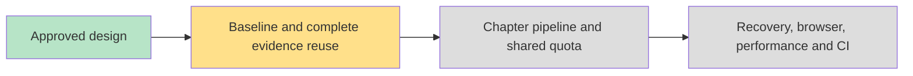

# Research Report Pipeline Implementation Plan

> **For agentic workers:** REQUIRED SUB-SKILL: Use superpowers:executing-plans (native recommended) or superpowers:subagent-driven-development to implement task-by-task. Steps use checkbox syntax.

**Goal:** Reduce first-prose latency and repeated evidence work without weakening report quality, provenance or recovery.

**Architecture:** Replace the all-chapter extraction barrier with first-chapter preparation and one shared tail scope feeding the existing ordered chapter commit lane. Use one shared model request limiter, durable extraction coverage and the existing revalidated evidence ledger. Preserve canonical source eligibility and all question-level and final semantic checks.

**Tech Stack:** TypeScript, existing runtime store, Vitest, Playwright, current model port.

**Spec:** Approved design below (human confirmed in chat 2026-10-20).

## Approved design and reference boundary

Google documents background execution, real progress/text events and reconnect by event identity: https://ai.google.dev/gemini-api/docs/deep-research#handling-long-running-tasks . LangChain implements bounded parallel researcher tasks, compressed findings and final synthesis: https://github.com/langchain-ai/open_deep_research/blob/main/src/open_deep_research/deep_researcher.py . Chapter pipelining is our adaptation, not a claim about Google internals or LangChain final report streaming.

Current barriers: source screening then document collection; all remaining questions across all eligible document chunks must finish extraction before any chapter writes. Existing limits: reads 3, extraction 4, chapter calculations 2. Existing ledger validates question/material identity but positive records alone do not prove complete extraction, especially negative/gap outcomes.

Proposed change: prepare each chapter against all canonical eligible materials, prioritized by existing task links; links determine order, never exclude other evidence. After that chapter's full extraction coverage settles, start writing and independent review while other chapter preparation continues. Keep confirmed outline order and current live foreground stream semantics. No early success from a source quota. Resume reuses complete matching coverage; explicit regeneration redoes prose while allowing matching evidence reuse. Persisted failures and previous formal report remain visible.

## Implementation refinement (2026-10-20)

Cold all-source extraction independently for every chapter multiplied source payloads and requests by chapter count. The implementation therefore prepares the first remaining chapter separately and shares one preparation result across all later chapters: at most two evidence scopes, regardless of chapter count. This preserves first-prose pipelining and full canonical source/question coverage while bounding cold overhead. Task associations only prioritize source ordering. Source reads retain existing global preparation and fetched-document eligibility semantics. Cache manifests preserve exact verified spans needed for repeated passages, with bounded manifest eviction rather than semantic weakening. Diagnostics distinguish provider prose from JSON envelopes; live prose reception can precede UI's existing <=250ms stream flush.

## Global Constraints

- Reuse this worktree; no coordinator impersonation or remote lease operations without authenticated identity.
- No new provider, dependency, production configuration or schema migration without demonstrated need.
- Reuse provenance ledger; add completion metadata only, never infer complete coverage from positive records.
- Exclusion, question, brief, source policy, material hash, validator and model configuration changes invalidate affected preparation.
- Model concurrency starts at 4 globally across extraction, prose and review; document concurrency remains 3. Neither is raised without measured evidence.
- Keep all source, citation, question-coverage, gap and final semantic quality gates.
- Serialize durable mutations; settle started work on failure; cancellation releases limiter permits and prevents late writes.
- Do not replace old formal report until new report successfully completes.
- Diagnostics contain stage timings/counts, never source bodies, tokens or private reasoning.

## Review Focus

1. Positive ledger facts without full coverage must not skip pending or negative extraction.
2. A later chapter failure must not erase committed prefix or permit late mutations after return.
3. Model quotas must include retries/reviews and release permits on cancellation and rejection.
4. Source exclusion/new material and duplicate question text must not reuse stale evidence.
5. Splitting per chapter can multiply extraction calls; measure tokens/calls and disclose regressions.

## Task 1: Establish timing and correctness baseline

**Files:** guided-runtime-service.ts, guided-report-chapters.ts and existing research diagnostics/tests under apps/api; evidence directory docs/evidence/research-report-pipeline/.

**Interfaces:** Existing RuntimePersistence observer and debug trace; add internal phase diagnostic with phase, durationMs, sectionId and counts. No public raw model trace.

- [ ] Add failing tests for reading/extraction/first delta/first approved chapter/synthesis/save diagnostic ordering, cancellation and sensitive-content absence.
- [ ] Run targeted research tests to observe failure.
- [ ] Implement phase measurements with monotonic elapsed time and existing diagnostics plumbing.
- [ ] Record old flow with fixed multi-chapter inputs, one delayed later material, identical model responses and call/token accounting; retain baseline source revision.
- [ ] Run tests green and commit baseline instrumentation.

## Task 2: Durable complete extraction reuse

**Files:** guided-report-evidence.ts, guided-evidence-ledger.ts, guided-evidence-ledger-record.ts, guided-runtime-private-ledger storage/contract files only if current private envelope requires it; corresponding ledger/evidence/recovery tests.

**Interfaces:** Chapter evidence preparation returns the existing extractReportEvidence result shape. Completion metadata binds exact canonical materials, question set, model configuration identity and validator version to validated outcomes, including valid negative outcomes. Public runtime remains free of private records.

- [ ] Add failing tests: matching completed coverage skips calls; positive-only ledger does not; interrupted extraction resumes missing batches; negative outcomes reuse only after complete validation; changed/excluded material, questions, provider or rule version misses cache.
- [ ] Run tests RED.
- [ ] Implement completion manifest with bounded private storage, stable question identity and deterministic record merging. Revalidate raw spans through existing ledger reader. Never reuse invalid/provider-rejected batches as successful outcomes.
- [ ] Run evidence, ledger, private transport and recovery tests GREEN; commit.

## Task 3: Chapter preparation pipeline and shared request limit

**Files:** guided-report-chapters.ts, guided-report-evidence.ts, guided-report-chapter-work.ts; new guided-report-work-queue.ts; tests/research/guided-report-pipeline.test.ts and existing chapter/evidence tests.

**Interfaces:** Internal request queue run<T>(work: () => Promise<T>, signal?: AbortSignal): Promise<T>, concurrency 4; all report model calls including extraction/retries/writing/review use this lane. Chapter prepare(sectionId) returns evidence result after all eligible materials for that chapter settle. No nested permit acquisition.

- [ ] RED: first chapter begins prose before delayed later chapter preparation; all eligible materials remain considered; global active calls <=4; completed later chapters commit in outline order; errors/cancellation drain work and release permits; no stale/late checkpoint writes.
- [ ] Implement first-chapter-prioritized preparation and existing two-chapter compute window, remove global extraction barrier, isolate chapter-local warnings/evidence and merge through serialized persistence. Keep complete coverage before each chapter writes; do not use task associations as filtering gates.
- [ ] Test deterministic ranking and no shared-ledger overwrite under reversed completion order. Preserve current foreground provider streaming (do not replay buffered content as provider tokens).
- [ ] Run full affected research unit suite, API typecheck and lint; commit.

## Task 4: Honest progress and end-to-end evidence

**Files:** existing guided report timeline/progress contracts and research report UI only where needed; existing research browser spec/CI lane. Update mod-user-research skill with verified lesson.

**Interfaces:** Existing progress transport carries actual completed/total counts and current chapter; add backward-compatible optional timing fields only if existing fields cannot express elapsed time. Snapshot remains authoritative; no guessed ETA.

- [ ] RED: simultaneous preparation/writing renders meaningful current work; refresh preserves provisional/approved content; old report survives failed regeneration; progress does not claim every source is read when some failed.
- [ ] Implement minimal status presentation preserving existing tokens/components and export isolation.
- [ ] Controlled API/controller and browser acceptance: slow source/model, failed batch, pause/resume, refreshed page, source exclusion and changed outline. Ensure newly added specs are included in an existing CI lane.
- [ ] Compare old/new using identical fixed inputs/responses: first prose, first approved chapter, formal save, model calls, retries and tokens. Then run real model on a representative multi-chapter input if legitimately configured; record absence as a gap, never claim controlled results as production improvement.
- [ ] Run init.sh, API typecheck/lint, research tests and affected browser/UI checks; independent whole-branch review; fix findings; create PR and own CI to green. No merge authority inferred.

## Acceptance

First-prose latency must be reduced in the delayed-later-chapter controlled case without losing any questions, eligible evidence or checks. Matching resumed extraction avoids redundant calls; cold execution call/token overhead is explicitly compared. Production speed claims require actual production timing, not screenshots or fake timers. Evidence report records revision, input basis, environment, timing, quality verdicts and limitations.

## Execution plan

